<!--
title: '👋 TANNER GOLDEN'
description: 'The GitHub profile of Tanner Golden: who I am, the case my work has earned, and where to find me, all drawn by GitHub Actions.'
tags: [github-profile, readme, automation, github-actions]
category: docs
-->

<!-- markdown:header:start -->
<!-- markdownlint-disable MD041 -->

<picture>
  <source media="(max-width: 585px) and (prefers-color-scheme: dark)" srcset="assets/banners/header-narrow-dark.svg">
  <source media="(max-width: 585px)" srcset="assets/banners/header-narrow-day.svg">
  <source media="(prefers-reduced-motion: reduce) and (prefers-color-scheme: dark)" srcset="assets/banners/header-still-dark.svg">
  <source media="(prefers-reduced-motion: reduce)" srcset="assets/banners/header-still-day.svg">
  <source media="(prefers-color-scheme: dark)" srcset="assets/banners/header-dark.svg">
  
</picture>

<!-- markdown:header:end -->

<!-- markdown:badges:start -->

<a href="https://github.com/tannergolden/standards/actions/workflows/self-checks.yml">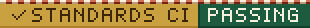</a>
<a href="https://github.com/tannergolden?tab=repositories">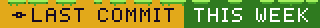</a>

<!-- markdown:badges:end -->

---

## 💡 About Me

I'm a software engineer building infrastructure for AI research. My focus is
the layer under the experiments: environments that rebuild the same way every
time, dependencies that are pinned and scanned, and CI that fails for the
right reasons, so a result can be trusted and repeated.

Most of my public work is one connected system.
[`standards`](https://github.com/tannergolden/standards) holds the engineering
rules and the reusable workflows that enforce them, called by link so a fix
lands once and reaches every repository.
[`path`](https://github.com/tannergolden/path) is the template new
repositories start from, and
[`markdown`](https://github.com/tannergolden/markdown) draws READMEs like this
one from data measured on a schedule.

- **Working on:** reproducible environments, supply-chain hygiene (pinned
  dependencies, secret scanning, CodeQL and SBOMs), and CI that fails for the
  right reasons.
- **Building with:** Python (standard library first), GitHub Actions, Bash and
  Make, plus dev containers and Codespaces so a Mac and a fresh container start
  from the same shell.
- **How I work:** standards a machine enforces, small reviewable changes,
  Conventional Commits, and signed commits on protected branches.
- **Ask me about:** reusable workflows, dependency pinning, release automation,
  and automating the chores nobody should do by hand.

---

## 🎲 Play Against Me

Four games, Chess, Checkers, Pentago and Tic-Tac, with me on one side and
everyone else on GitHub on the other. I always play White, and X in Tic-Tac.

1. **Pick a move** from the list under a board. Chess is always in view, and
   the other three open with a click.
2. **Submit the issue its link opens**, unchanged. The first move to reach the
   game is the one played.
3. **The Official Arbiter answers on your issue** and redraws the board within
   a few minutes.

Each side has a week to move, or the Arbiter moves for it at random. A win
counts for the player who makes the winning move, and the most wins top the
Hall of Fame below.

📖 The rules and everything else are in [Games](docs/README.md) and each game's
guide: [Chess](docs/Chess.md), [Checkers](docs/Checkers.md),
[Pentago](docs/Pentago.md) and [Tic-Tac](docs/Tic-Tac.md).

<!-- markdown:element:chess:start -->
<picture>
  <source media="(max-width: 585px) and (prefers-reduced-motion: reduce) and (prefers-color-scheme: dark)" srcset="assets/elements/chess-narrow-still-dark.svg">
  <source media="(max-width: 585px) and (prefers-reduced-motion: reduce)" srcset="assets/elements/chess-narrow-still-day.svg">
  <source media="(max-width: 585px) and (prefers-color-scheme: dark)" srcset="assets/elements/chess-narrow-dark.svg">
  <source media="(max-width: 585px)" srcset="assets/elements/chess-narrow-day.svg">
  <source media="(prefers-reduced-motion: reduce) and (prefers-color-scheme: dark)" srcset="assets/elements/chess-still-dark.svg">
  <source media="(prefers-reduced-motion: reduce)" srcset="assets/elements/chess-still-day.svg">
  <source media="(prefers-color-scheme: dark)" srcset="assets/elements/chess-dark.svg">
  
</picture>

♔ <b>@tannergolden's Turn</b> · 20 legal moves · only @tannergolden can play these

♘ Knights · 4 moves

|  | Move | In words | Play |
| :-: | :--- | :--- | :-: |
| 🐴 | **Knight Move** `Na3` | Knight from b1 to a3 | [Play ↗](https://github.com/tannergolden/play/issues/new?template=move.yml&title=chess%3A%20b1a3%20%C2%B7%20game%201%20%C2%B7%20move%201) |
| 🐴 | **Knight Move** `Nc3` | Knight from b1 to c3 | [Play ↗](https://github.com/tannergolden/play/issues/new?template=move.yml&title=chess%3A%20b1c3%20%C2%B7%20game%201%20%C2%B7%20move%201) |
| 🐴 | **Knight Move** `Nf3` | Knight from g1 to f3 | [Play ↗](https://github.com/tannergolden/play/issues/new?template=move.yml&title=chess%3A%20g1f3%20%C2%B7%20game%201%20%C2%B7%20move%201) |
| 🐴 | **Knight Move** `Nh3` | Knight from g1 to h3 | [Play ↗](https://github.com/tannergolden/play/issues/new?template=move.yml&title=chess%3A%20g1h3%20%C2%B7%20game%201%20%C2%B7%20move%201) |

♙ Pawns · 16 moves

|  | Move | In words | Play |
| :-: | :--- | :--- | :-: |
| ♟️ | **Double Pawn Push** `a4` | Pawn from a2 to a4, two squares | [Play ↗](https://github.com/tannergolden/play/issues/new?template=move.yml&title=chess%3A%20a2a4%20%C2%B7%20game%201%20%C2%B7%20move%201) |
| ♟️ | **Pawn Push** `a3` | Pawn from a2 to a3 | [Play ↗](https://github.com/tannergolden/play/issues/new?template=move.yml&title=chess%3A%20a2a3%20%C2%B7%20game%201%20%C2%B7%20move%201) |
| ♟️ | **Double Pawn Push** `b4` | Pawn from b2 to b4, two squares | [Play ↗](https://github.com/tannergolden/play/issues/new?template=move.yml&title=chess%3A%20b2b4%20%C2%B7%20game%201%20%C2%B7%20move%201) |
| ♟️ | **Pawn Push** `b3` | Pawn from b2 to b3 | [Play ↗](https://github.com/tannergolden/play/issues/new?template=move.yml&title=chess%3A%20b2b3%20%C2%B7%20game%201%20%C2%B7%20move%201) |
| ♟️ | **Double Pawn Push** `c4` | Pawn from c2 to c4, two squares | [Play ↗](https://github.com/tannergolden/play/issues/new?template=move.yml&title=chess%3A%20c2c4%20%C2%B7%20game%201%20%C2%B7%20move%201) |
| ♟️ | **Pawn Push** `c3` | Pawn from c2 to c3 | [Play ↗](https://github.com/tannergolden/play/issues/new?template=move.yml&title=chess%3A%20c2c3%20%C2%B7%20game%201%20%C2%B7%20move%201) |
| ♟️ | **Double Pawn Push** `d4` | Pawn from d2 to d4, two squares | [Play ↗](https://github.com/tannergolden/play/issues/new?template=move.yml&title=chess%3A%20d2d4%20%C2%B7%20game%201%20%C2%B7%20move%201) |
| ♟️ | **Pawn Push** `d3` | Pawn from d2 to d3 | [Play ↗](https://github.com/tannergolden/play/issues/new?template=move.yml&title=chess%3A%20d2d3%20%C2%B7%20game%201%20%C2%B7%20move%201) |
| ♟️ | **Double Pawn Push** `e4` | Pawn from e2 to e4, two squares | [Play ↗](https://github.com/tannergolden/play/issues/new?template=move.yml&title=chess%3A%20e2e4%20%C2%B7%20game%201%20%C2%B7%20move%201) |
| ♟️ | **Pawn Push** `e3` | Pawn from e2 to e3 | [Play ↗](https://github.com/tannergolden/play/issues/new?template=move.yml&title=chess%3A%20e2e3%20%C2%B7%20game%201%20%C2%B7%20move%201) |
| ♟️ | **Double Pawn Push** `f4` | Pawn from f2 to f4, two squares | [Play ↗](https://github.com/tannergolden/play/issues/new?template=move.yml&title=chess%3A%20f2f4%20%C2%B7%20game%201%20%C2%B7%20move%201) |
| ♟️ | **Pawn Push** `f3` | Pawn from f2 to f3 | [Play ↗](https://github.com/tannergolden/play/issues/new?template=move.yml&title=chess%3A%20f2f3%20%C2%B7%20game%201%20%C2%B7%20move%201) |
| ♟️ | **Double Pawn Push** `g4` | Pawn from g2 to g4, two squares | [Play ↗](https://github.com/tannergolden/play/issues/new?template=move.yml&title=chess%3A%20g2g4%20%C2%B7%20game%201%20%C2%B7%20move%201) |
| ♟️ | **Pawn Push** `g3` | Pawn from g2 to g3 | [Play ↗](https://github.com/tannergolden/play/issues/new?template=move.yml&title=chess%3A%20g2g3%20%C2%B7%20game%201%20%C2%B7%20move%201) |
| ♟️ | **Double Pawn Push** `h4` | Pawn from h2 to h4, two squares | [Play ↗](https://github.com/tannergolden/play/issues/new?template=move.yml&title=chess%3A%20h2h4%20%C2%B7%20game%201%20%C2%B7%20move%201) |
| ♟️ | **Pawn Push** `h3` | Pawn from h2 to h3 | [Play ↗](https://github.com/tannergolden/play/issues/new?template=move.yml&title=chess%3A%20h2h3%20%C2%B7%20game%201%20%C2%B7%20move%201) |

Only @tannergolden can play on this turn: a pick from anyone else is turned away with a comment on its issue. A side that goes a week without moving gets a random legal move from the Arbiter.
<!-- markdown:element:chess:end -->

<!-- markdown:element:checkers:start -->

<b>🏁 Checkers</b>

<picture>
  <source media="(max-width: 585px) and (prefers-reduced-motion: reduce) and (prefers-color-scheme: dark)" srcset="assets/elements/checkers-narrow-still-dark.svg">
  <source media="(max-width: 585px) and (prefers-reduced-motion: reduce)" srcset="assets/elements/checkers-narrow-still-day.svg">
  <source media="(max-width: 585px) and (prefers-color-scheme: dark)" srcset="assets/elements/checkers-narrow-dark.svg">
  <source media="(max-width: 585px)" srcset="assets/elements/checkers-narrow-day.svg">
  <source media="(prefers-reduced-motion: reduce) and (prefers-color-scheme: dark)" srcset="assets/elements/checkers-still-dark.svg">
  <source media="(prefers-reduced-motion: reduce)" srcset="assets/elements/checkers-still-day.svg">
  <source media="(prefers-color-scheme: dark)" srcset="assets/elements/checkers-dark.svg">
  
</picture>

⛂ <b>GitHub's Turn</b> · 7 legal moves · open to choose one

|  | Move | In words | Play |
| :-: | :--- | :--- | :-: |
| 👣 | **Man Move** `9-13` | Man from 9 to 13 | [Play ↗](https://github.com/tannergolden/play/issues/new?template=move.yml&title=checkers%3A%209-13%20%C2%B7%20game%201%20%C2%B7%20move%201) |
| 👣 | **Man Move** `9-14` | Man from 9 to 14 | [Play ↗](https://github.com/tannergolden/play/issues/new?template=move.yml&title=checkers%3A%209-14%20%C2%B7%20game%201%20%C2%B7%20move%201) |
| 👣 | **Man Move** `10-14` | Man from 10 to 14 | [Play ↗](https://github.com/tannergolden/play/issues/new?template=move.yml&title=checkers%3A%2010-14%20%C2%B7%20game%201%20%C2%B7%20move%201) |
| 👣 | **Man Move** `10-15` | Man from 10 to 15 | [Play ↗](https://github.com/tannergolden/play/issues/new?template=move.yml&title=checkers%3A%2010-15%20%C2%B7%20game%201%20%C2%B7%20move%201) |
| 👣 | **Man Move** `11-15` | Man from 11 to 15 | [Play ↗](https://github.com/tannergolden/play/issues/new?template=move.yml&title=checkers%3A%2011-15%20%C2%B7%20game%201%20%C2%B7%20move%201) |
| 👣 | **Man Move** `11-16` | Man from 11 to 16 | [Play ↗](https://github.com/tannergolden/play/issues/new?template=move.yml&title=checkers%3A%2011-16%20%C2%B7%20game%201%20%C2%B7%20move%201) |
| 👣 | **Man Move** `12-16` | Man from 12 to 16 | [Play ↗](https://github.com/tannergolden/play/issues/new?template=move.yml&title=checkers%3A%2012-16%20%C2%B7%20game%201%20%C2%B7%20move%201) |

GitHub plays Black, which moves first in American checkers, so GitHub opens every game, and @tannergolden plays White. Anyone but @tannergolden can play on this turn, and the first pick in is played. The move is due by 19 Oct, 06:10 EST, or the Arbiter plays a random legal move. A jump must be taken whenever there is one, and a man that reaches the far row is crowned.

<!-- markdown:element:checkers:end -->

<!-- markdown:element:pentago:start -->

<b>🌀 Pentago</b>

<picture>
  <source media="(max-width: 585px) and (prefers-reduced-motion: reduce) and (prefers-color-scheme: dark)" srcset="assets/elements/pentago-narrow-still-dark.svg">
  <source media="(max-width: 585px) and (prefers-reduced-motion: reduce)" srcset="assets/elements/pentago-narrow-still-day.svg">
  <source media="(max-width: 585px) and (prefers-color-scheme: dark)" srcset="assets/elements/pentago-narrow-dark.svg">
  <source media="(max-width: 585px)" srcset="assets/elements/pentago-narrow-day.svg">
  <source media="(prefers-reduced-motion: reduce) and (prefers-color-scheme: dark)" srcset="assets/elements/pentago-still-dark.svg">
  <source media="(prefers-reduced-motion: reduce)" srcset="assets/elements/pentago-still-day.svg">
  <source media="(prefers-color-scheme: dark)" srcset="assets/elements/pentago-dark.svg">
  
</picture>

⚫ <b>GitHub's Turn</b> · 36 holes for a ghost · open to choose one

⚫ Upper Left Quarter · 9 moves

|  | Hole | In words | Then turn |
| :-: | :--- | :--- | :--- |
| 👻 | **Corner Ghost** `a6` | A ghost on a6, the upper left corner of the upper left quarter | [Play ↗](https://github.com/tannergolden/play/issues/new?template=move.yml&title=pentago%3A%20a6%20%C2%B7%20game%201%20%C2%B7%20move%201) |
| 👻 | **Edge Ghost** `b6` | A ghost on b6, the top edge of the upper left quarter | [Play ↗](https://github.com/tannergolden/play/issues/new?template=move.yml&title=pentago%3A%20b6%20%C2%B7%20game%201%20%C2%B7%20move%201) |
| 👻 | **Corner Ghost** `c6` | A ghost on c6, the upper right corner of the upper left quarter | [Play ↗](https://github.com/tannergolden/play/issues/new?template=move.yml&title=pentago%3A%20c6%20%C2%B7%20game%201%20%C2%B7%20move%201) |
| 👻 | **Edge Ghost** `a5` | A ghost on a5, the left edge of the upper left quarter | [Play ↗](https://github.com/tannergolden/play/issues/new?template=move.yml&title=pentago%3A%20a5%20%C2%B7%20game%201%20%C2%B7%20move%201) |
| 👻 | **Centre Ghost** `b5` | A ghost on b5, the centre of the upper left quarter | [Play ↗](https://github.com/tannergolden/play/issues/new?template=move.yml&title=pentago%3A%20b5%20%C2%B7%20game%201%20%C2%B7%20move%201) |
| 👻 | **Edge Ghost** `c5` | A ghost on c5, the right edge of the upper left quarter | [Play ↗](https://github.com/tannergolden/play/issues/new?template=move.yml&title=pentago%3A%20c5%20%C2%B7%20game%201%20%C2%B7%20move%201) |
| 👻 | **Corner Ghost** `a4` | A ghost on a4, the lower left corner of the upper left quarter | [Play ↗](https://github.com/tannergolden/play/issues/new?template=move.yml&title=pentago%3A%20a4%20%C2%B7%20game%201%20%C2%B7%20move%201) |
| 👻 | **Edge Ghost** `b4` | A ghost on b4, the bottom edge of the upper left quarter | [Play ↗](https://github.com/tannergolden/play/issues/new?template=move.yml&title=pentago%3A%20b4%20%C2%B7%20game%201%20%C2%B7%20move%201) |
| 👻 | **Corner Ghost** `c4` | A ghost on c4, the lower right corner of the upper left quarter | [Play ↗](https://github.com/tannergolden/play/issues/new?template=move.yml&title=pentago%3A%20c4%20%C2%B7%20game%201%20%C2%B7%20move%201) |

⚫ Upper Right Quarter · 9 moves

|  | Hole | In words | Then turn |
| :-: | :--- | :--- | :--- |
| 👻 | **Corner Ghost** `d6` | A ghost on d6, the upper left corner of the upper right quarter | [Play ↗](https://github.com/tannergolden/play/issues/new?template=move.yml&title=pentago%3A%20d6%20%C2%B7%20game%201%20%C2%B7%20move%201) |
| 👻 | **Edge Ghost** `e6` | A ghost on e6, the top edge of the upper right quarter | [Play ↗](https://github.com/tannergolden/play/issues/new?template=move.yml&title=pentago%3A%20e6%20%C2%B7%20game%201%20%C2%B7%20move%201) |
| 👻 | **Corner Ghost** `f6` | A ghost on f6, the upper right corner of the upper right quarter | [Play ↗](https://github.com/tannergolden/play/issues/new?template=move.yml&title=pentago%3A%20f6%20%C2%B7%20game%201%20%C2%B7%20move%201) |
| 👻 | **Edge Ghost** `d5` | A ghost on d5, the left edge of the upper right quarter | [Play ↗](https://github.com/tannergolden/play/issues/new?template=move.yml&title=pentago%3A%20d5%20%C2%B7%20game%201%20%C2%B7%20move%201) |
| 👻 | **Centre Ghost** `e5` | A ghost on e5, the centre of the upper right quarter | [Play ↗](https://github.com/tannergolden/play/issues/new?template=move.yml&title=pentago%3A%20e5%20%C2%B7%20game%201%20%C2%B7%20move%201) |
| 👻 | **Edge Ghost** `f5` | A ghost on f5, the right edge of the upper right quarter | [Play ↗](https://github.com/tannergolden/play/issues/new?template=move.yml&title=pentago%3A%20f5%20%C2%B7%20game%201%20%C2%B7%20move%201) |
| 👻 | **Corner Ghost** `d4` | A ghost on d4, the lower left corner of the upper right quarter | [Play ↗](https://github.com/tannergolden/play/issues/new?template=move.yml&title=pentago%3A%20d4%20%C2%B7%20game%201%20%C2%B7%20move%201) |
| 👻 | **Edge Ghost** `e4` | A ghost on e4, the bottom edge of the upper right quarter | [Play ↗](https://github.com/tannergolden/play/issues/new?template=move.yml&title=pentago%3A%20e4%20%C2%B7%20game%201%20%C2%B7%20move%201) |
| 👻 | **Corner Ghost** `f4` | A ghost on f4, the lower right corner of the upper right quarter | [Play ↗](https://github.com/tannergolden/play/issues/new?template=move.yml&title=pentago%3A%20f4%20%C2%B7%20game%201%20%C2%B7%20move%201) |

⚫ Lower Left Quarter · 9 moves

|  | Hole | In words | Then turn |
| :-: | :--- | :--- | :--- |
| 👻 | **Corner Ghost** `a3` | A ghost on a3, the upper left corner of the lower left quarter | [Play ↗](https://github.com/tannergolden/play/issues/new?template=move.yml&title=pentago%3A%20a3%20%C2%B7%20game%201%20%C2%B7%20move%201) |
| 👻 | **Edge Ghost** `b3` | A ghost on b3, the top edge of the lower left quarter | [Play ↗](https://github.com/tannergolden/play/issues/new?template=move.yml&title=pentago%3A%20b3%20%C2%B7%20game%201%20%C2%B7%20move%201) |
| 👻 | **Corner Ghost** `c3` | A ghost on c3, the upper right corner of the lower left quarter | [Play ↗](https://github.com/tannergolden/play/issues/new?template=move.yml&title=pentago%3A%20c3%20%C2%B7%20game%201%20%C2%B7%20move%201) |
| 👻 | **Edge Ghost** `a2` | A ghost on a2, the left edge of the lower left quarter | [Play ↗](https://github.com/tannergolden/play/issues/new?template=move.yml&title=pentago%3A%20a2%20%C2%B7%20game%201%20%C2%B7%20move%201) |
| 👻 | **Centre Ghost** `b2` | A ghost on b2, the centre of the lower left quarter | [Play ↗](https://github.com/tannergolden/play/issues/new?template=move.yml&title=pentago%3A%20b2%20%C2%B7%20game%201%20%C2%B7%20move%201) |
| 👻 | **Edge Ghost** `c2` | A ghost on c2, the right edge of the lower left quarter | [Play ↗](https://github.com/tannergolden/play/issues/new?template=move.yml&title=pentago%3A%20c2%20%C2%B7%20game%201%20%C2%B7%20move%201) |
| 👻 | **Corner Ghost** `a1` | A ghost on a1, the lower left corner of the lower left quarter | [Play ↗](https://github.com/tannergolden/play/issues/new?template=move.yml&title=pentago%3A%20a1%20%C2%B7%20game%201%20%C2%B7%20move%201) |
| 👻 | **Edge Ghost** `b1` | A ghost on b1, the bottom edge of the lower left quarter | [Play ↗](https://github.com/tannergolden/play/issues/new?template=move.yml&title=pentago%3A%20b1%20%C2%B7%20game%201%20%C2%B7%20move%201) |
| 👻 | **Corner Ghost** `c1` | A ghost on c1, the lower right corner of the lower left quarter | [Play ↗](https://github.com/tannergolden/play/issues/new?template=move.yml&title=pentago%3A%20c1%20%C2%B7%20game%201%20%C2%B7%20move%201) |

⚫ Lower Right Quarter · 9 moves

|  | Hole | In words | Then turn |
| :-: | :--- | :--- | :--- |
| 👻 | **Corner Ghost** `d3` | A ghost on d3, the upper left corner of the lower right quarter | [Play ↗](https://github.com/tannergolden/play/issues/new?template=move.yml&title=pentago%3A%20d3%20%C2%B7%20game%201%20%C2%B7%20move%201) |
| 👻 | **Edge Ghost** `e3` | A ghost on e3, the top edge of the lower right quarter | [Play ↗](https://github.com/tannergolden/play/issues/new?template=move.yml&title=pentago%3A%20e3%20%C2%B7%20game%201%20%C2%B7%20move%201) |
| 👻 | **Corner Ghost** `f3` | A ghost on f3, the upper right corner of the lower right quarter | [Play ↗](https://github.com/tannergolden/play/issues/new?template=move.yml&title=pentago%3A%20f3%20%C2%B7%20game%201%20%C2%B7%20move%201) |
| 👻 | **Edge Ghost** `d2` | A ghost on d2, the left edge of the lower right quarter | [Play ↗](https://github.com/tannergolden/play/issues/new?template=move.yml&title=pentago%3A%20d2%20%C2%B7%20game%201%20%C2%B7%20move%201) |
| 👻 | **Centre Ghost** `e2` | A ghost on e2, the centre of the lower right quarter | [Play ↗](https://github.com/tannergolden/play/issues/new?template=move.yml&title=pentago%3A%20e2%20%C2%B7%20game%201%20%C2%B7%20move%201) |
| 👻 | **Edge Ghost** `f2` | A ghost on f2, the right edge of the lower right quarter | [Play ↗](https://github.com/tannergolden/play/issues/new?template=move.yml&title=pentago%3A%20f2%20%C2%B7%20game%201%20%C2%B7%20move%201) |
| 👻 | **Corner Ghost** `d1` | A ghost on d1, the lower left corner of the lower right quarter | [Play ↗](https://github.com/tannergolden/play/issues/new?template=move.yml&title=pentago%3A%20d1%20%C2%B7%20game%201%20%C2%B7%20move%201) |
| 👻 | **Edge Ghost** `e1` | A ghost on e1, the bottom edge of the lower right quarter | [Play ↗](https://github.com/tannergolden/play/issues/new?template=move.yml&title=pentago%3A%20e1%20%C2%B7%20game%201%20%C2%B7%20move%201) |
| 👻 | **Corner Ghost** `f1` | A ghost on f1, the lower right corner of the lower right quarter | [Play ↗](https://github.com/tannergolden/play/issues/new?template=move.yml&title=pentago%3A%20f1%20%C2%B7%20game%201%20%C2%B7%20move%201) |

@tannergolden always plays White and GitHub Black. Under the Ghost Rule each side first sets a ghost, a marble that is nobody's, and then the Arbiter draws who sets the first marble. Anyone but @tannergolden can play on this turn, and the first pick in is played. The ghost is due by 20 Oct, 04:25 EST, or the Arbiter sets one at random.

<!-- markdown:element:pentago:end -->

<!-- markdown:element:tictac:start -->

<b>❌ Tic-Tac</b>

<picture>
  <source media="(max-width: 585px) and (prefers-reduced-motion: reduce) and (prefers-color-scheme: dark)" srcset="assets/elements/tictac-narrow-still-dark.svg">
  <source media="(max-width: 585px) and (prefers-reduced-motion: reduce)" srcset="assets/elements/tictac-narrow-still-day.svg">
  <source media="(max-width: 585px) and (prefers-color-scheme: dark)" srcset="assets/elements/tictac-narrow-dark.svg">
  <source media="(max-width: 585px)" srcset="assets/elements/tictac-narrow-day.svg">
  <source media="(prefers-reduced-motion: reduce) and (prefers-color-scheme: dark)" srcset="assets/elements/tictac-still-dark.svg">
  <source media="(prefers-reduced-motion: reduce)" srcset="assets/elements/tictac-still-day.svg">
  <source media="(prefers-color-scheme: dark)" srcset="assets/elements/tictac-dark.svg">
  
</picture>

❌ <b>@tannergolden's Turn</b> · 81 squares to lock · only @tannergolden can play these

❌ Upper Left Board · 9 moves

|  | Move | In words | Play |
| :-: | :--- | :--- | :-: |
| 👻 | **Corner Ghost** `a9` | A ghost locks the upper left corner of the upper left board | [Play ↗](https://github.com/tannergolden/play/issues/new?template=move.yml&title=tictac%3A%20a9%20%C2%B7%20game%201%20%C2%B7%20move%201) |
| 👻 | **Edge Ghost** `b9` | A ghost locks the top edge of the upper left board | [Play ↗](https://github.com/tannergolden/play/issues/new?template=move.yml&title=tictac%3A%20b9%20%C2%B7%20game%201%20%C2%B7%20move%201) |
| 👻 | **Corner Ghost** `c9` | A ghost locks the upper right corner of the upper left board | [Play ↗](https://github.com/tannergolden/play/issues/new?template=move.yml&title=tictac%3A%20c9%20%C2%B7%20game%201%20%C2%B7%20move%201) |
| 👻 | **Edge Ghost** `a8` | A ghost locks the left edge of the upper left board | [Play ↗](https://github.com/tannergolden/play/issues/new?template=move.yml&title=tictac%3A%20a8%20%C2%B7%20game%201%20%C2%B7%20move%201) |
| 👻 | **Centre Ghost** `b8` | A ghost locks the centre of the upper left board | [Play ↗](https://github.com/tannergolden/play/issues/new?template=move.yml&title=tictac%3A%20b8%20%C2%B7%20game%201%20%C2%B7%20move%201) |
| 👻 | **Edge Ghost** `c8` | A ghost locks the right edge of the upper left board | [Play ↗](https://github.com/tannergolden/play/issues/new?template=move.yml&title=tictac%3A%20c8%20%C2%B7%20game%201%20%C2%B7%20move%201) |
| 👻 | **Corner Ghost** `a7` | A ghost locks the lower left corner of the upper left board | [Play ↗](https://github.com/tannergolden/play/issues/new?template=move.yml&title=tictac%3A%20a7%20%C2%B7%20game%201%20%C2%B7%20move%201) |
| 👻 | **Edge Ghost** `b7` | A ghost locks the bottom edge of the upper left board | [Play ↗](https://github.com/tannergolden/play/issues/new?template=move.yml&title=tictac%3A%20b7%20%C2%B7%20game%201%20%C2%B7%20move%201) |
| 👻 | **Corner Ghost** `c7` | A ghost locks the lower right corner of the upper left board | [Play ↗](https://github.com/tannergolden/play/issues/new?template=move.yml&title=tictac%3A%20c7%20%C2%B7%20game%201%20%C2%B7%20move%201) |

❌ Top Board · 9 moves

|  | Move | In words | Play |
| :-: | :--- | :--- | :-: |
| 👻 | **Corner Ghost** `d9` | A ghost locks the upper left corner of the top board | [Play ↗](https://github.com/tannergolden/play/issues/new?template=move.yml&title=tictac%3A%20d9%20%C2%B7%20game%201%20%C2%B7%20move%201) |
| 👻 | **Edge Ghost** `e9` | A ghost locks the top edge of the top board | [Play ↗](https://github.com/tannergolden/play/issues/new?template=move.yml&title=tictac%3A%20e9%20%C2%B7%20game%201%20%C2%B7%20move%201) |
| 👻 | **Corner Ghost** `f9` | A ghost locks the upper right corner of the top board | [Play ↗](https://github.com/tannergolden/play/issues/new?template=move.yml&title=tictac%3A%20f9%20%C2%B7%20game%201%20%C2%B7%20move%201) |
| 👻 | **Edge Ghost** `d8` | A ghost locks the left edge of the top board | [Play ↗](https://github.com/tannergolden/play/issues/new?template=move.yml&title=tictac%3A%20d8%20%C2%B7%20game%201%20%C2%B7%20move%201) |
| 👻 | **Centre Ghost** `e8` | A ghost locks the centre of the top board | [Play ↗](https://github.com/tannergolden/play/issues/new?template=move.yml&title=tictac%3A%20e8%20%C2%B7%20game%201%20%C2%B7%20move%201) |
| 👻 | **Edge Ghost** `f8` | A ghost locks the right edge of the top board | [Play ↗](https://github.com/tannergolden/play/issues/new?template=move.yml&title=tictac%3A%20f8%20%C2%B7%20game%201%20%C2%B7%20move%201) |
| 👻 | **Corner Ghost** `d7` | A ghost locks the lower left corner of the top board | [Play ↗](https://github.com/tannergolden/play/issues/new?template=move.yml&title=tictac%3A%20d7%20%C2%B7%20game%201%20%C2%B7%20move%201) |
| 👻 | **Edge Ghost** `e7` | A ghost locks the bottom edge of the top board | [Play ↗](https://github.com/tannergolden/play/issues/new?template=move.yml&title=tictac%3A%20e7%20%C2%B7%20game%201%20%C2%B7%20move%201) |
| 👻 | **Corner Ghost** `f7` | A ghost locks the lower right corner of the top board | [Play ↗](https://github.com/tannergolden/play/issues/new?template=move.yml&title=tictac%3A%20f7%20%C2%B7%20game%201%20%C2%B7%20move%201) |

❌ Upper Right Board · 9 moves

|  | Move | In words | Play |
| :-: | :--- | :--- | :-: |
| 👻 | **Corner Ghost** `g9` | A ghost locks the upper left corner of the upper right board | [Play ↗](https://github.com/tannergolden/play/issues/new?template=move.yml&title=tictac%3A%20g9%20%C2%B7%20game%201%20%C2%B7%20move%201) |
| 👻 | **Edge Ghost** `h9` | A ghost locks the top edge of the upper right board | [Play ↗](https://github.com/tannergolden/play/issues/new?template=move.yml&title=tictac%3A%20h9%20%C2%B7%20game%201%20%C2%B7%20move%201) |
| 👻 | **Corner Ghost** `i9` | A ghost locks the upper right corner of the upper right board | [Play ↗](https://github.com/tannergolden/play/issues/new?template=move.yml&title=tictac%3A%20i9%20%C2%B7%20game%201%20%C2%B7%20move%201) |
| 👻 | **Edge Ghost** `g8` | A ghost locks the left edge of the upper right board | [Play ↗](https://github.com/tannergolden/play/issues/new?template=move.yml&title=tictac%3A%20g8%20%C2%B7%20game%201%20%C2%B7%20move%201) |
| 👻 | **Centre Ghost** `h8` | A ghost locks the centre of the upper right board | [Play ↗](https://github.com/tannergolden/play/issues/new?template=move.yml&title=tictac%3A%20h8%20%C2%B7%20game%201%20%C2%B7%20move%201) |
| 👻 | **Edge Ghost** `i8` | A ghost locks the right edge of the upper right board | [Play ↗](https://github.com/tannergolden/play/issues/new?template=move.yml&title=tictac%3A%20i8%20%C2%B7%20game%201%20%C2%B7%20move%201) |
| 👻 | **Corner Ghost** `g7` | A ghost locks the lower left corner of the upper right board | [Play ↗](https://github.com/tannergolden/play/issues/new?template=move.yml&title=tictac%3A%20g7%20%C2%B7%20game%201%20%C2%B7%20move%201) |
| 👻 | **Edge Ghost** `h7` | A ghost locks the bottom edge of the upper right board | [Play ↗](https://github.com/tannergolden/play/issues/new?template=move.yml&title=tictac%3A%20h7%20%C2%B7%20game%201%20%C2%B7%20move%201) |
| 👻 | **Corner Ghost** `i7` | A ghost locks the lower right corner of the upper right board | [Play ↗](https://github.com/tannergolden/play/issues/new?template=move.yml&title=tictac%3A%20i7%20%C2%B7%20game%201%20%C2%B7%20move%201) |

❌ Left Board · 9 moves

|  | Move | In words | Play |
| :-: | :--- | :--- | :-: |
| 👻 | **Corner Ghost** `a6` | A ghost locks the upper left corner of the left board | [Play ↗](https://github.com/tannergolden/play/issues/new?template=move.yml&title=tictac%3A%20a6%20%C2%B7%20game%201%20%C2%B7%20move%201) |
| 👻 | **Edge Ghost** `b6` | A ghost locks the top edge of the left board | [Play ↗](https://github.com/tannergolden/play/issues/new?template=move.yml&title=tictac%3A%20b6%20%C2%B7%20game%201%20%C2%B7%20move%201) |
| 👻 | **Corner Ghost** `c6` | A ghost locks the upper right corner of the left board | [Play ↗](https://github.com/tannergolden/play/issues/new?template=move.yml&title=tictac%3A%20c6%20%C2%B7%20game%201%20%C2%B7%20move%201) |
| 👻 | **Edge Ghost** `a5` | A ghost locks the left edge of the left board | [Play ↗](https://github.com/tannergolden/play/issues/new?template=move.yml&title=tictac%3A%20a5%20%C2%B7%20game%201%20%C2%B7%20move%201) |
| 👻 | **Centre Ghost** `b5` | A ghost locks the centre of the left board | [Play ↗](https://github.com/tannergolden/play/issues/new?template=move.yml&title=tictac%3A%20b5%20%C2%B7%20game%201%20%C2%B7%20move%201) |
| 👻 | **Edge Ghost** `c5` | A ghost locks the right edge of the left board | [Play ↗](https://github.com/tannergolden/play/issues/new?template=move.yml&title=tictac%3A%20c5%20%C2%B7%20game%201%20%C2%B7%20move%201) |
| 👻 | **Corner Ghost** `a4` | A ghost locks the lower left corner of the left board | [Play ↗](https://github.com/tannergolden/play/issues/new?template=move.yml&title=tictac%3A%20a4%20%C2%B7%20game%201%20%C2%B7%20move%201) |
| 👻 | **Edge Ghost** `b4` | A ghost locks the bottom edge of the left board | [Play ↗](https://github.com/tannergolden/play/issues/new?template=move.yml&title=tictac%3A%20b4%20%C2%B7%20game%201%20%C2%B7%20move%201) |
| 👻 | **Corner Ghost** `c4` | A ghost locks the lower right corner of the left board | [Play ↗](https://github.com/tannergolden/play/issues/new?template=move.yml&title=tictac%3A%20c4%20%C2%B7%20game%201%20%C2%B7%20move%201) |

❌ Centre Board · 9 moves

|  | Move | In words | Play |
| :-: | :--- | :--- | :-: |
| 👻 | **Corner Ghost** `d6` | A ghost locks the upper left corner of the centre board | [Play ↗](https://github.com/tannergolden/play/issues/new?template=move.yml&title=tictac%3A%20d6%20%C2%B7%20game%201%20%C2%B7%20move%201) |
| 👻 | **Edge Ghost** `e6` | A ghost locks the top edge of the centre board | [Play ↗](https://github.com/tannergolden/play/issues/new?template=move.yml&title=tictac%3A%20e6%20%C2%B7%20game%201%20%C2%B7%20move%201) |
| 👻 | **Corner Ghost** `f6` | A ghost locks the upper right corner of the centre board | [Play ↗](https://github.com/tannergolden/play/issues/new?template=move.yml&title=tictac%3A%20f6%20%C2%B7%20game%201%20%C2%B7%20move%201) |
| 👻 | **Edge Ghost** `d5` | A ghost locks the left edge of the centre board | [Play ↗](https://github.com/tannergolden/play/issues/new?template=move.yml&title=tictac%3A%20d5%20%C2%B7%20game%201%20%C2%B7%20move%201) |
| 👻 | **Centre Ghost** `e5` | A ghost locks the centre of the centre board | [Play ↗](https://github.com/tannergolden/play/issues/new?template=move.yml&title=tictac%3A%20e5%20%C2%B7%20game%201%20%C2%B7%20move%201) |
| 👻 | **Edge Ghost** `f5` | A ghost locks the right edge of the centre board | [Play ↗](https://github.com/tannergolden/play/issues/new?template=move.yml&title=tictac%3A%20f5%20%C2%B7%20game%201%20%C2%B7%20move%201) |
| 👻 | **Corner Ghost** `d4` | A ghost locks the lower left corner of the centre board | [Play ↗](https://github.com/tannergolden/play/issues/new?template=move.yml&title=tictac%3A%20d4%20%C2%B7%20game%201%20%C2%B7%20move%201) |
| 👻 | **Edge Ghost** `e4` | A ghost locks the bottom edge of the centre board | [Play ↗](https://github.com/tannergolden/play/issues/new?template=move.yml&title=tictac%3A%20e4%20%C2%B7%20game%201%20%C2%B7%20move%201) |
| 👻 | **Corner Ghost** `f4` | A ghost locks the lower right corner of the centre board | [Play ↗](https://github.com/tannergolden/play/issues/new?template=move.yml&title=tictac%3A%20f4%20%C2%B7%20game%201%20%C2%B7%20move%201) |

❌ Right Board · 9 moves

|  | Move | In words | Play |
| :-: | :--- | :--- | :-: |
| 👻 | **Corner Ghost** `g6` | A ghost locks the upper left corner of the right board | [Play ↗](https://github.com/tannergolden/play/issues/new?template=move.yml&title=tictac%3A%20g6%20%C2%B7%20game%201%20%C2%B7%20move%201) |
| 👻 | **Edge Ghost** `h6` | A ghost locks the top edge of the right board | [Play ↗](https://github.com/tannergolden/play/issues/new?template=move.yml&title=tictac%3A%20h6%20%C2%B7%20game%201%20%C2%B7%20move%201) |
| 👻 | **Corner Ghost** `i6` | A ghost locks the upper right corner of the right board | [Play ↗](https://github.com/tannergolden/play/issues/new?template=move.yml&title=tictac%3A%20i6%20%C2%B7%20game%201%20%C2%B7%20move%201) |
| 👻 | **Edge Ghost** `g5` | A ghost locks the left edge of the right board | [Play ↗](https://github.com/tannergolden/play/issues/new?template=move.yml&title=tictac%3A%20g5%20%C2%B7%20game%201%20%C2%B7%20move%201) |
| 👻 | **Centre Ghost** `h5` | A ghost locks the centre of the right board | [Play ↗](https://github.com/tannergolden/play/issues/new?template=move.yml&title=tictac%3A%20h5%20%C2%B7%20game%201%20%C2%B7%20move%201) |
| 👻 | **Edge Ghost** `i5` | A ghost locks the right edge of the right board | [Play ↗](https://github.com/tannergolden/play/issues/new?template=move.yml&title=tictac%3A%20i5%20%C2%B7%20game%201%20%C2%B7%20move%201) |
| 👻 | **Corner Ghost** `g4` | A ghost locks the lower left corner of the right board | [Play ↗](https://github.com/tannergolden/play/issues/new?template=move.yml&title=tictac%3A%20g4%20%C2%B7%20game%201%20%C2%B7%20move%201) |
| 👻 | **Edge Ghost** `h4` | A ghost locks the bottom edge of the right board | [Play ↗](https://github.com/tannergolden/play/issues/new?template=move.yml&title=tictac%3A%20h4%20%C2%B7%20game%201%20%C2%B7%20move%201) |
| 👻 | **Corner Ghost** `i4` | A ghost locks the lower right corner of the right board | [Play ↗](https://github.com/tannergolden/play/issues/new?template=move.yml&title=tictac%3A%20i4%20%C2%B7%20game%201%20%C2%B7%20move%201) |

❌ Lower Left Board · 9 moves

|  | Move | In words | Play |
| :-: | :--- | :--- | :-: |
| 👻 | **Corner Ghost** `a3` | A ghost locks the upper left corner of the lower left board | [Play ↗](https://github.com/tannergolden/play/issues/new?template=move.yml&title=tictac%3A%20a3%20%C2%B7%20game%201%20%C2%B7%20move%201) |
| 👻 | **Edge Ghost** `b3` | A ghost locks the top edge of the lower left board | [Play ↗](https://github.com/tannergolden/play/issues/new?template=move.yml&title=tictac%3A%20b3%20%C2%B7%20game%201%20%C2%B7%20move%201) |
| 👻 | **Corner Ghost** `c3` | A ghost locks the upper right corner of the lower left board | [Play ↗](https://github.com/tannergolden/play/issues/new?template=move.yml&title=tictac%3A%20c3%20%C2%B7%20game%201%20%C2%B7%20move%201) |
| 👻 | **Edge Ghost** `a2` | A ghost locks the left edge of the lower left board | [Play ↗](https://github.com/tannergolden/play/issues/new?template=move.yml&title=tictac%3A%20a2%20%C2%B7%20game%201%20%C2%B7%20move%201) |
| 👻 | **Centre Ghost** `b2` | A ghost locks the centre of the lower left board | [Play ↗](https://github.com/tannergolden/play/issues/new?template=move.yml&title=tictac%3A%20b2%20%C2%B7%20game%201%20%C2%B7%20move%201) |
| 👻 | **Edge Ghost** `c2` | A ghost locks the right edge of the lower left board | [Play ↗](https://github.com/tannergolden/play/issues/new?template=move.yml&title=tictac%3A%20c2%20%C2%B7%20game%201%20%C2%B7%20move%201) |
| 👻 | **Corner Ghost** `a1` | A ghost locks the lower left corner of the lower left board | [Play ↗](https://github.com/tannergolden/play/issues/new?template=move.yml&title=tictac%3A%20a1%20%C2%B7%20game%201%20%C2%B7%20move%201) |
| 👻 | **Edge Ghost** `b1` | A ghost locks the bottom edge of the lower left board | [Play ↗](https://github.com/tannergolden/play/issues/new?template=move.yml&title=tictac%3A%20b1%20%C2%B7%20game%201%20%C2%B7%20move%201) |
| 👻 | **Corner Ghost** `c1` | A ghost locks the lower right corner of the lower left board | [Play ↗](https://github.com/tannergolden/play/issues/new?template=move.yml&title=tictac%3A%20c1%20%C2%B7%20game%201%20%C2%B7%20move%201) |

❌ Bottom Board · 9 moves

|  | Move | In words | Play |
| :-: | :--- | :--- | :-: |
| 👻 | **Corner Ghost** `d3` | A ghost locks the upper left corner of the bottom board | [Play ↗](https://github.com/tannergolden/play/issues/new?template=move.yml&title=tictac%3A%20d3%20%C2%B7%20game%201%20%C2%B7%20move%201) |
| 👻 | **Edge Ghost** `e3` | A ghost locks the top edge of the bottom board | [Play ↗](https://github.com/tannergolden/play/issues/new?template=move.yml&title=tictac%3A%20e3%20%C2%B7%20game%201%20%C2%B7%20move%201) |
| 👻 | **Corner Ghost** `f3` | A ghost locks the upper right corner of the bottom board | [Play ↗](https://github.com/tannergolden/play/issues/new?template=move.yml&title=tictac%3A%20f3%20%C2%B7%20game%201%20%C2%B7%20move%201) |
| 👻 | **Edge Ghost** `d2` | A ghost locks the left edge of the bottom board | [Play ↗](https://github.com/tannergolden/play/issues/new?template=move.yml&title=tictac%3A%20d2%20%C2%B7%20game%201%20%C2%B7%20move%201) |
| 👻 | **Centre Ghost** `e2` | A ghost locks the centre of the bottom board | [Play ↗](https://github.com/tannergolden/play/issues/new?template=move.yml&title=tictac%3A%20e2%20%C2%B7%20game%201%20%C2%B7%20move%201) |
| 👻 | **Edge Ghost** `f2` | A ghost locks the right edge of the bottom board | [Play ↗](https://github.com/tannergolden/play/issues/new?template=move.yml&title=tictac%3A%20f2%20%C2%B7%20game%201%20%C2%B7%20move%201) |
| 👻 | **Corner Ghost** `d1` | A ghost locks the lower left corner of the bottom board | [Play ↗](https://github.com/tannergolden/play/issues/new?template=move.yml&title=tictac%3A%20d1%20%C2%B7%20game%201%20%C2%B7%20move%201) |
| 👻 | **Edge Ghost** `e1` | A ghost locks the bottom edge of the bottom board | [Play ↗](https://github.com/tannergolden/play/issues/new?template=move.yml&title=tictac%3A%20e1%20%C2%B7%20game%201%20%C2%B7%20move%201) |
| 👻 | **Corner Ghost** `f1` | A ghost locks the lower right corner of the bottom board | [Play ↗](https://github.com/tannergolden/play/issues/new?template=move.yml&title=tictac%3A%20f1%20%C2%B7%20game%201%20%C2%B7%20move%201) |

❌ Lower Right Board · 9 moves

|  | Move | In words | Play |
| :-: | :--- | :--- | :-: |
| 👻 | **Corner Ghost** `g3` | A ghost locks the upper left corner of the lower right board | [Play ↗](https://github.com/tannergolden/play/issues/new?template=move.yml&title=tictac%3A%20g3%20%C2%B7%20game%201%20%C2%B7%20move%201) |
| 👻 | **Edge Ghost** `h3` | A ghost locks the top edge of the lower right board | [Play ↗](https://github.com/tannergolden/play/issues/new?template=move.yml&title=tictac%3A%20h3%20%C2%B7%20game%201%20%C2%B7%20move%201) |
| 👻 | **Corner Ghost** `i3` | A ghost locks the upper right corner of the lower right board | [Play ↗](https://github.com/tannergolden/play/issues/new?template=move.yml&title=tictac%3A%20i3%20%C2%B7%20game%201%20%C2%B7%20move%201) |
| 👻 | **Edge Ghost** `g2` | A ghost locks the left edge of the lower right board | [Play ↗](https://github.com/tannergolden/play/issues/new?template=move.yml&title=tictac%3A%20g2%20%C2%B7%20game%201%20%C2%B7%20move%201) |
| 👻 | **Centre Ghost** `h2` | A ghost locks the centre of the lower right board | [Play ↗](https://github.com/tannergolden/play/issues/new?template=move.yml&title=tictac%3A%20h2%20%C2%B7%20game%201%20%C2%B7%20move%201) |
| 👻 | **Edge Ghost** `i2` | A ghost locks the right edge of the lower right board | [Play ↗](https://github.com/tannergolden/play/issues/new?template=move.yml&title=tictac%3A%20i2%20%C2%B7%20game%201%20%C2%B7%20move%201) |
| 👻 | **Corner Ghost** `g1` | A ghost locks the lower left corner of the lower right board | [Play ↗](https://github.com/tannergolden/play/issues/new?template=move.yml&title=tictac%3A%20g1%20%C2%B7%20game%201%20%C2%B7%20move%201) |
| 👻 | **Edge Ghost** `h1` | A ghost locks the bottom edge of the lower right board | [Play ↗](https://github.com/tannergolden/play/issues/new?template=move.yml&title=tictac%3A%20h1%20%C2%B7%20game%201%20%C2%B7%20move%201) |
| 👻 | **Corner Ghost** `i1` | A ghost locks the lower right corner of the lower right board | [Play ↗](https://github.com/tannergolden/play/issues/new?template=move.yml&title=tictac%3A%20i1%20%C2%B7%20game%201%20%C2%B7%20move%201) |

@tannergolden always plays X and GitHub O. Under the Ghost Rule each side first locks a square with a ghost, and then the Arbiter draws who makes the first mark. Only @tannergolden can play on this turn: a pick from anyone else is turned away with a comment on its issue. The ghost is due by 20 Oct, 04:25 EST, or the Arbiter places one at random.

<!-- markdown:element:tictac:end -->

### 🏆 Hall of Fame

<!-- markdown:element:hall-of-fame:start -->
<picture>
  <source media="(max-width: 585px) and (prefers-reduced-motion: reduce) and (prefers-color-scheme: dark)" srcset="assets/elements/hall-of-fame-narrow-still-dark.svg">
  <source media="(max-width: 585px) and (prefers-reduced-motion: reduce)" srcset="assets/elements/hall-of-fame-narrow-still-day.svg">
  <source media="(max-width: 585px) and (prefers-color-scheme: dark)" srcset="assets/elements/hall-of-fame-narrow-dark.svg">
  <source media="(max-width: 585px)" srcset="assets/elements/hall-of-fame-narrow-day.svg">
  <source media="(prefers-reduced-motion: reduce) and (prefers-color-scheme: dark)" srcset="assets/elements/hall-of-fame-still-dark.svg">
  <source media="(prefers-reduced-motion: reduce)" srcset="assets/elements/hall-of-fame-still-day.svg">
  <source media="(prefers-color-scheme: dark)" srcset="assets/elements/hall-of-fame-dark.svg">
  
</picture>

🏆 <b>Leaderboard</b> · @tannergolden · GitHub's players join with their first move

|  | Player | ♔♚ | ⛀⛂ | ⚪⚫ | ❌⭕ | Moves | Wins |
| :-: | :--- | --: | --: | --: | --: | --: | --: |
| 🏠 | **[@tannergolden](https://github.com/tannergolden)** | **0** | **0** | **0** | **0** | **0** | **0** |

A win counts only for the player who makes the winning move: the checkmate in Chess, the move that leaves the other side no move in Checkers, the move that makes five in a row for its side in Pentago and the mark that wins a third board in a row in Tic-Tac. A move the Arbiter plays, for either side, counts for nobody, and a draw is nobody's win.

<!-- markdown:element:hall-of-fame:end -->

---

## 💡 How It Fits Together

Follow the arrows from the rules to this page.
[`standards`](https://github.com/tannergolden/standards) holds the rules and
the reusable workflows that enforce them, called by link and never copied, so
a fix lands once and reaches every repository pinned to it.
[`path`](https://github.com/tannergolden/path) is the template every new
repository starts from, already wired to those workflows. A repository that
wants a drawn README adds one
[`markdown`](https://github.com/tannergolden/markdown) stub. Once a day the kit
it calls measures the repository, or here the account, redraws what moved and
commits it as SVGs, header to footer in one commit, so nothing on this page
depends on a third-party service.

<!-- markdown:element:how-it-fits:start -->
<picture>
  <source media="(max-width: 585px) and (prefers-color-scheme: dark)" srcset="assets/elements/how-it-fits-narrow-dark.svg">
  <source media="(max-width: 585px)" srcset="assets/elements/how-it-fits-narrow-day.svg">
  <source media="(prefers-color-scheme: dark)" srcset="assets/elements/how-it-fits-dark.svg">
  
</picture>
<!-- markdown:element:how-it-fits:end -->

---

<!-- markdown:trophies:start -->

  <picture><source media="(prefers-color-scheme: dark)" srcset="assets/trophies/level.svg"></picture>
  <picture><source media="(prefers-color-scheme: dark)" srcset="assets/trophies/next-up.svg">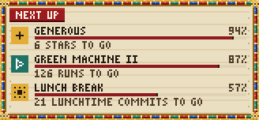</picture>

  <a href="https://github.com/tannergolden/markdown/blob/HEAD/docs/Catalogue.md#profile-commits"><picture><source media="(prefers-color-scheme: dark)" srcset="assets/trophies/commits.svg">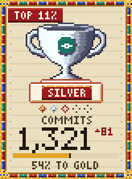</picture></a>
  <a href="https://github.com/tannergolden/markdown/blob/HEAD/docs/Catalogue.md#profile-repos"><picture><source media="(prefers-color-scheme: dark)" srcset="assets/trophies/repos.svg">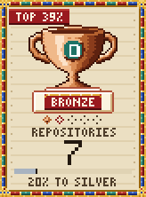</picture></a>
  <a href="https://github.com/tannergolden/markdown/blob/HEAD/docs/Catalogue.md#profile-streak"><picture><source media="(prefers-color-scheme: dark)" srcset="assets/trophies/streak.svg">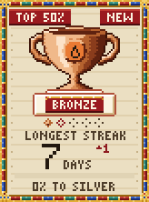</picture></a>
  <a href="https://github.com/tannergolden/markdown/blob/HEAD/docs/Catalogue.md#profile-followers"><picture><source media="(prefers-color-scheme: dark)" srcset="assets/trophies/followers.svg">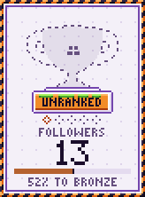</picture></a>
  <a href="https://github.com/tannergolden/markdown/blob/HEAD/docs/Catalogue.md#profile-pulls"><picture><source media="(prefers-color-scheme: dark)" srcset="assets/trophies/pulls.svg">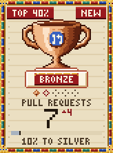</picture></a>

<b>Achievements</b> · 42 of 104 earned · next: Generous, 94%

<b>Milestones</b>

  <a href="https://github.com/tannergolden/markdown/blob/HEAD/docs/Catalogue.md#profile-century"><picture><source media="(prefers-color-scheme: dark)" srcset="assets/trophies/achievements/century.svg"></picture></a>
  <a href="https://github.com/tannergolden/markdown/blob/HEAD/docs/Catalogue.md#profile-landed"><picture><source media="(prefers-color-scheme: dark)" srcset="assets/trophies/achievements/landed.svg">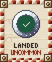</picture></a>
  <a href="https://github.com/tannergolden/markdown/blob/HEAD/docs/Catalogue.md#profile-shipped"><picture><source media="(prefers-color-scheme: dark)" srcset="assets/trophies/achievements/shipped.svg">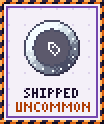</picture></a>
  <a href="https://github.com/tannergolden/markdown/blob/HEAD/docs/Catalogue.md#profile-first-light"><picture><source media="(prefers-color-scheme: dark)" srcset="assets/trophies/achievements/first-light.svg">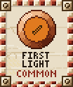</picture></a>
  <a href="https://github.com/tannergolden/markdown/blob/HEAD/docs/Catalogue.md#profile-hello-world"><picture><source media="(prefers-color-scheme: dark)" srcset="assets/trophies/achievements/hello-world.svg">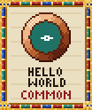</picture></a>
  <a href="https://github.com/tannergolden/markdown/blob/HEAD/docs/Catalogue.md#profile-opening-move"><picture><source media="(prefers-color-scheme: dark)" srcset="assets/trophies/achievements/opening-move.svg">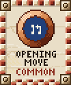</picture></a>
  <a href="https://github.com/tannergolden/markdown/blob/HEAD/docs/Catalogue.md#profile-ticket"><picture><source media="(prefers-color-scheme: dark)" srcset="assets/trophies/achievements/ticket.svg">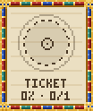</picture></a>
  <a href="https://github.com/tannergolden/markdown/blob/HEAD/docs/Catalogue.md#profile-veteran"><picture><source media="(prefers-color-scheme: dark)" srcset="assets/trophies/achievements/veteran.svg">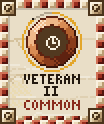</picture></a>
  <a href="https://github.com/tannergolden/markdown/blob/HEAD/docs/Catalogue.md#profile-polyglot"><picture><source media="(prefers-color-scheme: dark)" srcset="assets/trophies/achievements/polyglot.svg">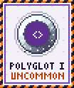</picture></a>
  <a href="https://github.com/tannergolden/markdown/blob/HEAD/docs/Catalogue.md#profile-branching-out"><picture><source media="(prefers-color-scheme: dark)" srcset="assets/trophies/achievements/branching-out.svg">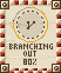</picture></a>
  <a href="https://github.com/tannergolden/markdown/blob/HEAD/docs/Catalogue.md#profile-shipwright"><picture><source media="(prefers-color-scheme: dark)" srcset="assets/trophies/achievements/shipwright.svg">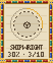</picture></a>
  <a href="https://github.com/tannergolden/markdown/blob/HEAD/docs/Catalogue.md#profile-monolith"><picture><source media="(prefers-color-scheme: dark)" srcset="assets/trophies/achievements/monolith.svg"></picture></a>
  <a href="https://github.com/tannergolden/markdown/blob/HEAD/docs/Catalogue.md#profile-bug-hunter"><picture><source media="(prefers-color-scheme: dark)" srcset="assets/trophies/achievements/bug-hunter.svg">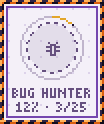</picture></a>
  <a href="https://github.com/tannergolden/markdown/blob/HEAD/docs/Catalogue.md#profile-merge-master"><picture><source media="(prefers-color-scheme: dark)" srcset="assets/trophies/achievements/merge-master.svg">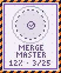</picture></a>
  <a href="https://github.com/tannergolden/markdown/blob/HEAD/docs/Catalogue.md#profile-closer"><picture><source media="(prefers-color-scheme: dark)" srcset="assets/trophies/achievements/closer.svg">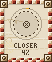</picture></a>
  <a href="https://github.com/tannergolden/markdown/blob/HEAD/docs/Catalogue.md#profile-fan-club"><picture><source media="(prefers-color-scheme: dark)" srcset="assets/trophies/achievements/fan-club.svg">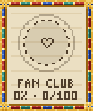</picture></a>
  <a href="https://github.com/tannergolden/markdown/blob/HEAD/docs/Catalogue.md#profile-forked"><picture><source media="(prefers-color-scheme: dark)" srcset="assets/trophies/achievements/forked.svg"></picture></a>
  <a href="https://github.com/tannergolden/markdown/blob/HEAD/docs/Catalogue.md#profile-long-haul"><picture><source media="(prefers-color-scheme: dark)" srcset="assets/trophies/achievements/long-haul.svg"></picture></a>
  <a href="https://github.com/tannergolden/markdown/blob/HEAD/docs/Catalogue.md#profile-second-opinion"><picture><source media="(prefers-color-scheme: dark)" srcset="assets/trophies/achievements/second-opinion.svg">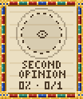</picture></a>
  <a href="https://github.com/tannergolden/markdown/blob/HEAD/docs/Catalogue.md#profile-stargazer"><picture><source media="(prefers-color-scheme: dark)" srcset="assets/trophies/achievements/stargazer.svg">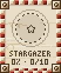</picture></a>
  <a href="https://github.com/tannergolden/markdown/blob/HEAD/docs/Catalogue.md#profile-watched"><picture><source media="(prefers-color-scheme: dark)" srcset="assets/trophies/achievements/watched.svg">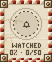</picture></a>

<b>Craft</b>

  <a href="https://github.com/tannergolden/markdown/blob/HEAD/docs/Catalogue.md#profile-by-the-book"><picture><source media="(prefers-color-scheme: dark)" srcset="assets/trophies/achievements/by-the-book.svg">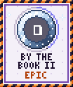</picture></a>
  <a href="https://github.com/tannergolden/markdown/blob/HEAD/docs/Catalogue.md#profile-duet"><picture><source media="(prefers-color-scheme: dark)" srcset="assets/trophies/achievements/duet.svg">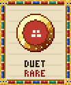</picture></a>
  <a href="https://github.com/tannergolden/markdown/blob/HEAD/docs/Catalogue.md#profile-green-machine"><picture><source media="(prefers-color-scheme: dark)" srcset="assets/trophies/achievements/green-machine.svg">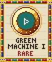</picture></a>
  <a href="https://github.com/tannergolden/markdown/blob/HEAD/docs/Catalogue.md#profile-scribe"><picture><source media="(prefers-color-scheme: dark)" srcset="assets/trophies/achievements/scribe.svg">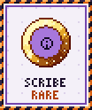</picture></a>
  <a href="https://github.com/tannergolden/markdown/blob/HEAD/docs/Catalogue.md#profile-signed"><picture><source media="(prefers-color-scheme: dark)" srcset="assets/trophies/achievements/signed.svg"></picture></a>
  <a href="https://github.com/tannergolden/markdown/blob/HEAD/docs/Catalogue.md#profile-tested"><picture><source media="(prefers-color-scheme: dark)" srcset="assets/trophies/achievements/tested.svg"></picture></a>
  <a href="https://github.com/tannergolden/markdown/blob/HEAD/docs/Catalogue.md#profile-fixer"><picture><source media="(prefers-color-scheme: dark)" srcset="assets/trophies/achievements/fixer.svg">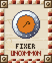</picture></a>
  <a href="https://github.com/tannergolden/markdown/blob/HEAD/docs/Catalogue.md#profile-surgeon"><picture><source media="(prefers-color-scheme: dark)" srcset="assets/trophies/achievements/surgeon.svg">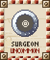</picture></a>
  <a href="https://github.com/tannergolden/markdown/blob/HEAD/docs/Catalogue.md#profile-sweeping-change"><picture><source media="(prefers-color-scheme: dark)" srcset="assets/trophies/achievements/sweeping-change.svg">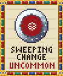</picture></a>
  <a href="https://github.com/tannergolden/markdown/blob/HEAD/docs/Catalogue.md#profile-heavy-lifter"><picture><source media="(prefers-color-scheme: dark)" srcset="assets/trophies/achievements/heavy-lifter.svg">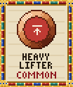</picture></a>
  <a href="https://github.com/tannergolden/markdown/blob/HEAD/docs/Catalogue.md#profile-well-maintained"><picture><source media="(prefers-color-scheme: dark)" srcset="assets/trophies/achievements/well-maintained.svg">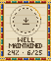</picture></a>
  <a href="https://github.com/tannergolden/markdown/blob/HEAD/docs/Catalogue.md#profile-gitmoji"><picture><source media="(prefers-color-scheme: dark)" srcset="assets/trophies/achievements/gitmoji.svg">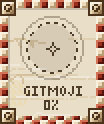</picture></a>
  <a href="https://github.com/tannergolden/markdown/blob/HEAD/docs/Catalogue.md#profile-toolsmith"><picture><source media="(prefers-color-scheme: dark)" srcset="assets/trophies/achievements/toolsmith.svg">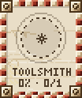</picture></a>
  <a href="https://github.com/tannergolden/markdown/blob/HEAD/docs/Catalogue.md#profile-undo"><picture><source media="(prefers-color-scheme: dark)" srcset="assets/trophies/achievements/undo.svg">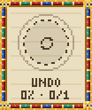</picture></a>

<b>Rhythm</b>

  <a href="https://github.com/tannergolden/markdown/blob/HEAD/docs/Catalogue.md#profile-marathon-day"><picture><source media="(prefers-color-scheme: dark)" srcset="assets/trophies/achievements/marathon-day.svg">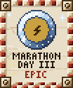</picture></a>
  <a href="https://github.com/tannergolden/markdown/blob/HEAD/docs/Catalogue.md#profile-sprint"><picture><source media="(prefers-color-scheme: dark)" srcset="assets/trophies/achievements/sprint.svg"></picture></a>
  <a href="https://github.com/tannergolden/markdown/blob/HEAD/docs/Catalogue.md#profile-big-week"><picture><source media="(prefers-color-scheme: dark)" srcset="assets/trophies/achievements/big-week.svg"></picture></a>
  <a href="https://github.com/tannergolden/markdown/blob/HEAD/docs/Catalogue.md#profile-night-owl"><picture><source media="(prefers-color-scheme: dark)" srcset="assets/trophies/achievements/night-owl.svg"></picture></a>
  <a href="https://github.com/tannergolden/markdown/blob/HEAD/docs/Catalogue.md#profile-comeback"><picture><source media="(prefers-color-scheme: dark)" srcset="assets/trophies/achievements/comeback.svg"></picture></a>
  <a href="https://github.com/tannergolden/markdown/blob/HEAD/docs/Catalogue.md#profile-long-game"><picture><source media="(prefers-color-scheme: dark)" srcset="assets/trophies/achievements/long-game.svg"></picture></a>
  <a href="https://github.com/tannergolden/markdown/blob/HEAD/docs/Catalogue.md#profile-lunch-break"><picture><source media="(prefers-color-scheme: dark)" srcset="assets/trophies/achievements/lunch-break.svg"></picture></a>
  <a href="https://github.com/tannergolden/markdown/blob/HEAD/docs/Catalogue.md#profile-early-bird"><picture><source media="(prefers-color-scheme: dark)" srcset="assets/trophies/achievements/early-bird.svg"></picture></a>
  <a href="https://github.com/tannergolden/markdown/blob/HEAD/docs/Catalogue.md#profile-weekender"><picture><source media="(prefers-color-scheme: dark)" srcset="assets/trophies/achievements/weekender.svg"></picture></a>
  <a href="https://github.com/tannergolden/markdown/blob/HEAD/docs/Catalogue.md#profile-weekday-warrior"><picture><source media="(prefers-color-scheme: dark)" srcset="assets/trophies/achievements/weekday-warrior.svg"></picture></a>
  <a href="https://github.com/tannergolden/markdown/blob/HEAD/docs/Catalogue.md#profile-year-of-code"><picture><source media="(prefers-color-scheme: dark)" srcset="assets/trophies/achievements/year-of-code.svg"></picture></a>
  <a href="https://github.com/tannergolden/markdown/blob/HEAD/docs/Catalogue.md#profile-four-seasons"><picture><source media="(prefers-color-scheme: dark)" srcset="assets/trophies/achievements/four-seasons.svg"></picture></a>
  <a href="https://github.com/tannergolden/markdown/blob/HEAD/docs/Catalogue.md#profile-friday-deploy"><picture><source media="(prefers-color-scheme: dark)" srcset="assets/trophies/achievements/friday-deploy.svg"></picture></a>
  <a href="https://github.com/tannergolden/markdown/blob/HEAD/docs/Catalogue.md#profile-perfect-month"><picture><source media="(prefers-color-scheme: dark)" srcset="assets/trophies/achievements/perfect-month.svg"></picture></a>

<b>Community</b>

  <a href="https://github.com/tannergolden/markdown/blob/HEAD/docs/Catalogue.md#profile-introduced"><picture><source media="(prefers-color-scheme: dark)" srcset="assets/trophies/achievements/introduced.svg"></picture></a>
  <a href="https://github.com/tannergolden/markdown/blob/HEAD/docs/Catalogue.md#profile-open-door"><picture><source media="(prefers-color-scheme: dark)" srcset="assets/trophies/achievements/open-door.svg"></picture></a>
  <a href="https://github.com/tannergolden/markdown/blob/HEAD/docs/Catalogue.md#profile-generous"><picture><source media="(prefers-color-scheme: dark)" srcset="assets/trophies/achievements/generous.svg"></picture></a>
  <a href="https://github.com/tannergolden/markdown/blob/HEAD/docs/Catalogue.md#profile-curious"><picture><source media="(prefers-color-scheme: dark)" srcset="assets/trophies/achievements/curious.svg"></picture></a>
  <a href="https://github.com/tannergolden/markdown/blob/HEAD/docs/Catalogue.md#profile-answer-key"><picture><source media="(prefers-color-scheme: dark)" srcset="assets/trophies/achievements/answer-key.svg"></picture></a>
  <a href="https://github.com/tannergolden/markdown/blob/HEAD/docs/Catalogue.md#profile-backed"><picture><source media="(prefers-color-scheme: dark)" srcset="assets/trophies/achievements/backed.svg"></picture></a>
  <a href="https://github.com/tannergolden/markdown/blob/HEAD/docs/Catalogue.md#profile-conversation-starter"><picture><source media="(prefers-color-scheme: dark)" srcset="assets/trophies/achievements/conversation-starter.svg"></picture></a>
  <a href="https://github.com/tannergolden/markdown/blob/HEAD/docs/Catalogue.md#profile-crew"><picture><source media="(prefers-color-scheme: dark)" srcset="assets/trophies/achievements/crew.svg"></picture></a>
  <a href="https://github.com/tannergolden/markdown/blob/HEAD/docs/Catalogue.md#profile-founder"><picture><source media="(prefers-color-scheme: dark)" srcset="assets/trophies/achievements/founder.svg"></picture></a>
  <a href="https://github.com/tannergolden/markdown/blob/HEAD/docs/Catalogue.md#profile-gist-keeper"><picture><source media="(prefers-color-scheme: dark)" srcset="assets/trophies/achievements/gist-keeper.svg"></picture></a>
  <a href="https://github.com/tannergolden/markdown/blob/HEAD/docs/Catalogue.md#profile-green-light"><picture><source media="(prefers-color-scheme: dark)" srcset="assets/trophies/achievements/green-light.svg"></picture></a>
  <a href="https://github.com/tannergolden/markdown/blob/HEAD/docs/Catalogue.md#profile-patron"><picture><source media="(prefers-color-scheme: dark)" srcset="assets/trophies/achievements/patron.svg"></picture></a>
  <a href="https://github.com/tannergolden/markdown/blob/HEAD/docs/Catalogue.md#profile-planner"><picture><source media="(prefers-color-scheme: dark)" srcset="assets/trophies/achievements/planner.svg"></picture></a>
  <a href="https://github.com/tannergolden/markdown/blob/HEAD/docs/Catalogue.md#profile-red-pen"><picture><source media="(prefers-color-scheme: dark)" srcset="assets/trophies/achievements/red-pen.svg"></picture></a>
  <a href="https://github.com/tannergolden/markdown/blob/HEAD/docs/Catalogue.md#profile-registry"><picture><source media="(prefers-color-scheme: dark)" srcset="assets/trophies/achievements/registry.svg"></picture></a>
  <a href="https://github.com/tannergolden/markdown/blob/HEAD/docs/Catalogue.md#profile-reporter"><picture><source media="(prefers-color-scheme: dark)" srcset="assets/trophies/achievements/reporter.svg"></picture></a>
  <a href="https://github.com/tannergolden/markdown/blob/HEAD/docs/Catalogue.md#profile-roundtable"><picture><source media="(prefers-color-scheme: dark)" srcset="assets/trophies/achievements/roundtable.svg"></picture></a>
  <a href="https://github.com/tannergolden/markdown/blob/HEAD/docs/Catalogue.md#profile-second-pair-of-eyes"><picture><source media="(prefers-color-scheme: dark)" srcset="assets/trophies/achievements/second-pair-of-eyes.svg"></picture></a>
  <a href="https://github.com/tannergolden/markdown/blob/HEAD/docs/Catalogue.md#profile-team-player"><picture><source media="(prefers-color-scheme: dark)" srcset="assets/trophies/achievements/team-player.svg"></picture></a>
  <a href="https://github.com/tannergolden/markdown/blob/HEAD/docs/Catalogue.md#profile-upstream"><picture><source media="(prefers-color-scheme: dark)" srcset="assets/trophies/achievements/upstream.svg"></picture></a>
  <a href="https://github.com/tannergolden/markdown/blob/HEAD/docs/Catalogue.md#profile-voice"><picture><source media="(prefers-color-scheme: dark)" srcset="assets/trophies/achievements/voice.svg"></picture></a>

<b>Housekeeping</b>

  <a href="https://github.com/tannergolden/markdown/blob/HEAD/docs/Catalogue.md#profile-gatekeeper"><picture><source media="(prefers-color-scheme: dark)" srcset="assets/trophies/achievements/gatekeeper.svg"></picture></a>
  <a href="https://github.com/tannergolden/markdown/blob/HEAD/docs/Catalogue.md#profile-locksmith"><picture><source media="(prefers-color-scheme: dark)" srcset="assets/trophies/achievements/locksmith.svg"></picture></a>
  <a href="https://github.com/tannergolden/markdown/blob/HEAD/docs/Catalogue.md#profile-auto-pilot"><picture><source media="(prefers-color-scheme: dark)" srcset="assets/trophies/achievements/auto-pilot.svg"></picture></a>
  <a href="https://github.com/tannergolden/markdown/blob/HEAD/docs/Catalogue.md#profile-blueprint"><picture><source media="(prefers-color-scheme: dark)" srcset="assets/trophies/achievements/blueprint.svg"></picture></a>
  <a href="https://github.com/tannergolden/markdown/blob/HEAD/docs/Catalogue.md#profile-form-filler"><picture><source media="(prefers-color-scheme: dark)" srcset="assets/trophies/achievements/form-filler.svg"></picture></a>
  <a href="https://github.com/tannergolden/markdown/blob/HEAD/docs/Catalogue.md#profile-house-rules"><picture><source media="(prefers-color-scheme: dark)" srcset="assets/trophies/achievements/house-rules.svg"></picture></a>
  <a href="https://github.com/tannergolden/markdown/blob/HEAD/docs/Catalogue.md#profile-label-maker"><picture><source media="(prefers-color-scheme: dark)" srcset="assets/trophies/achievements/label-maker.svg"></picture></a>
  <a href="https://github.com/tannergolden/markdown/blob/HEAD/docs/Catalogue.md#profile-town-hall"><picture><source media="(prefers-color-scheme: dark)" srcset="assets/trophies/achievements/town-hall.svg"></picture></a>
  <a href="https://github.com/tannergolden/markdown/blob/HEAD/docs/Catalogue.md#profile-welcome-mat"><picture><source media="(prefers-color-scheme: dark)" srcset="assets/trophies/achievements/welcome-mat.svg"></picture></a>
  <a href="https://github.com/tannergolden/markdown/blob/HEAD/docs/Catalogue.md#profile-curator"><picture><source media="(prefers-color-scheme: dark)" srcset="assets/trophies/achievements/curator.svg"></picture></a>
  <a href="https://github.com/tannergolden/markdown/blob/HEAD/docs/Catalogue.md#profile-documented"><picture><source media="(prefers-color-scheme: dark)" srcset="assets/trophies/achievements/documented.svg"></picture></a>
  <a href="https://github.com/tannergolden/markdown/blob/HEAD/docs/Catalogue.md#profile-licensed"><picture><source media="(prefers-color-scheme: dark)" srcset="assets/trophies/achievements/licensed.svg"></picture></a>
  <a href="https://github.com/tannergolden/markdown/blob/HEAD/docs/Catalogue.md#profile-semver"><picture><source media="(prefers-color-scheme: dark)" srcset="assets/trophies/achievements/semver.svg"></picture></a>
  <a href="https://github.com/tannergolden/markdown/blob/HEAD/docs/Catalogue.md#profile-front-door"><picture><source media="(prefers-color-scheme: dark)" srcset="assets/trophies/achievements/front-door.svg"></picture></a>
  <a href="https://github.com/tannergolden/markdown/blob/HEAD/docs/Catalogue.md#profile-open-hand"><picture><source media="(prefers-color-scheme: dark)" srcset="assets/trophies/achievements/open-hand.svg"></picture></a>
  <a href="https://github.com/tannergolden/markdown/blob/HEAD/docs/Catalogue.md#profile-packager"><picture><source media="(prefers-color-scheme: dark)" srcset="assets/trophies/achievements/packager.svg"></picture></a>
  <a href="https://github.com/tannergolden/markdown/blob/HEAD/docs/Catalogue.md#profile-roadmap"><picture><source media="(prefers-color-scheme: dark)" srcset="assets/trophies/achievements/roadmap.svg"></picture></a>
  <a href="https://github.com/tannergolden/markdown/blob/HEAD/docs/Catalogue.md#profile-tidy"><picture><source media="(prefers-color-scheme: dark)" srcset="assets/trophies/achievements/tidy.svg"></picture></a>

<b>Secret</b>

  <a href="https://github.com/tannergolden/markdown/blob/HEAD/docs/Catalogue.md#profile-ghost"><picture><source media="(prefers-color-scheme: dark)" srcset="assets/trophies/achievements/ghost.svg"></picture></a>
  <a href="https://github.com/tannergolden/markdown/blob/HEAD/docs/Catalogue.md#profile-constellation"><picture><source media="(prefers-color-scheme: dark)" srcset="assets/trophies/achievements/constellation.svg"></picture></a>
  <a href="https://github.com/tannergolden/markdown/blob/HEAD/docs/Catalogue.md#profile-friday-the-13th"><picture><source media="(prefers-color-scheme: dark)" srcset="assets/trophies/achievements/friday-the-13th.svg"></picture></a>
  <a href="https://github.com/tannergolden/markdown/blob/HEAD/docs/Catalogue.md#profile-full-house"><picture><source media="(prefers-color-scheme: dark)" srcset="assets/trophies/achievements/full-house.svg"></picture></a>
  <a href="https://github.com/tannergolden/markdown/blob/HEAD/docs/Catalogue.md#profile-green-wall"><picture><source media="(prefers-color-scheme: dark)" srcset="assets/trophies/achievements/green-wall.svg"></picture></a>
  <a href="https://github.com/tannergolden/markdown/blob/HEAD/docs/Catalogue.md#profile-homecoming"><picture><source media="(prefers-color-scheme: dark)" srcset="assets/trophies/achievements/homecoming.svg"></picture></a>
  <a href="https://github.com/tannergolden/markdown/blob/HEAD/docs/Catalogue.md#profile-inbox-zero"><picture><source media="(prefers-color-scheme: dark)" srcset="assets/trophies/achievements/inbox-zero.svg"></picture></a>
  <a href="https://github.com/tannergolden/markdown/blob/HEAD/docs/Catalogue.md#profile-leap-day"><picture><source media="(prefers-color-scheme: dark)" srcset="assets/trophies/achievements/leap-day.svg"></picture></a>
  <a href="https://github.com/tannergolden/markdown/blob/HEAD/docs/Catalogue.md#profile-midnight-oil"><picture><source media="(prefers-color-scheme: dark)" srcset="assets/trophies/achievements/midnight-oil.svg"></picture></a>
  <a href="https://github.com/tannergolden/markdown/blob/HEAD/docs/Catalogue.md#profile-new-year"><picture><source media="(prefers-color-scheme: dark)" srcset="assets/trophies/achievements/new-year.svg"></picture></a>
  <a href="https://github.com/tannergolden/markdown/blob/HEAD/docs/Catalogue.md#profile-round-number"><picture><source media="(prefers-color-scheme: dark)" srcset="assets/trophies/achievements/round-number.svg"></picture></a>
  <a href="https://github.com/tannergolden/markdown/blob/HEAD/docs/Catalogue.md#profile-the-answer"><picture><source media="(prefers-color-scheme: dark)" srcset="assets/trophies/achievements/the-answer.svg"></picture></a>

<b>Maker</b>

  <a href="https://github.com/tannergolden/markdown/blob/HEAD/docs/Catalogue.md#profile-badge-maker"><picture><source media="(prefers-color-scheme: dark)" srcset="assets/trophies/achievements/badge-maker.svg"></picture></a>
  <a href="https://github.com/tannergolden/markdown/blob/HEAD/docs/Catalogue.md#profile-pathfinder"><picture><source media="(prefers-color-scheme: dark)" srcset="assets/trophies/achievements/pathfinder.svg"></picture></a>
  <a href="https://github.com/tannergolden/markdown/blob/HEAD/docs/Catalogue.md#profile-standard-bearer"><picture><source media="(prefers-color-scheme: dark)" srcset="assets/trophies/achievements/standard-bearer.svg"></picture></a>
  <a href="https://github.com/tannergolden/markdown/blob/HEAD/docs/Catalogue.md#profile-trophy-maker"><picture><source media="(prefers-color-scheme: dark)" srcset="assets/trophies/achievements/trophy-maker.svg"></picture></a>

Refreshed daily by <a href="https://github.com/tannergolden/markdown">tannergolden/markdown</a> · Every trophy and achievement, what it is for and how to earn it: <a href="https://github.com/tannergolden/markdown/blob/HEAD/docs/Catalogue.md#profile">the catalogue</a>. Click any card for its entry.

<!-- markdown:trophies:end -->

---

## 📦 Latest Releases

The two repositories on this account that shipped most recently, each with its
version, the day it went out and the major tag a stub pins to follow it.
Superseded releases are pruned, so each one shown is its repository's current
release. Redrawn every Wednesday.

<!-- markdown:element:release-1:start -->
<a href="https://github.com/tannergolden/markdown/releases/latest">
<picture>
  <source media="(prefers-color-scheme: dark)" srcset="assets/elements/release-1-dark.svg">
  
</picture>
</a>
<!-- markdown:element:release-1:end -->
<!-- markdown:element:release-2:start -->
<a href="https://github.com/tannergolden/standards/releases/latest">
<picture>
  <source media="(prefers-color-scheme: dark)" srcset="assets/elements/release-2-dark.svg">
  
</picture>
</a>
<!-- markdown:element:release-2:end -->

---

## 📝 Field Notes

<!-- notes:start -->

> [!NOTE]
> **GitHub changelog · 9 Oct.** [GitHub Copilot weekly releases - October 5](https://github.blog/changelog/2026-10-09-github-copilot-weekly-releases-october-5)

> [!TIP]
> **tldr-pages · [az-webapp](https://github.com/tldr-pages/tldr/blob/main/pages/common/az-webapp.md).** List all web applications: `az webapp list`

> [!IMPORTANT]
> **Advanced · Documentation.** Document each service's limits and failure behavior: maximum payload, rate limits, timeouts and what it returns when a dependency is down. Callers otherwise discover them in production and build workarounds that break when the limits change.

> [!WARNING]
> **Professional · Debugging.** Capturing with `tcpdump` on a busy host can drop packets and fill the disk. Use a capture filter, cap the size with `-c` or rotate files with `-C` and `-W`, and write to a volume with room to spare.

> [!CAUTION]
> **Beginner · CI.** Re-running an old deploy job in CI deploys that job's original commit, which can overwrite newer code in production. Start a fresh deploy from the current branch instead.

Redrawn every Monday, at random, from 5,000 curated notes and five open data sources. Week 42 of 2026. Open data this week: GitHub changelog, tldr-pages (CC BY 4.0).

<!-- notes:end -->

---

## 🌿 Good First Issue

<!-- markdown:element:issue-1:start -->
<a href="https://github.com/langgenius/dify/issues/43768">
<picture>
  <source media="(prefers-color-scheme: dark)" srcset="assets/elements/issue-1-dark.svg">
  
</picture>
</a>
<!-- markdown:element:issue-1:end -->
<!-- markdown:element:issue-2:start -->
<a href="https://github.com/immich-app/immich/issues/32476">
<picture>
  <source media="(prefers-color-scheme: dark)" srcset="assets/elements/issue-2-dark.svg">
  
</picture>
</a>
<!-- markdown:element:issue-2:end -->

The newest good first issue from each of the two most-starred projects that opened one lately, still open and unclaimed. Redrawn every Friday.

---

<!-- markdown:footer:start -->

<a href="#top">
<picture>
  <source media="(max-width: 585px) and (prefers-color-scheme: dark)" srcset="assets/banners/footer-narrow-dark.svg">
  <source media="(max-width: 585px)" srcset="assets/banners/footer-narrow-day.svg">
  <source media="(prefers-color-scheme: dark)" srcset="assets/banners/footer-dark.svg">
  
</picture>
</a>

<a href="https://github.com/tannergolden?tab=repositories"><picture><source media="(prefers-color-scheme: dark)" srcset="assets/banners/link-repositories-dark.svg"></picture></a>
<a href="https://github.com/tannergolden/standards"><picture><source media="(prefers-color-scheme: dark)" srcset="assets/banners/link-standards-dark.svg"></picture></a>
<a href="https://github.com/tannergolden/path"><picture><source media="(prefers-color-scheme: dark)" srcset="assets/banners/link-golden-path-dark.svg"></picture></a>
<a href="https://github.com/tannergolden/markdown"><picture><source media="(prefers-color-scheme: dark)" srcset="assets/banners/link-markdown-dark.svg"></picture></a>

<!-- markdown:footer:end -->
