<!--
title: '👋 TANNER GOLDEN'
description: 'The GitHub profile of Tanner Golden: who I am, the case my work has earned, and where to find me, all drawn by GitHub Actions.'
type: index
-->

<!-- markdown:header:start -->
<!-- markdownlint-disable MD041 -->

<picture>
  <source media="(max-width: 585px) and (prefers-color-scheme: dark)" srcset="assets/banners/header-narrow-dark.svg">
  <source media="(max-width: 585px)" srcset="assets/banners/header-narrow-day.svg">
  <source media="(prefers-reduced-motion: reduce) and (prefers-color-scheme: dark)" srcset="assets/banners/header-still-dark.svg">
  <source media="(prefers-reduced-motion: reduce)" srcset="assets/banners/header-still-day.svg">
  <source media="(prefers-color-scheme: dark)" srcset="assets/banners/header-dark.svg">
  
</picture>

<!-- markdown:header:end -->

<!-- markdown:badges:start -->

<a href="https://github.com/tannergolden?tab=repositories">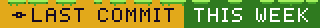</a>

<!-- markdown:badges:end -->

---

## 💡 About Me

I'm a software engineer building infrastructure for AI research. My focus is
the layer under the experiments: environments that rebuild the same way every
time, dependencies that are pinned and scanned, and CI that fails for the
right reasons, so a result can be trusted and repeated.

Most of my public work is one connected system.
[`standards`](https://github.com/tannergolden/standards) holds the engineering
rules and the reusable workflows that enforce them, called by link so a fix
lands once and reaches every repository.
[`path`](https://github.com/tannergolden/path) is the template new
repositories start from, and
[`markdown`](https://github.com/tannergolden/markdown) draws READMEs like this
one from data measured on a schedule.

- **Working on:** reproducible environments, supply-chain hygiene (pinned
  dependencies, secret scanning, CodeQL and SBOMs), and CI that fails for the
  right reasons.
- **Building with:** Python (standard library first), GitHub Actions, Bash and
  Make, plus dev containers and Codespaces so a Mac and a fresh container start
  from the same shell.
- **How I work:** standards a machine enforces, small reviewable changes,
  Conventional Commits, and signed commits on protected branches.
- **Ask me about:** reusable workflows, dependency pinning, release automation,
  and automating the chores nobody should do by hand.

---

## 🎲 Play Against Me

Four games, Chess, Checkers, Pentago and Tic-Tac, with me on one side and
everyone else on GitHub on the other. I always play White, and X in Tic-Tac.

1. **Pick a move** from the list under a board. Chess is always in view, and
   the other three open with a click.
2. **Tick the box in the issue its link opens, then submit it**, its title
   unchanged. The box agrees to the rules and to the games showing your move,
   username and avatar. The first move to reach the game is the one played.
3. **The Official Arbiter rules on it** within a few minutes: it answers on
   your issue, closes it as `played` or `turned away`, and redraws the board.

Each side has a week to move, or the Arbiter moves for it at random. A win
counts for the player who makes the winning move, and the most wins top the
Hall of Fame below.

📖 The rules and everything else are in [Games](docs/library/Games.md) and each game's
guide: [Chess](docs/library/Chess.md), [Checkers](docs/library/Checkers.md),
[Pentago](docs/library/Pentago.md) and [Tic-Tac](docs/library/Tic-Tac.md).

<!-- markdown:element:chess:start -->
<picture>
  <source media="(max-width: 585px) and (prefers-reduced-motion: reduce) and (prefers-color-scheme: dark)" srcset="assets/elements/chess-narrow-still-dark.svg">
  <source media="(max-width: 585px) and (prefers-reduced-motion: reduce)" srcset="assets/elements/chess-narrow-still-day.svg">
  <source media="(max-width: 585px) and (prefers-color-scheme: dark)" srcset="assets/elements/chess-narrow-dark.svg">
  <source media="(max-width: 585px)" srcset="assets/elements/chess-narrow-day.svg">
  <source media="(prefers-reduced-motion: reduce) and (prefers-color-scheme: dark)" srcset="assets/elements/chess-still-dark.svg">
  <source media="(prefers-reduced-motion: reduce)" srcset="assets/elements/chess-still-day.svg">
  <source media="(prefers-color-scheme: dark)" srcset="assets/elements/chess-dark.svg">
  
</picture>

♔ <b>@tannergolden's Turn</b> · 27 legal moves · only @tannergolden can play these

♔ King · 1 move

|  | Move | In words | Play |
| :-: | :--- | :--- | :-: |
| 🤴 | **King Move** `Kd2` | King from e1 to d2 | [Play ↗](https://github.com/tannergolden/play/issues/new?template=move.yml&title=chess%3A%20e1d2%20%C2%B7%20game%201%20%C2%B7%20move%205) |

♕ Queen · 3 moves

|  | Move | In words | Play |
| :-: | :--- | :--- | :-: |
| 👸 | **Queen Move** `Qd4` | Queen from d1 to d4 | [Play ↗](https://github.com/tannergolden/play/issues/new?template=move.yml&title=chess%3A%20d1d4%20%C2%B7%20game%201%20%C2%B7%20move%205) |
| 👸 | **Queen Move** `Qd3` | Queen from d1 to d3 | [Play ↗](https://github.com/tannergolden/play/issues/new?template=move.yml&title=chess%3A%20d1d3%20%C2%B7%20game%201%20%C2%B7%20move%205) |
| 👸 | **Queen Move** `Qd2` | Queen from d1 to d2 | [Play ↗](https://github.com/tannergolden/play/issues/new?template=move.yml&title=chess%3A%20d1d2%20%C2%B7%20game%201%20%C2%B7%20move%205) |

♗ Bishop · 5 moves

|  | Move | In words | Play |
| :-: | :--- | :--- | :-: |
| ⛪ | **Bishop Move** `Bd2` | Bishop from c1 to d2 | [Play ↗](https://github.com/tannergolden/play/issues/new?template=move.yml&title=chess%3A%20c1d2%20%C2%B7%20game%201%20%C2%B7%20move%205) |
| ⛪ | **Bishop Move** `Be3` | Bishop from c1 to e3 | [Play ↗](https://github.com/tannergolden/play/issues/new?template=move.yml&title=chess%3A%20c1e3%20%C2%B7%20game%201%20%C2%B7%20move%205) |
| ⛪ | **Bishop Move** `Bf4` | Bishop from c1 to f4 | [Play ↗](https://github.com/tannergolden/play/issues/new?template=move.yml&title=chess%3A%20c1f4%20%C2%B7%20game%201%20%C2%B7%20move%205) |
| ⛪ | **Bishop Move** `Bg5` | Bishop from c1 to g5 | [Play ↗](https://github.com/tannergolden/play/issues/new?template=move.yml&title=chess%3A%20c1g5%20%C2%B7%20game%201%20%C2%B7%20move%205) |
| ⛪ | **Bishop Move** `Bh6` | Bishop from c1 to h6 | [Play ↗](https://github.com/tannergolden/play/issues/new?template=move.yml&title=chess%3A%20c1h6%20%C2%B7%20game%201%20%C2%B7%20move%205) |

♘ Knights · 5 moves

|  | Move | In words | Play |
| :-: | :--- | :--- | :-: |
| 🐴 | **Knight Move** `Na3` | Knight from b1 to a3 | [Play ↗](https://github.com/tannergolden/play/issues/new?template=move.yml&title=chess%3A%20b1a3%20%C2%B7%20game%201%20%C2%B7%20move%205) |
| 🐴 | **Knight Move** `Nc3` | Knight from b1 to c3 | [Play ↗](https://github.com/tannergolden/play/issues/new?template=move.yml&title=chess%3A%20b1c3%20%C2%B7%20game%201%20%C2%B7%20move%205) |
| 🐴 | **Knight Move** `Nd2` | Knight from b1 to d2 | [Play ↗](https://github.com/tannergolden/play/issues/new?template=move.yml&title=chess%3A%20b1d2%20%C2%B7%20game%201%20%C2%B7%20move%205) |
| 🐴 | **Knight Move** `Nf3` | Knight from g1 to f3 | [Play ↗](https://github.com/tannergolden/play/issues/new?template=move.yml&title=chess%3A%20g1f3%20%C2%B7%20game%201%20%C2%B7%20move%205) |
| 🐴 | **Knight Move** `Nh3` | Knight from g1 to h3 | [Play ↗](https://github.com/tannergolden/play/issues/new?template=move.yml&title=chess%3A%20g1h3%20%C2%B7%20game%201%20%C2%B7%20move%205) |

♙ Pawns · 13 moves

|  | Move | In words | Play |
| :-: | :--- | :--- | :-: |
| ♟️ | **Double Pawn Push** `a4` | Pawn from a2 to a4, two squares | [Play ↗](https://github.com/tannergolden/play/issues/new?template=move.yml&title=chess%3A%20a2a4%20%C2%B7%20game%201%20%C2%B7%20move%205) |
| ♟️ | **Pawn Push** `a3` | Pawn from a2 to a3 | [Play ↗](https://github.com/tannergolden/play/issues/new?template=move.yml&title=chess%3A%20a2a3%20%C2%B7%20game%201%20%C2%B7%20move%205) |
| ♟️ | **Double Pawn Push** `b4` | Pawn from b2 to b4, two squares | [Play ↗](https://github.com/tannergolden/play/issues/new?template=move.yml&title=chess%3A%20b2b4%20%C2%B7%20game%201%20%C2%B7%20move%205) |
| ♟️ | **Pawn Push** `b3` | Pawn from b2 to b3 | [Play ↗](https://github.com/tannergolden/play/issues/new?template=move.yml&title=chess%3A%20b2b3%20%C2%B7%20game%201%20%C2%B7%20move%205) |
| ♟️ | **Double Pawn Push** `c4` | Pawn from c2 to c4, two squares | [Play ↗](https://github.com/tannergolden/play/issues/new?template=move.yml&title=chess%3A%20c2c4%20%C2%B7%20game%201%20%C2%B7%20move%205) |
| ♟️ | **Pawn Push** `c3` | Pawn from c2 to c3 | [Play ↗](https://github.com/tannergolden/play/issues/new?template=move.yml&title=chess%3A%20c2c3%20%C2%B7%20game%201%20%C2%B7%20move%205) |
| ♟️ | **Pawn Push** `d6` | Pawn from d5 to d6 | [Play ↗](https://github.com/tannergolden/play/issues/new?template=move.yml&title=chess%3A%20d5d6%20%C2%B7%20game%201%20%C2%B7%20move%205) |
| ⚔️ | **Pawn Takes Pawn** `dxe6` | Pawn from d5 takes the pawn on e6 | [Play ↗](https://github.com/tannergolden/play/issues/new?template=move.yml&title=chess%3A%20d5e6%20%C2%B7%20game%201%20%C2%B7%20move%205) |
| ♟️ | **Double Pawn Push** `e4` | Pawn from e2 to e4, two squares | [Play ↗](https://github.com/tannergolden/play/issues/new?template=move.yml&title=chess%3A%20e2e4%20%C2%B7%20game%201%20%C2%B7%20move%205) |
| ♟️ | **Pawn Push** `e3` | Pawn from e2 to e3 | [Play ↗](https://github.com/tannergolden/play/issues/new?template=move.yml&title=chess%3A%20e2e3%20%C2%B7%20game%201%20%C2%B7%20move%205) |
| ♟️ | **Double Pawn Push** `g4` | Pawn from g2 to g4, two squares | [Play ↗](https://github.com/tannergolden/play/issues/new?template=move.yml&title=chess%3A%20g2g4%20%C2%B7%20game%201%20%C2%B7%20move%205) |
| ♟️ | **Pawn Push** `g3` | Pawn from g2 to g3 | [Play ↗](https://github.com/tannergolden/play/issues/new?template=move.yml&title=chess%3A%20g2g3%20%C2%B7%20game%201%20%C2%B7%20move%205) |
| ♟️ | **Pawn Push** `h3` | Pawn from h2 to h3 | [Play ↗](https://github.com/tannergolden/play/issues/new?template=move.yml&title=chess%3A%20h2h3%20%C2%B7%20game%201%20%C2%B7%20move%205) |

Only @tannergolden can play on this turn: a pick from anyone else is turned away with a comment on its issue. The move is due by 14 Nov, 15:52 EST, or the Arbiter plays a random legal move.
<!-- markdown:element:chess:end -->

<!-- markdown:element:checkers:start -->

<b>🏁 Checkers</b>

<picture>
  <source media="(max-width: 585px) and (prefers-reduced-motion: reduce) and (prefers-color-scheme: dark)" srcset="assets/elements/checkers-narrow-still-dark.svg">
  <source media="(max-width: 585px) and (prefers-reduced-motion: reduce)" srcset="assets/elements/checkers-narrow-still-day.svg">
  <source media="(max-width: 585px) and (prefers-color-scheme: dark)" srcset="assets/elements/checkers-narrow-dark.svg">
  <source media="(max-width: 585px)" srcset="assets/elements/checkers-narrow-day.svg">
  <source media="(prefers-reduced-motion: reduce) and (prefers-color-scheme: dark)" srcset="assets/elements/checkers-still-dark.svg">
  <source media="(prefers-reduced-motion: reduce)" srcset="assets/elements/checkers-still-day.svg">
  <source media="(prefers-color-scheme: dark)" srcset="assets/elements/checkers-dark.svg">
  
</picture>

⛂ <b>GitHub's Turn</b> · 1 legal move · open to choose one

|  | Move | In words | Play |
| :-: | :--- | :--- | :-: |
| ⚔️ | **Single Jump** `16x23` | Man from 16 jumps 19, landing on 23 | [Play ↗](https://github.com/tannergolden/play/issues/new?template=move.yml&title=checkers%3A%2016x23%20%C2%B7%20game%201%20%C2%B7%20move%205) |

Anyone but @tannergolden can play on this turn, and the first pick in is played. The move is due by 10 Nov, 20:20 EST, or the Arbiter plays a random legal move. A jump must be taken whenever there is one, and a man that reaches the far row is crowned.

<!-- markdown:element:checkers:end -->

<!-- markdown:element:pentago:start -->

<b>🌀 Pentago</b>

<picture>
  <source media="(max-width: 585px) and (prefers-reduced-motion: reduce) and (prefers-color-scheme: dark)" srcset="assets/elements/pentago-narrow-still-dark.svg">
  <source media="(max-width: 585px) and (prefers-reduced-motion: reduce)" srcset="assets/elements/pentago-narrow-still-day.svg">
  <source media="(max-width: 585px) and (prefers-color-scheme: dark)" srcset="assets/elements/pentago-narrow-dark.svg">
  <source media="(max-width: 585px)" srcset="assets/elements/pentago-narrow-day.svg">
  <source media="(prefers-reduced-motion: reduce) and (prefers-color-scheme: dark)" srcset="assets/elements/pentago-still-dark.svg">
  <source media="(prefers-reduced-motion: reduce)" srcset="assets/elements/pentago-still-day.svg">
  <source media="(prefers-color-scheme: dark)" srcset="assets/elements/pentago-dark.svg">
  
</picture>

⚫ <b>GitHub's Turn</b> · 32 empty holes · open to choose one

⚫ Upper Left Quarter · 7 moves

|  | Hole | In words | Then turn |
| :-: | :--- | :--- | :--- |
| ⚫ | **Corner Move** `a6` | A black marble on a6, then a quarter turns | [↻&#8202;UL](https://github.com/tannergolden/play/issues/new?template=move.yml&title=pentago%3A%20a6-ul-cw%20%C2%B7%20game%201%20%C2%B7%20move%205) [↺&#8202;UL](https://github.com/tannergolden/play/issues/new?template=move.yml&title=pentago%3A%20a6-ul-acw%20%C2%B7%20game%201%20%C2%B7%20move%205) [↻&#8202;UR](https://github.com/tannergolden/play/issues/new?template=move.yml&title=pentago%3A%20a6-ur-cw%20%C2%B7%20game%201%20%C2%B7%20move%205) [↺&#8202;UR](https://github.com/tannergolden/play/issues/new?template=move.yml&title=pentago%3A%20a6-ur-acw%20%C2%B7%20game%201%20%C2%B7%20move%205) [↻&#8202;LL](https://github.com/tannergolden/play/issues/new?template=move.yml&title=pentago%3A%20a6-ll-cw%20%C2%B7%20game%201%20%C2%B7%20move%205) [↺&#8202;LL](https://github.com/tannergolden/play/issues/new?template=move.yml&title=pentago%3A%20a6-ll-acw%20%C2%B7%20game%201%20%C2%B7%20move%205) [↻&#8202;LR](https://github.com/tannergolden/play/issues/new?template=move.yml&title=pentago%3A%20a6-lr-cw%20%C2%B7%20game%201%20%C2%B7%20move%205) [↺&#8202;LR](https://github.com/tannergolden/play/issues/new?template=move.yml&title=pentago%3A%20a6-lr-acw%20%C2%B7%20game%201%20%C2%B7%20move%205) |
| ⚫ | **Edge Move** `b6` | A black marble on b6, then a quarter turns | [↻&#8202;UL](https://github.com/tannergolden/play/issues/new?template=move.yml&title=pentago%3A%20b6-ul-cw%20%C2%B7%20game%201%20%C2%B7%20move%205) [↺&#8202;UL](https://github.com/tannergolden/play/issues/new?template=move.yml&title=pentago%3A%20b6-ul-acw%20%C2%B7%20game%201%20%C2%B7%20move%205) [↻&#8202;UR](https://github.com/tannergolden/play/issues/new?template=move.yml&title=pentago%3A%20b6-ur-cw%20%C2%B7%20game%201%20%C2%B7%20move%205) [↺&#8202;UR](https://github.com/tannergolden/play/issues/new?template=move.yml&title=pentago%3A%20b6-ur-acw%20%C2%B7%20game%201%20%C2%B7%20move%205) [↻&#8202;LL](https://github.com/tannergolden/play/issues/new?template=move.yml&title=pentago%3A%20b6-ll-cw%20%C2%B7%20game%201%20%C2%B7%20move%205) [↺&#8202;LL](https://github.com/tannergolden/play/issues/new?template=move.yml&title=pentago%3A%20b6-ll-acw%20%C2%B7%20game%201%20%C2%B7%20move%205) [↻&#8202;LR](https://github.com/tannergolden/play/issues/new?template=move.yml&title=pentago%3A%20b6-lr-cw%20%C2%B7%20game%201%20%C2%B7%20move%205) [↺&#8202;LR](https://github.com/tannergolden/play/issues/new?template=move.yml&title=pentago%3A%20b6-lr-acw%20%C2%B7%20game%201%20%C2%B7%20move%205) |
| ⚫ | **Corner Move** `c6` | A black marble on c6, then a quarter turns | [↻&#8202;UL](https://github.com/tannergolden/play/issues/new?template=move.yml&title=pentago%3A%20c6-ul-cw%20%C2%B7%20game%201%20%C2%B7%20move%205) [↺&#8202;UL](https://github.com/tannergolden/play/issues/new?template=move.yml&title=pentago%3A%20c6-ul-acw%20%C2%B7%20game%201%20%C2%B7%20move%205) [↻&#8202;UR](https://github.com/tannergolden/play/issues/new?template=move.yml&title=pentago%3A%20c6-ur-cw%20%C2%B7%20game%201%20%C2%B7%20move%205) [↺&#8202;UR](https://github.com/tannergolden/play/issues/new?template=move.yml&title=pentago%3A%20c6-ur-acw%20%C2%B7%20game%201%20%C2%B7%20move%205) [↻&#8202;LL](https://github.com/tannergolden/play/issues/new?template=move.yml&title=pentago%3A%20c6-ll-cw%20%C2%B7%20game%201%20%C2%B7%20move%205) [↺&#8202;LL](https://github.com/tannergolden/play/issues/new?template=move.yml&title=pentago%3A%20c6-ll-acw%20%C2%B7%20game%201%20%C2%B7%20move%205) [↻&#8202;LR](https://github.com/tannergolden/play/issues/new?template=move.yml&title=pentago%3A%20c6-lr-cw%20%C2%B7%20game%201%20%C2%B7%20move%205) [↺&#8202;LR](https://github.com/tannergolden/play/issues/new?template=move.yml&title=pentago%3A%20c6-lr-acw%20%C2%B7%20game%201%20%C2%B7%20move%205) |
| ⚫ | **Edge Move** `a5` | A black marble on a5, then a quarter turns | [↻&#8202;UL](https://github.com/tannergolden/play/issues/new?template=move.yml&title=pentago%3A%20a5-ul-cw%20%C2%B7%20game%201%20%C2%B7%20move%205) [↺&#8202;UL](https://github.com/tannergolden/play/issues/new?template=move.yml&title=pentago%3A%20a5-ul-acw%20%C2%B7%20game%201%20%C2%B7%20move%205) [↻&#8202;UR](https://github.com/tannergolden/play/issues/new?template=move.yml&title=pentago%3A%20a5-ur-cw%20%C2%B7%20game%201%20%C2%B7%20move%205) [↺&#8202;UR](https://github.com/tannergolden/play/issues/new?template=move.yml&title=pentago%3A%20a5-ur-acw%20%C2%B7%20game%201%20%C2%B7%20move%205) [↻&#8202;LL](https://github.com/tannergolden/play/issues/new?template=move.yml&title=pentago%3A%20a5-ll-cw%20%C2%B7%20game%201%20%C2%B7%20move%205) [↺&#8202;LL](https://github.com/tannergolden/play/issues/new?template=move.yml&title=pentago%3A%20a5-ll-acw%20%C2%B7%20game%201%20%C2%B7%20move%205) [↻&#8202;LR](https://github.com/tannergolden/play/issues/new?template=move.yml&title=pentago%3A%20a5-lr-cw%20%C2%B7%20game%201%20%C2%B7%20move%205) [↺&#8202;LR](https://github.com/tannergolden/play/issues/new?template=move.yml&title=pentago%3A%20a5-lr-acw%20%C2%B7%20game%201%20%C2%B7%20move%205) |
| ⚫ | **Edge Move** `c5` | A black marble on c5, then a quarter turns | [↻&#8202;UL](https://github.com/tannergolden/play/issues/new?template=move.yml&title=pentago%3A%20c5-ul-cw%20%C2%B7%20game%201%20%C2%B7%20move%205) [↺&#8202;UL](https://github.com/tannergolden/play/issues/new?template=move.yml&title=pentago%3A%20c5-ul-acw%20%C2%B7%20game%201%20%C2%B7%20move%205) [↻&#8202;UR](https://github.com/tannergolden/play/issues/new?template=move.yml&title=pentago%3A%20c5-ur-cw%20%C2%B7%20game%201%20%C2%B7%20move%205) [↺&#8202;UR](https://github.com/tannergolden/play/issues/new?template=move.yml&title=pentago%3A%20c5-ur-acw%20%C2%B7%20game%201%20%C2%B7%20move%205) [↻&#8202;LL](https://github.com/tannergolden/play/issues/new?template=move.yml&title=pentago%3A%20c5-ll-cw%20%C2%B7%20game%201%20%C2%B7%20move%205) [↺&#8202;LL](https://github.com/tannergolden/play/issues/new?template=move.yml&title=pentago%3A%20c5-ll-acw%20%C2%B7%20game%201%20%C2%B7%20move%205) [↻&#8202;LR](https://github.com/tannergolden/play/issues/new?template=move.yml&title=pentago%3A%20c5-lr-cw%20%C2%B7%20game%201%20%C2%B7%20move%205) [↺&#8202;LR](https://github.com/tannergolden/play/issues/new?template=move.yml&title=pentago%3A%20c5-lr-acw%20%C2%B7%20game%201%20%C2%B7%20move%205) |
| ⚫ | **Edge Move** `b4` | A black marble on b4, then a quarter turns | [↻&#8202;UL](https://github.com/tannergolden/play/issues/new?template=move.yml&title=pentago%3A%20b4-ul-cw%20%C2%B7%20game%201%20%C2%B7%20move%205) [↺&#8202;UL](https://github.com/tannergolden/play/issues/new?template=move.yml&title=pentago%3A%20b4-ul-acw%20%C2%B7%20game%201%20%C2%B7%20move%205) [↻&#8202;UR](https://github.com/tannergolden/play/issues/new?template=move.yml&title=pentago%3A%20b4-ur-cw%20%C2%B7%20game%201%20%C2%B7%20move%205) [↺&#8202;UR](https://github.com/tannergolden/play/issues/new?template=move.yml&title=pentago%3A%20b4-ur-acw%20%C2%B7%20game%201%20%C2%B7%20move%205) [↻&#8202;LL](https://github.com/tannergolden/play/issues/new?template=move.yml&title=pentago%3A%20b4-ll-cw%20%C2%B7%20game%201%20%C2%B7%20move%205) [↺&#8202;LL](https://github.com/tannergolden/play/issues/new?template=move.yml&title=pentago%3A%20b4-ll-acw%20%C2%B7%20game%201%20%C2%B7%20move%205) [↻&#8202;LR](https://github.com/tannergolden/play/issues/new?template=move.yml&title=pentago%3A%20b4-lr-cw%20%C2%B7%20game%201%20%C2%B7%20move%205) [↺&#8202;LR](https://github.com/tannergolden/play/issues/new?template=move.yml&title=pentago%3A%20b4-lr-acw%20%C2%B7%20game%201%20%C2%B7%20move%205) |
| ⚫ | **Corner Move** `c4` | A black marble on c4, then a quarter turns | [↻&#8202;UL](https://github.com/tannergolden/play/issues/new?template=move.yml&title=pentago%3A%20c4-ul-cw%20%C2%B7%20game%201%20%C2%B7%20move%205) [↺&#8202;UL](https://github.com/tannergolden/play/issues/new?template=move.yml&title=pentago%3A%20c4-ul-acw%20%C2%B7%20game%201%20%C2%B7%20move%205) [↻&#8202;UR](https://github.com/tannergolden/play/issues/new?template=move.yml&title=pentago%3A%20c4-ur-cw%20%C2%B7%20game%201%20%C2%B7%20move%205) [↺&#8202;UR](https://github.com/tannergolden/play/issues/new?template=move.yml&title=pentago%3A%20c4-ur-acw%20%C2%B7%20game%201%20%C2%B7%20move%205) [↻&#8202;LL](https://github.com/tannergolden/play/issues/new?template=move.yml&title=pentago%3A%20c4-ll-cw%20%C2%B7%20game%201%20%C2%B7%20move%205) [↺&#8202;LL](https://github.com/tannergolden/play/issues/new?template=move.yml&title=pentago%3A%20c4-ll-acw%20%C2%B7%20game%201%20%C2%B7%20move%205) [↻&#8202;LR](https://github.com/tannergolden/play/issues/new?template=move.yml&title=pentago%3A%20c4-lr-cw%20%C2%B7%20game%201%20%C2%B7%20move%205) [↺&#8202;LR](https://github.com/tannergolden/play/issues/new?template=move.yml&title=pentago%3A%20c4-lr-acw%20%C2%B7%20game%201%20%C2%B7%20move%205) |

⚫ Upper Right Quarter · 9 moves

|  | Hole | In words | Then turn |
| :-: | :--- | :--- | :--- |
| ⚫ | **Corner Move** `d6` | A black marble on d6, then a quarter turns | [↻&#8202;UL](https://github.com/tannergolden/play/issues/new?template=move.yml&title=pentago%3A%20d6-ul-cw%20%C2%B7%20game%201%20%C2%B7%20move%205) [↺&#8202;UL](https://github.com/tannergolden/play/issues/new?template=move.yml&title=pentago%3A%20d6-ul-acw%20%C2%B7%20game%201%20%C2%B7%20move%205) [↻&#8202;UR](https://github.com/tannergolden/play/issues/new?template=move.yml&title=pentago%3A%20d6-ur-cw%20%C2%B7%20game%201%20%C2%B7%20move%205) [↺&#8202;UR](https://github.com/tannergolden/play/issues/new?template=move.yml&title=pentago%3A%20d6-ur-acw%20%C2%B7%20game%201%20%C2%B7%20move%205) [↻&#8202;LL](https://github.com/tannergolden/play/issues/new?template=move.yml&title=pentago%3A%20d6-ll-cw%20%C2%B7%20game%201%20%C2%B7%20move%205) [↺&#8202;LL](https://github.com/tannergolden/play/issues/new?template=move.yml&title=pentago%3A%20d6-ll-acw%20%C2%B7%20game%201%20%C2%B7%20move%205) [↻&#8202;LR](https://github.com/tannergolden/play/issues/new?template=move.yml&title=pentago%3A%20d6-lr-cw%20%C2%B7%20game%201%20%C2%B7%20move%205) [↺&#8202;LR](https://github.com/tannergolden/play/issues/new?template=move.yml&title=pentago%3A%20d6-lr-acw%20%C2%B7%20game%201%20%C2%B7%20move%205) |
| ⚫ | **Edge Move** `e6` | A black marble on e6, then a quarter turns | [↻&#8202;UL](https://github.com/tannergolden/play/issues/new?template=move.yml&title=pentago%3A%20e6-ul-cw%20%C2%B7%20game%201%20%C2%B7%20move%205) [↺&#8202;UL](https://github.com/tannergolden/play/issues/new?template=move.yml&title=pentago%3A%20e6-ul-acw%20%C2%B7%20game%201%20%C2%B7%20move%205) [↻&#8202;UR](https://github.com/tannergolden/play/issues/new?template=move.yml&title=pentago%3A%20e6-ur-cw%20%C2%B7%20game%201%20%C2%B7%20move%205) [↺&#8202;UR](https://github.com/tannergolden/play/issues/new?template=move.yml&title=pentago%3A%20e6-ur-acw%20%C2%B7%20game%201%20%C2%B7%20move%205) [↻&#8202;LL](https://github.com/tannergolden/play/issues/new?template=move.yml&title=pentago%3A%20e6-ll-cw%20%C2%B7%20game%201%20%C2%B7%20move%205) [↺&#8202;LL](https://github.com/tannergolden/play/issues/new?template=move.yml&title=pentago%3A%20e6-ll-acw%20%C2%B7%20game%201%20%C2%B7%20move%205) [↻&#8202;LR](https://github.com/tannergolden/play/issues/new?template=move.yml&title=pentago%3A%20e6-lr-cw%20%C2%B7%20game%201%20%C2%B7%20move%205) [↺&#8202;LR](https://github.com/tannergolden/play/issues/new?template=move.yml&title=pentago%3A%20e6-lr-acw%20%C2%B7%20game%201%20%C2%B7%20move%205) |
| ⚫ | **Corner Move** `f6` | A black marble on f6, then a quarter turns | [↻&#8202;UL](https://github.com/tannergolden/play/issues/new?template=move.yml&title=pentago%3A%20f6-ul-cw%20%C2%B7%20game%201%20%C2%B7%20move%205) [↺&#8202;UL](https://github.com/tannergolden/play/issues/new?template=move.yml&title=pentago%3A%20f6-ul-acw%20%C2%B7%20game%201%20%C2%B7%20move%205) [↻&#8202;UR](https://github.com/tannergolden/play/issues/new?template=move.yml&title=pentago%3A%20f6-ur-cw%20%C2%B7%20game%201%20%C2%B7%20move%205) [↺&#8202;UR](https://github.com/tannergolden/play/issues/new?template=move.yml&title=pentago%3A%20f6-ur-acw%20%C2%B7%20game%201%20%C2%B7%20move%205) [↻&#8202;LL](https://github.com/tannergolden/play/issues/new?template=move.yml&title=pentago%3A%20f6-ll-cw%20%C2%B7%20game%201%20%C2%B7%20move%205) [↺&#8202;LL](https://github.com/tannergolden/play/issues/new?template=move.yml&title=pentago%3A%20f6-ll-acw%20%C2%B7%20game%201%20%C2%B7%20move%205) [↻&#8202;LR](https://github.com/tannergolden/play/issues/new?template=move.yml&title=pentago%3A%20f6-lr-cw%20%C2%B7%20game%201%20%C2%B7%20move%205) [↺&#8202;LR](https://github.com/tannergolden/play/issues/new?template=move.yml&title=pentago%3A%20f6-lr-acw%20%C2%B7%20game%201%20%C2%B7%20move%205) |
| ⚫ | **Edge Move** `d5` | A black marble on d5, then a quarter turns | [↻&#8202;UL](https://github.com/tannergolden/play/issues/new?template=move.yml&title=pentago%3A%20d5-ul-cw%20%C2%B7%20game%201%20%C2%B7%20move%205) [↺&#8202;UL](https://github.com/tannergolden/play/issues/new?template=move.yml&title=pentago%3A%20d5-ul-acw%20%C2%B7%20game%201%20%C2%B7%20move%205) [↻&#8202;UR](https://github.com/tannergolden/play/issues/new?template=move.yml&title=pentago%3A%20d5-ur-cw%20%C2%B7%20game%201%20%C2%B7%20move%205) [↺&#8202;UR](https://github.com/tannergolden/play/issues/new?template=move.yml&title=pentago%3A%20d5-ur-acw%20%C2%B7%20game%201%20%C2%B7%20move%205) [↻&#8202;LL](https://github.com/tannergolden/play/issues/new?template=move.yml&title=pentago%3A%20d5-ll-cw%20%C2%B7%20game%201%20%C2%B7%20move%205) [↺&#8202;LL](https://github.com/tannergolden/play/issues/new?template=move.yml&title=pentago%3A%20d5-ll-acw%20%C2%B7%20game%201%20%C2%B7%20move%205) [↻&#8202;LR](https://github.com/tannergolden/play/issues/new?template=move.yml&title=pentago%3A%20d5-lr-cw%20%C2%B7%20game%201%20%C2%B7%20move%205) [↺&#8202;LR](https://github.com/tannergolden/play/issues/new?template=move.yml&title=pentago%3A%20d5-lr-acw%20%C2%B7%20game%201%20%C2%B7%20move%205) |
| ⚫ | **Centre Move** `e5` | A black marble on e5, then a quarter turns | [↻&#8202;UL](https://github.com/tannergolden/play/issues/new?template=move.yml&title=pentago%3A%20e5-ul-cw%20%C2%B7%20game%201%20%C2%B7%20move%205) [↺&#8202;UL](https://github.com/tannergolden/play/issues/new?template=move.yml&title=pentago%3A%20e5-ul-acw%20%C2%B7%20game%201%20%C2%B7%20move%205) [↻&#8202;UR](https://github.com/tannergolden/play/issues/new?template=move.yml&title=pentago%3A%20e5-ur-cw%20%C2%B7%20game%201%20%C2%B7%20move%205) [↺&#8202;UR](https://github.com/tannergolden/play/issues/new?template=move.yml&title=pentago%3A%20e5-ur-acw%20%C2%B7%20game%201%20%C2%B7%20move%205) [↻&#8202;LL](https://github.com/tannergolden/play/issues/new?template=move.yml&title=pentago%3A%20e5-ll-cw%20%C2%B7%20game%201%20%C2%B7%20move%205) [↺&#8202;LL](https://github.com/tannergolden/play/issues/new?template=move.yml&title=pentago%3A%20e5-ll-acw%20%C2%B7%20game%201%20%C2%B7%20move%205) [↻&#8202;LR](https://github.com/tannergolden/play/issues/new?template=move.yml&title=pentago%3A%20e5-lr-cw%20%C2%B7%20game%201%20%C2%B7%20move%205) [↺&#8202;LR](https://github.com/tannergolden/play/issues/new?template=move.yml&title=pentago%3A%20e5-lr-acw%20%C2%B7%20game%201%20%C2%B7%20move%205) |
| ⚫ | **Edge Move** `f5` | A black marble on f5, then a quarter turns | [↻&#8202;UL](https://github.com/tannergolden/play/issues/new?template=move.yml&title=pentago%3A%20f5-ul-cw%20%C2%B7%20game%201%20%C2%B7%20move%205) [↺&#8202;UL](https://github.com/tannergolden/play/issues/new?template=move.yml&title=pentago%3A%20f5-ul-acw%20%C2%B7%20game%201%20%C2%B7%20move%205) [↻&#8202;UR](https://github.com/tannergolden/play/issues/new?template=move.yml&title=pentago%3A%20f5-ur-cw%20%C2%B7%20game%201%20%C2%B7%20move%205) [↺&#8202;UR](https://github.com/tannergolden/play/issues/new?template=move.yml&title=pentago%3A%20f5-ur-acw%20%C2%B7%20game%201%20%C2%B7%20move%205) [↻&#8202;LL](https://github.com/tannergolden/play/issues/new?template=move.yml&title=pentago%3A%20f5-ll-cw%20%C2%B7%20game%201%20%C2%B7%20move%205) [↺&#8202;LL](https://github.com/tannergolden/play/issues/new?template=move.yml&title=pentago%3A%20f5-ll-acw%20%C2%B7%20game%201%20%C2%B7%20move%205) [↻&#8202;LR](https://github.com/tannergolden/play/issues/new?template=move.yml&title=pentago%3A%20f5-lr-cw%20%C2%B7%20game%201%20%C2%B7%20move%205) [↺&#8202;LR](https://github.com/tannergolden/play/issues/new?template=move.yml&title=pentago%3A%20f5-lr-acw%20%C2%B7%20game%201%20%C2%B7%20move%205) |
| ⚫ | **Corner Move** `d4` | A black marble on d4, then a quarter turns | [↻&#8202;UL](https://github.com/tannergolden/play/issues/new?template=move.yml&title=pentago%3A%20d4-ul-cw%20%C2%B7%20game%201%20%C2%B7%20move%205) [↺&#8202;UL](https://github.com/tannergolden/play/issues/new?template=move.yml&title=pentago%3A%20d4-ul-acw%20%C2%B7%20game%201%20%C2%B7%20move%205) [↻&#8202;UR](https://github.com/tannergolden/play/issues/new?template=move.yml&title=pentago%3A%20d4-ur-cw%20%C2%B7%20game%201%20%C2%B7%20move%205) [↺&#8202;UR](https://github.com/tannergolden/play/issues/new?template=move.yml&title=pentago%3A%20d4-ur-acw%20%C2%B7%20game%201%20%C2%B7%20move%205) [↻&#8202;LL](https://github.com/tannergolden/play/issues/new?template=move.yml&title=pentago%3A%20d4-ll-cw%20%C2%B7%20game%201%20%C2%B7%20move%205) [↺&#8202;LL](https://github.com/tannergolden/play/issues/new?template=move.yml&title=pentago%3A%20d4-ll-acw%20%C2%B7%20game%201%20%C2%B7%20move%205) [↻&#8202;LR](https://github.com/tannergolden/play/issues/new?template=move.yml&title=pentago%3A%20d4-lr-cw%20%C2%B7%20game%201%20%C2%B7%20move%205) [↺&#8202;LR](https://github.com/tannergolden/play/issues/new?template=move.yml&title=pentago%3A%20d4-lr-acw%20%C2%B7%20game%201%20%C2%B7%20move%205) |
| ⚫ | **Edge Move** `e4` | A black marble on e4, then a quarter turns | [↻&#8202;UL](https://github.com/tannergolden/play/issues/new?template=move.yml&title=pentago%3A%20e4-ul-cw%20%C2%B7%20game%201%20%C2%B7%20move%205) [↺&#8202;UL](https://github.com/tannergolden/play/issues/new?template=move.yml&title=pentago%3A%20e4-ul-acw%20%C2%B7%20game%201%20%C2%B7%20move%205) [↻&#8202;UR](https://github.com/tannergolden/play/issues/new?template=move.yml&title=pentago%3A%20e4-ur-cw%20%C2%B7%20game%201%20%C2%B7%20move%205) [↺&#8202;UR](https://github.com/tannergolden/play/issues/new?template=move.yml&title=pentago%3A%20e4-ur-acw%20%C2%B7%20game%201%20%C2%B7%20move%205) [↻&#8202;LL](https://github.com/tannergolden/play/issues/new?template=move.yml&title=pentago%3A%20e4-ll-cw%20%C2%B7%20game%201%20%C2%B7%20move%205) [↺&#8202;LL](https://github.com/tannergolden/play/issues/new?template=move.yml&title=pentago%3A%20e4-ll-acw%20%C2%B7%20game%201%20%C2%B7%20move%205) [↻&#8202;LR](https://github.com/tannergolden/play/issues/new?template=move.yml&title=pentago%3A%20e4-lr-cw%20%C2%B7%20game%201%20%C2%B7%20move%205) [↺&#8202;LR](https://github.com/tannergolden/play/issues/new?template=move.yml&title=pentago%3A%20e4-lr-acw%20%C2%B7%20game%201%20%C2%B7%20move%205) |
| ⚫ | **Corner Move** `f4` | A black marble on f4, then a quarter turns | [↻&#8202;UL](https://github.com/tannergolden/play/issues/new?template=move.yml&title=pentago%3A%20f4-ul-cw%20%C2%B7%20game%201%20%C2%B7%20move%205) [↺&#8202;UL](https://github.com/tannergolden/play/issues/new?template=move.yml&title=pentago%3A%20f4-ul-acw%20%C2%B7%20game%201%20%C2%B7%20move%205) [↻&#8202;UR](https://github.com/tannergolden/play/issues/new?template=move.yml&title=pentago%3A%20f4-ur-cw%20%C2%B7%20game%201%20%C2%B7%20move%205) [↺&#8202;UR](https://github.com/tannergolden/play/issues/new?template=move.yml&title=pentago%3A%20f4-ur-acw%20%C2%B7%20game%201%20%C2%B7%20move%205) [↻&#8202;LL](https://github.com/tannergolden/play/issues/new?template=move.yml&title=pentago%3A%20f4-ll-cw%20%C2%B7%20game%201%20%C2%B7%20move%205) [↺&#8202;LL](https://github.com/tannergolden/play/issues/new?template=move.yml&title=pentago%3A%20f4-ll-acw%20%C2%B7%20game%201%20%C2%B7%20move%205) [↻&#8202;LR](https://github.com/tannergolden/play/issues/new?template=move.yml&title=pentago%3A%20f4-lr-cw%20%C2%B7%20game%201%20%C2%B7%20move%205) [↺&#8202;LR](https://github.com/tannergolden/play/issues/new?template=move.yml&title=pentago%3A%20f4-lr-acw%20%C2%B7%20game%201%20%C2%B7%20move%205) |

⚫ Lower Left Quarter · 7 moves

|  | Hole | In words | Then turn |
| :-: | :--- | :--- | :--- |
| ⚫ | **Edge Move** `b3` | A black marble on b3, then a quarter turns | [↻&#8202;UL](https://github.com/tannergolden/play/issues/new?template=move.yml&title=pentago%3A%20b3-ul-cw%20%C2%B7%20game%201%20%C2%B7%20move%205) [↺&#8202;UL](https://github.com/tannergolden/play/issues/new?template=move.yml&title=pentago%3A%20b3-ul-acw%20%C2%B7%20game%201%20%C2%B7%20move%205) [↻&#8202;UR](https://github.com/tannergolden/play/issues/new?template=move.yml&title=pentago%3A%20b3-ur-cw%20%C2%B7%20game%201%20%C2%B7%20move%205) [↺&#8202;UR](https://github.com/tannergolden/play/issues/new?template=move.yml&title=pentago%3A%20b3-ur-acw%20%C2%B7%20game%201%20%C2%B7%20move%205) [↻&#8202;LL](https://github.com/tannergolden/play/issues/new?template=move.yml&title=pentago%3A%20b3-ll-cw%20%C2%B7%20game%201%20%C2%B7%20move%205) [↺&#8202;LL](https://github.com/tannergolden/play/issues/new?template=move.yml&title=pentago%3A%20b3-ll-acw%20%C2%B7%20game%201%20%C2%B7%20move%205) [↻&#8202;LR](https://github.com/tannergolden/play/issues/new?template=move.yml&title=pentago%3A%20b3-lr-cw%20%C2%B7%20game%201%20%C2%B7%20move%205) [↺&#8202;LR](https://github.com/tannergolden/play/issues/new?template=move.yml&title=pentago%3A%20b3-lr-acw%20%C2%B7%20game%201%20%C2%B7%20move%205) |
| ⚫ | **Corner Move** `c3` | A black marble on c3, then a quarter turns | [↻&#8202;UL](https://github.com/tannergolden/play/issues/new?template=move.yml&title=pentago%3A%20c3-ul-cw%20%C2%B7%20game%201%20%C2%B7%20move%205) [↺&#8202;UL](https://github.com/tannergolden/play/issues/new?template=move.yml&title=pentago%3A%20c3-ul-acw%20%C2%B7%20game%201%20%C2%B7%20move%205) [↻&#8202;UR](https://github.com/tannergolden/play/issues/new?template=move.yml&title=pentago%3A%20c3-ur-cw%20%C2%B7%20game%201%20%C2%B7%20move%205) [↺&#8202;UR](https://github.com/tannergolden/play/issues/new?template=move.yml&title=pentago%3A%20c3-ur-acw%20%C2%B7%20game%201%20%C2%B7%20move%205) [↻&#8202;LL](https://github.com/tannergolden/play/issues/new?template=move.yml&title=pentago%3A%20c3-ll-cw%20%C2%B7%20game%201%20%C2%B7%20move%205) [↺&#8202;LL](https://github.com/tannergolden/play/issues/new?template=move.yml&title=pentago%3A%20c3-ll-acw%20%C2%B7%20game%201%20%C2%B7%20move%205) [↻&#8202;LR](https://github.com/tannergolden/play/issues/new?template=move.yml&title=pentago%3A%20c3-lr-cw%20%C2%B7%20game%201%20%C2%B7%20move%205) [↺&#8202;LR](https://github.com/tannergolden/play/issues/new?template=move.yml&title=pentago%3A%20c3-lr-acw%20%C2%B7%20game%201%20%C2%B7%20move%205) |
| ⚫ | **Edge Move** `a2` | A black marble on a2, then a quarter turns | [↻&#8202;UL](https://github.com/tannergolden/play/issues/new?template=move.yml&title=pentago%3A%20a2-ul-cw%20%C2%B7%20game%201%20%C2%B7%20move%205) [↺&#8202;UL](https://github.com/tannergolden/play/issues/new?template=move.yml&title=pentago%3A%20a2-ul-acw%20%C2%B7%20game%201%20%C2%B7%20move%205) [↻&#8202;UR](https://github.com/tannergolden/play/issues/new?template=move.yml&title=pentago%3A%20a2-ur-cw%20%C2%B7%20game%201%20%C2%B7%20move%205) [↺&#8202;UR](https://github.com/tannergolden/play/issues/new?template=move.yml&title=pentago%3A%20a2-ur-acw%20%C2%B7%20game%201%20%C2%B7%20move%205) [↻&#8202;LL](https://github.com/tannergolden/play/issues/new?template=move.yml&title=pentago%3A%20a2-ll-cw%20%C2%B7%20game%201%20%C2%B7%20move%205) [↺&#8202;LL](https://github.com/tannergolden/play/issues/new?template=move.yml&title=pentago%3A%20a2-ll-acw%20%C2%B7%20game%201%20%C2%B7%20move%205) [↻&#8202;LR](https://github.com/tannergolden/play/issues/new?template=move.yml&title=pentago%3A%20a2-lr-cw%20%C2%B7%20game%201%20%C2%B7%20move%205) [↺&#8202;LR](https://github.com/tannergolden/play/issues/new?template=move.yml&title=pentago%3A%20a2-lr-acw%20%C2%B7%20game%201%20%C2%B7%20move%205) |
| ⚫ | **Centre Move** `b2` | A black marble on b2, then a quarter turns | [↻&#8202;UL](https://github.com/tannergolden/play/issues/new?template=move.yml&title=pentago%3A%20b2-ul-cw%20%C2%B7%20game%201%20%C2%B7%20move%205) [↺&#8202;UL](https://github.com/tannergolden/play/issues/new?template=move.yml&title=pentago%3A%20b2-ul-acw%20%C2%B7%20game%201%20%C2%B7%20move%205) [↻&#8202;UR](https://github.com/tannergolden/play/issues/new?template=move.yml&title=pentago%3A%20b2-ur-cw%20%C2%B7%20game%201%20%C2%B7%20move%205) [↺&#8202;UR](https://github.com/tannergolden/play/issues/new?template=move.yml&title=pentago%3A%20b2-ur-acw%20%C2%B7%20game%201%20%C2%B7%20move%205) [↻&#8202;LL](https://github.com/tannergolden/play/issues/new?template=move.yml&title=pentago%3A%20b2-ll-cw%20%C2%B7%20game%201%20%C2%B7%20move%205) [↺&#8202;LL](https://github.com/tannergolden/play/issues/new?template=move.yml&title=pentago%3A%20b2-ll-acw%20%C2%B7%20game%201%20%C2%B7%20move%205) [↻&#8202;LR](https://github.com/tannergolden/play/issues/new?template=move.yml&title=pentago%3A%20b2-lr-cw%20%C2%B7%20game%201%20%C2%B7%20move%205) [↺&#8202;LR](https://github.com/tannergolden/play/issues/new?template=move.yml&title=pentago%3A%20b2-lr-acw%20%C2%B7%20game%201%20%C2%B7%20move%205) |
| ⚫ | **Edge Move** `c2` | A black marble on c2, then a quarter turns | [↻&#8202;UL](https://github.com/tannergolden/play/issues/new?template=move.yml&title=pentago%3A%20c2-ul-cw%20%C2%B7%20game%201%20%C2%B7%20move%205) [↺&#8202;UL](https://github.com/tannergolden/play/issues/new?template=move.yml&title=pentago%3A%20c2-ul-acw%20%C2%B7%20game%201%20%C2%B7%20move%205) [↻&#8202;UR](https://github.com/tannergolden/play/issues/new?template=move.yml&title=pentago%3A%20c2-ur-cw%20%C2%B7%20game%201%20%C2%B7%20move%205) [↺&#8202;UR](https://github.com/tannergolden/play/issues/new?template=move.yml&title=pentago%3A%20c2-ur-acw%20%C2%B7%20game%201%20%C2%B7%20move%205) [↻&#8202;LL](https://github.com/tannergolden/play/issues/new?template=move.yml&title=pentago%3A%20c2-ll-cw%20%C2%B7%20game%201%20%C2%B7%20move%205) [↺&#8202;LL](https://github.com/tannergolden/play/issues/new?template=move.yml&title=pentago%3A%20c2-ll-acw%20%C2%B7%20game%201%20%C2%B7%20move%205) [↻&#8202;LR](https://github.com/tannergolden/play/issues/new?template=move.yml&title=pentago%3A%20c2-lr-cw%20%C2%B7%20game%201%20%C2%B7%20move%205) [↺&#8202;LR](https://github.com/tannergolden/play/issues/new?template=move.yml&title=pentago%3A%20c2-lr-acw%20%C2%B7%20game%201%20%C2%B7%20move%205) |
| ⚫ | **Corner Move** `a1` | A black marble on a1, then a quarter turns | [↻&#8202;UL](https://github.com/tannergolden/play/issues/new?template=move.yml&title=pentago%3A%20a1-ul-cw%20%C2%B7%20game%201%20%C2%B7%20move%205) [↺&#8202;UL](https://github.com/tannergolden/play/issues/new?template=move.yml&title=pentago%3A%20a1-ul-acw%20%C2%B7%20game%201%20%C2%B7%20move%205) [↻&#8202;UR](https://github.com/tannergolden/play/issues/new?template=move.yml&title=pentago%3A%20a1-ur-cw%20%C2%B7%20game%201%20%C2%B7%20move%205) [↺&#8202;UR](https://github.com/tannergolden/play/issues/new?template=move.yml&title=pentago%3A%20a1-ur-acw%20%C2%B7%20game%201%20%C2%B7%20move%205) [↻&#8202;LL](https://github.com/tannergolden/play/issues/new?template=move.yml&title=pentago%3A%20a1-ll-cw%20%C2%B7%20game%201%20%C2%B7%20move%205) [↺&#8202;LL](https://github.com/tannergolden/play/issues/new?template=move.yml&title=pentago%3A%20a1-ll-acw%20%C2%B7%20game%201%20%C2%B7%20move%205) [↻&#8202;LR](https://github.com/tannergolden/play/issues/new?template=move.yml&title=pentago%3A%20a1-lr-cw%20%C2%B7%20game%201%20%C2%B7%20move%205) [↺&#8202;LR](https://github.com/tannergolden/play/issues/new?template=move.yml&title=pentago%3A%20a1-lr-acw%20%C2%B7%20game%201%20%C2%B7%20move%205) |
| ⚫ | **Corner Move** `c1` | A black marble on c1, then a quarter turns | [↻&#8202;UL](https://github.com/tannergolden/play/issues/new?template=move.yml&title=pentago%3A%20c1-ul-cw%20%C2%B7%20game%201%20%C2%B7%20move%205) [↺&#8202;UL](https://github.com/tannergolden/play/issues/new?template=move.yml&title=pentago%3A%20c1-ul-acw%20%C2%B7%20game%201%20%C2%B7%20move%205) [↻&#8202;UR](https://github.com/tannergolden/play/issues/new?template=move.yml&title=pentago%3A%20c1-ur-cw%20%C2%B7%20game%201%20%C2%B7%20move%205) [↺&#8202;UR](https://github.com/tannergolden/play/issues/new?template=move.yml&title=pentago%3A%20c1-ur-acw%20%C2%B7%20game%201%20%C2%B7%20move%205) [↻&#8202;LL](https://github.com/tannergolden/play/issues/new?template=move.yml&title=pentago%3A%20c1-ll-cw%20%C2%B7%20game%201%20%C2%B7%20move%205) [↺&#8202;LL](https://github.com/tannergolden/play/issues/new?template=move.yml&title=pentago%3A%20c1-ll-acw%20%C2%B7%20game%201%20%C2%B7%20move%205) [↻&#8202;LR](https://github.com/tannergolden/play/issues/new?template=move.yml&title=pentago%3A%20c1-lr-cw%20%C2%B7%20game%201%20%C2%B7%20move%205) [↺&#8202;LR](https://github.com/tannergolden/play/issues/new?template=move.yml&title=pentago%3A%20c1-lr-acw%20%C2%B7%20game%201%20%C2%B7%20move%205) |

⚫ Lower Right Quarter · 9 moves

|  | Hole | In words | Then turn |
| :-: | :--- | :--- | :--- |
| ⚫ | **Corner Move** `d3` | A black marble on d3, then a quarter turns | [↻&#8202;UL](https://github.com/tannergolden/play/issues/new?template=move.yml&title=pentago%3A%20d3-ul-cw%20%C2%B7%20game%201%20%C2%B7%20move%205) [↺&#8202;UL](https://github.com/tannergolden/play/issues/new?template=move.yml&title=pentago%3A%20d3-ul-acw%20%C2%B7%20game%201%20%C2%B7%20move%205) [↻&#8202;UR](https://github.com/tannergolden/play/issues/new?template=move.yml&title=pentago%3A%20d3-ur-cw%20%C2%B7%20game%201%20%C2%B7%20move%205) [↺&#8202;UR](https://github.com/tannergolden/play/issues/new?template=move.yml&title=pentago%3A%20d3-ur-acw%20%C2%B7%20game%201%20%C2%B7%20move%205) [↻&#8202;LL](https://github.com/tannergolden/play/issues/new?template=move.yml&title=pentago%3A%20d3-ll-cw%20%C2%B7%20game%201%20%C2%B7%20move%205) [↺&#8202;LL](https://github.com/tannergolden/play/issues/new?template=move.yml&title=pentago%3A%20d3-ll-acw%20%C2%B7%20game%201%20%C2%B7%20move%205) [↻&#8202;LR](https://github.com/tannergolden/play/issues/new?template=move.yml&title=pentago%3A%20d3-lr-cw%20%C2%B7%20game%201%20%C2%B7%20move%205) [↺&#8202;LR](https://github.com/tannergolden/play/issues/new?template=move.yml&title=pentago%3A%20d3-lr-acw%20%C2%B7%20game%201%20%C2%B7%20move%205) |
| ⚫ | **Edge Move** `e3` | A black marble on e3, then a quarter turns | [↻&#8202;UL](https://github.com/tannergolden/play/issues/new?template=move.yml&title=pentago%3A%20e3-ul-cw%20%C2%B7%20game%201%20%C2%B7%20move%205) [↺&#8202;UL](https://github.com/tannergolden/play/issues/new?template=move.yml&title=pentago%3A%20e3-ul-acw%20%C2%B7%20game%201%20%C2%B7%20move%205) [↻&#8202;UR](https://github.com/tannergolden/play/issues/new?template=move.yml&title=pentago%3A%20e3-ur-cw%20%C2%B7%20game%201%20%C2%B7%20move%205) [↺&#8202;UR](https://github.com/tannergolden/play/issues/new?template=move.yml&title=pentago%3A%20e3-ur-acw%20%C2%B7%20game%201%20%C2%B7%20move%205) [↻&#8202;LL](https://github.com/tannergolden/play/issues/new?template=move.yml&title=pentago%3A%20e3-ll-cw%20%C2%B7%20game%201%20%C2%B7%20move%205) [↺&#8202;LL](https://github.com/tannergolden/play/issues/new?template=move.yml&title=pentago%3A%20e3-ll-acw%20%C2%B7%20game%201%20%C2%B7%20move%205) [↻&#8202;LR](https://github.com/tannergolden/play/issues/new?template=move.yml&title=pentago%3A%20e3-lr-cw%20%C2%B7%20game%201%20%C2%B7%20move%205) [↺&#8202;LR](https://github.com/tannergolden/play/issues/new?template=move.yml&title=pentago%3A%20e3-lr-acw%20%C2%B7%20game%201%20%C2%B7%20move%205) |
| ⚫ | **Corner Move** `f3` | A black marble on f3, then a quarter turns | [↻&#8202;UL](https://github.com/tannergolden/play/issues/new?template=move.yml&title=pentago%3A%20f3-ul-cw%20%C2%B7%20game%201%20%C2%B7%20move%205) [↺&#8202;UL](https://github.com/tannergolden/play/issues/new?template=move.yml&title=pentago%3A%20f3-ul-acw%20%C2%B7%20game%201%20%C2%B7%20move%205) [↻&#8202;UR](https://github.com/tannergolden/play/issues/new?template=move.yml&title=pentago%3A%20f3-ur-cw%20%C2%B7%20game%201%20%C2%B7%20move%205) [↺&#8202;UR](https://github.com/tannergolden/play/issues/new?template=move.yml&title=pentago%3A%20f3-ur-acw%20%C2%B7%20game%201%20%C2%B7%20move%205) [↻&#8202;LL](https://github.com/tannergolden/play/issues/new?template=move.yml&title=pentago%3A%20f3-ll-cw%20%C2%B7%20game%201%20%C2%B7%20move%205) [↺&#8202;LL](https://github.com/tannergolden/play/issues/new?template=move.yml&title=pentago%3A%20f3-ll-acw%20%C2%B7%20game%201%20%C2%B7%20move%205) [↻&#8202;LR](https://github.com/tannergolden/play/issues/new?template=move.yml&title=pentago%3A%20f3-lr-cw%20%C2%B7%20game%201%20%C2%B7%20move%205) [↺&#8202;LR](https://github.com/tannergolden/play/issues/new?template=move.yml&title=pentago%3A%20f3-lr-acw%20%C2%B7%20game%201%20%C2%B7%20move%205) |
| ⚫ | **Edge Move** `d2` | A black marble on d2, then a quarter turns | [↻&#8202;UL](https://github.com/tannergolden/play/issues/new?template=move.yml&title=pentago%3A%20d2-ul-cw%20%C2%B7%20game%201%20%C2%B7%20move%205) [↺&#8202;UL](https://github.com/tannergolden/play/issues/new?template=move.yml&title=pentago%3A%20d2-ul-acw%20%C2%B7%20game%201%20%C2%B7%20move%205) [↻&#8202;UR](https://github.com/tannergolden/play/issues/new?template=move.yml&title=pentago%3A%20d2-ur-cw%20%C2%B7%20game%201%20%C2%B7%20move%205) [↺&#8202;UR](https://github.com/tannergolden/play/issues/new?template=move.yml&title=pentago%3A%20d2-ur-acw%20%C2%B7%20game%201%20%C2%B7%20move%205) [↻&#8202;LL](https://github.com/tannergolden/play/issues/new?template=move.yml&title=pentago%3A%20d2-ll-cw%20%C2%B7%20game%201%20%C2%B7%20move%205) [↺&#8202;LL](https://github.com/tannergolden/play/issues/new?template=move.yml&title=pentago%3A%20d2-ll-acw%20%C2%B7%20game%201%20%C2%B7%20move%205) [↻&#8202;LR](https://github.com/tannergolden/play/issues/new?template=move.yml&title=pentago%3A%20d2-lr-cw%20%C2%B7%20game%201%20%C2%B7%20move%205) [↺&#8202;LR](https://github.com/tannergolden/play/issues/new?template=move.yml&title=pentago%3A%20d2-lr-acw%20%C2%B7%20game%201%20%C2%B7%20move%205) |
| ⚫ | **Centre Move** `e2` | A black marble on e2, then a quarter turns | [↻&#8202;UL](https://github.com/tannergolden/play/issues/new?template=move.yml&title=pentago%3A%20e2-ul-cw%20%C2%B7%20game%201%20%C2%B7%20move%205) [↺&#8202;UL](https://github.com/tannergolden/play/issues/new?template=move.yml&title=pentago%3A%20e2-ul-acw%20%C2%B7%20game%201%20%C2%B7%20move%205) [↻&#8202;UR](https://github.com/tannergolden/play/issues/new?template=move.yml&title=pentago%3A%20e2-ur-cw%20%C2%B7%20game%201%20%C2%B7%20move%205) [↺&#8202;UR](https://github.com/tannergolden/play/issues/new?template=move.yml&title=pentago%3A%20e2-ur-acw%20%C2%B7%20game%201%20%C2%B7%20move%205) [↻&#8202;LL](https://github.com/tannergolden/play/issues/new?template=move.yml&title=pentago%3A%20e2-ll-cw%20%C2%B7%20game%201%20%C2%B7%20move%205) [↺&#8202;LL](https://github.com/tannergolden/play/issues/new?template=move.yml&title=pentago%3A%20e2-ll-acw%20%C2%B7%20game%201%20%C2%B7%20move%205) [↻&#8202;LR](https://github.com/tannergolden/play/issues/new?template=move.yml&title=pentago%3A%20e2-lr-cw%20%C2%B7%20game%201%20%C2%B7%20move%205) [↺&#8202;LR](https://github.com/tannergolden/play/issues/new?template=move.yml&title=pentago%3A%20e2-lr-acw%20%C2%B7%20game%201%20%C2%B7%20move%205) |
| ⚫ | **Edge Move** `f2` | A black marble on f2, then a quarter turns | [↻&#8202;UL](https://github.com/tannergolden/play/issues/new?template=move.yml&title=pentago%3A%20f2-ul-cw%20%C2%B7%20game%201%20%C2%B7%20move%205) [↺&#8202;UL](https://github.com/tannergolden/play/issues/new?template=move.yml&title=pentago%3A%20f2-ul-acw%20%C2%B7%20game%201%20%C2%B7%20move%205) [↻&#8202;UR](https://github.com/tannergolden/play/issues/new?template=move.yml&title=pentago%3A%20f2-ur-cw%20%C2%B7%20game%201%20%C2%B7%20move%205) [↺&#8202;UR](https://github.com/tannergolden/play/issues/new?template=move.yml&title=pentago%3A%20f2-ur-acw%20%C2%B7%20game%201%20%C2%B7%20move%205) [↻&#8202;LL](https://github.com/tannergolden/play/issues/new?template=move.yml&title=pentago%3A%20f2-ll-cw%20%C2%B7%20game%201%20%C2%B7%20move%205) [↺&#8202;LL](https://github.com/tannergolden/play/issues/new?template=move.yml&title=pentago%3A%20f2-ll-acw%20%C2%B7%20game%201%20%C2%B7%20move%205) [↻&#8202;LR](https://github.com/tannergolden/play/issues/new?template=move.yml&title=pentago%3A%20f2-lr-cw%20%C2%B7%20game%201%20%C2%B7%20move%205) [↺&#8202;LR](https://github.com/tannergolden/play/issues/new?template=move.yml&title=pentago%3A%20f2-lr-acw%20%C2%B7%20game%201%20%C2%B7%20move%205) |
| ⚫ | **Corner Move** `d1` | A black marble on d1, then a quarter turns | [↻&#8202;UL](https://github.com/tannergolden/play/issues/new?template=move.yml&title=pentago%3A%20d1-ul-cw%20%C2%B7%20game%201%20%C2%B7%20move%205) [↺&#8202;UL](https://github.com/tannergolden/play/issues/new?template=move.yml&title=pentago%3A%20d1-ul-acw%20%C2%B7%20game%201%20%C2%B7%20move%205) [↻&#8202;UR](https://github.com/tannergolden/play/issues/new?template=move.yml&title=pentago%3A%20d1-ur-cw%20%C2%B7%20game%201%20%C2%B7%20move%205) [↺&#8202;UR](https://github.com/tannergolden/play/issues/new?template=move.yml&title=pentago%3A%20d1-ur-acw%20%C2%B7%20game%201%20%C2%B7%20move%205) [↻&#8202;LL](https://github.com/tannergolden/play/issues/new?template=move.yml&title=pentago%3A%20d1-ll-cw%20%C2%B7%20game%201%20%C2%B7%20move%205) [↺&#8202;LL](https://github.com/tannergolden/play/issues/new?template=move.yml&title=pentago%3A%20d1-ll-acw%20%C2%B7%20game%201%20%C2%B7%20move%205) [↻&#8202;LR](https://github.com/tannergolden/play/issues/new?template=move.yml&title=pentago%3A%20d1-lr-cw%20%C2%B7%20game%201%20%C2%B7%20move%205) [↺&#8202;LR](https://github.com/tannergolden/play/issues/new?template=move.yml&title=pentago%3A%20d1-lr-acw%20%C2%B7%20game%201%20%C2%B7%20move%205) |
| ⚫ | **Edge Move** `e1` | A black marble on e1, then a quarter turns | [↻&#8202;UL](https://github.com/tannergolden/play/issues/new?template=move.yml&title=pentago%3A%20e1-ul-cw%20%C2%B7%20game%201%20%C2%B7%20move%205) [↺&#8202;UL](https://github.com/tannergolden/play/issues/new?template=move.yml&title=pentago%3A%20e1-ul-acw%20%C2%B7%20game%201%20%C2%B7%20move%205) [↻&#8202;UR](https://github.com/tannergolden/play/issues/new?template=move.yml&title=pentago%3A%20e1-ur-cw%20%C2%B7%20game%201%20%C2%B7%20move%205) [↺&#8202;UR](https://github.com/tannergolden/play/issues/new?template=move.yml&title=pentago%3A%20e1-ur-acw%20%C2%B7%20game%201%20%C2%B7%20move%205) [↻&#8202;LL](https://github.com/tannergolden/play/issues/new?template=move.yml&title=pentago%3A%20e1-ll-cw%20%C2%B7%20game%201%20%C2%B7%20move%205) [↺&#8202;LL](https://github.com/tannergolden/play/issues/new?template=move.yml&title=pentago%3A%20e1-ll-acw%20%C2%B7%20game%201%20%C2%B7%20move%205) [↻&#8202;LR](https://github.com/tannergolden/play/issues/new?template=move.yml&title=pentago%3A%20e1-lr-cw%20%C2%B7%20game%201%20%C2%B7%20move%205) [↺&#8202;LR](https://github.com/tannergolden/play/issues/new?template=move.yml&title=pentago%3A%20e1-lr-acw%20%C2%B7%20game%201%20%C2%B7%20move%205) |
| ⚫ | **Corner Move** `f1` | A black marble on f1, then a quarter turns | [↻&#8202;UL](https://github.com/tannergolden/play/issues/new?template=move.yml&title=pentago%3A%20f1-ul-cw%20%C2%B7%20game%201%20%C2%B7%20move%205) [↺&#8202;UL](https://github.com/tannergolden/play/issues/new?template=move.yml&title=pentago%3A%20f1-ul-acw%20%C2%B7%20game%201%20%C2%B7%20move%205) [↻&#8202;UR](https://github.com/tannergolden/play/issues/new?template=move.yml&title=pentago%3A%20f1-ur-cw%20%C2%B7%20game%201%20%C2%B7%20move%205) [↺&#8202;UR](https://github.com/tannergolden/play/issues/new?template=move.yml&title=pentago%3A%20f1-ur-acw%20%C2%B7%20game%201%20%C2%B7%20move%205) [↻&#8202;LL](https://github.com/tannergolden/play/issues/new?template=move.yml&title=pentago%3A%20f1-ll-cw%20%C2%B7%20game%201%20%C2%B7%20move%205) [↺&#8202;LL](https://github.com/tannergolden/play/issues/new?template=move.yml&title=pentago%3A%20f1-ll-acw%20%C2%B7%20game%201%20%C2%B7%20move%205) [↻&#8202;LR](https://github.com/tannergolden/play/issues/new?template=move.yml&title=pentago%3A%20f1-lr-cw%20%C2%B7%20game%201%20%C2%B7%20move%205) [↺&#8202;LR](https://github.com/tannergolden/play/issues/new?template=move.yml&title=pentago%3A%20f1-lr-acw%20%C2%B7%20game%201%20%C2%B7%20move%205) |

Anyone but @tannergolden can play on this turn, and the first pick in is played. The move is due by 11 Nov, 04:11 EST, or the Arbiter plays a random legal move. A move sets a marble, then turns any quarter a quarter turn; five in a row wins, for the other side if the turn makes five for it alone, and five for both or a full board is a draw.

<!-- markdown:element:pentago:end -->

<!-- markdown:element:tictac:start -->

<b>❌ Tic-Tac</b>

<picture>
  <source media="(max-width: 585px) and (prefers-reduced-motion: reduce) and (prefers-color-scheme: dark)" srcset="assets/elements/tictac-narrow-still-dark.svg">
  <source media="(max-width: 585px) and (prefers-reduced-motion: reduce)" srcset="assets/elements/tictac-narrow-still-day.svg">
  <source media="(max-width: 585px) and (prefers-color-scheme: dark)" srcset="assets/elements/tictac-narrow-dark.svg">
  <source media="(max-width: 585px)" srcset="assets/elements/tictac-narrow-day.svg">
  <source media="(prefers-reduced-motion: reduce) and (prefers-color-scheme: dark)" srcset="assets/elements/tictac-still-dark.svg">
  <source media="(prefers-reduced-motion: reduce)" srcset="assets/elements/tictac-still-day.svg">
  <source media="(prefers-color-scheme: dark)" srcset="assets/elements/tictac-dark.svg">
  
</picture>

⭕ <b>GitHub's Turn</b> · 8 open squares · open to choose one

|  | Move | In words | Play |
| :-: | :--- | :--- | :-: |
| 📐 | **Corner Move** `Od9` | O takes the upper left corner of the top board | [Play ↗](https://github.com/tannergolden/play/issues/new?template=move.yml&title=tictac%3A%20d9%20%C2%B7%20game%201%20%C2%B7%20move%205) |
| 📐 | **Corner Move** `Of9` | O takes the upper right corner of the top board | [Play ↗](https://github.com/tannergolden/play/issues/new?template=move.yml&title=tictac%3A%20f9%20%C2%B7%20game%201%20%C2%B7%20move%205) |
| 📏 | **Edge Move** `Od8` | O takes the left edge of the top board | [Play ↗](https://github.com/tannergolden/play/issues/new?template=move.yml&title=tictac%3A%20d8%20%C2%B7%20game%201%20%C2%B7%20move%205) |
| 🔳 | **Centre Move** `Oe8` | O takes the centre of the top board | [Play ↗](https://github.com/tannergolden/play/issues/new?template=move.yml&title=tictac%3A%20e8%20%C2%B7%20game%201%20%C2%B7%20move%205) |
| 📏 | **Edge Move** `Of8` | O takes the right edge of the top board | [Play ↗](https://github.com/tannergolden/play/issues/new?template=move.yml&title=tictac%3A%20f8%20%C2%B7%20game%201%20%C2%B7%20move%205) |
| 📐 | **Corner Move** `Od7` | O takes the lower left corner of the top board | [Play ↗](https://github.com/tannergolden/play/issues/new?template=move.yml&title=tictac%3A%20d7%20%C2%B7%20game%201%20%C2%B7%20move%205) |
| 📏 | **Edge Move** `Oe7` | O takes the bottom edge of the top board | [Play ↗](https://github.com/tannergolden/play/issues/new?template=move.yml&title=tictac%3A%20e7%20%C2%B7%20game%201%20%C2%B7%20move%205) |
| 📐 | **Corner Move** `Of7` | O takes the lower right corner of the top board | [Play ↗](https://github.com/tannergolden/play/issues/new?template=move.yml&title=tictac%3A%20f7%20%C2%B7%20game%201%20%C2%B7%20move%205) |

Anyone but @tannergolden can play on this turn, and the first pick in is played. The move is due by 14 Nov, 15:52 EST, or the Arbiter plays a random legal move. Where a mark goes in its board sends the other side to the board in that place, three in a row wins a board, and three boards in a row wins the game; once neither side can win three boards in a row, it is a draw.

<!-- markdown:element:tictac:end -->

### 🏆 Hall of Fame

<!-- markdown:element:hall-of-fame:start -->
<picture>
  <source media="(max-width: 585px) and (prefers-reduced-motion: reduce) and (prefers-color-scheme: dark)" srcset="assets/elements/hall-of-fame-narrow-still-dark.svg">
  <source media="(max-width: 585px) and (prefers-reduced-motion: reduce)" srcset="assets/elements/hall-of-fame-narrow-still-day.svg">
  <source media="(max-width: 585px) and (prefers-color-scheme: dark)" srcset="assets/elements/hall-of-fame-narrow-dark.svg">
  <source media="(max-width: 585px)" srcset="assets/elements/hall-of-fame-narrow-day.svg">
  <source media="(prefers-reduced-motion: reduce) and (prefers-color-scheme: dark)" srcset="assets/elements/hall-of-fame-still-dark.svg">
  <source media="(prefers-reduced-motion: reduce)" srcset="assets/elements/hall-of-fame-still-day.svg">
  <source media="(prefers-color-scheme: dark)" srcset="assets/elements/hall-of-fame-dark.svg">
  
</picture>

🏆 <b>Leaderboard</b> · @tannergolden · GitHub's players join with their first move

|  | Player | ♔♚ | ⛀⛂ | ⚪⚫ | ❌⭕ | Moves | Wins |
| :-: | :--- | --: | --: | --: | --: | --: | --: |
| 🏠 | **[@tannergolden](https://github.com/tannergolden)** | **0** | **0** | **0** | **0** | **4** | **0** |

A win counts only for the player who makes the winning move: the checkmate in Chess, the move that leaves the other side no move in Checkers, the move that makes five in a row for its side in Pentago and the mark that wins a third board in a row in Tic-Tac. A move the Arbiter plays, for either side, counts for nobody, and a draw is nobody's win.

<!-- markdown:element:hall-of-fame:end -->

---

## 💡 How It Fits Together

Follow the arrows from the rules to this page.
[`standards`](https://github.com/tannergolden/standards) holds the rules and
the reusable workflows that enforce them, called by link and never copied, so
a fix lands once and reaches every repository pinned to it.
[`path`](https://github.com/tannergolden/path) is the template every new
repository starts from, already wired to those workflows. A repository that
wants a drawn README adds one
[`markdown`](https://github.com/tannergolden/markdown) stub. Once a day the kit
it calls measures the repository, or here the account, redraws what moved and
commits it as SVGs, header to footer in one commit, so nothing on this page
depends on a third-party service.

<!-- markdown:element:how-it-fits:start -->
<picture>
  <source media="(max-width: 585px) and (prefers-color-scheme: dark)" srcset="assets/elements/how-it-fits-narrow-dark.svg">
  <source media="(max-width: 585px)" srcset="assets/elements/how-it-fits-narrow-day.svg">
  <source media="(prefers-color-scheme: dark)" srcset="assets/elements/how-it-fits-dark.svg">
  
</picture>
<!-- markdown:element:how-it-fits:end -->

---

<!-- markdown:trophies:start -->

  <picture><source media="(prefers-color-scheme: dark)" srcset="assets/trophies/level.svg">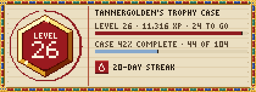</picture>
  <picture><source media="(prefers-color-scheme: dark)" srcset="assets/trophies/next-up.svg">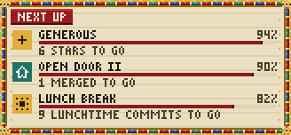</picture>

  <a href="https://github.com/tannergolden/markdown/blob/HEAD/docs/references/Catalogue.md#profile-commits"><picture><source media="(prefers-color-scheme: dark)" srcset="assets/trophies/commits.svg">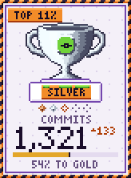</picture></a>
  <a href="https://github.com/tannergolden/markdown/blob/HEAD/docs/references/Catalogue.md#profile-repos"><picture><source media="(prefers-color-scheme: dark)" srcset="assets/trophies/repos.svg">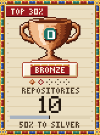</picture></a>
  <a href="https://github.com/tannergolden/markdown/blob/HEAD/docs/references/Catalogue.md#profile-streak"><picture><source media="(prefers-color-scheme: dark)" srcset="assets/trophies/streak.svg">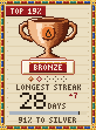</picture></a>
  <a href="https://github.com/tannergolden/markdown/blob/HEAD/docs/references/Catalogue.md#profile-followers"><picture><source media="(prefers-color-scheme: dark)" srcset="assets/trophies/followers.svg">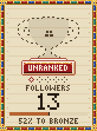</picture></a>
  <a href="https://github.com/tannergolden/markdown/blob/HEAD/docs/references/Catalogue.md#profile-pulls"><picture><source media="(prefers-color-scheme: dark)" srcset="assets/trophies/pulls.svg">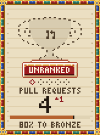</picture></a>

<b>Achievements</b> · 46 of 104 earned · next: Generous, 94%

<b>Milestones</b>

  <a href="https://github.com/tannergolden/markdown/blob/HEAD/docs/references/Catalogue.md#profile-shipwright"><picture><source media="(prefers-color-scheme: dark)" srcset="assets/trophies/achievements/shipwright.svg">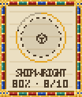</picture></a>
  <a href="https://github.com/tannergolden/markdown/blob/HEAD/docs/references/Catalogue.md#profile-century"><picture><source media="(prefers-color-scheme: dark)" srcset="assets/trophies/achievements/century.svg"></picture></a>
  <a href="https://github.com/tannergolden/markdown/blob/HEAD/docs/references/Catalogue.md#profile-landed"><picture><source media="(prefers-color-scheme: dark)" srcset="assets/trophies/achievements/landed.svg">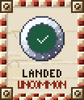</picture></a>
  <a href="https://github.com/tannergolden/markdown/blob/HEAD/docs/references/Catalogue.md#profile-polyglot"><picture><source media="(prefers-color-scheme: dark)" srcset="assets/trophies/achievements/polyglot.svg">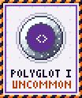</picture></a>
  <a href="https://github.com/tannergolden/markdown/blob/HEAD/docs/references/Catalogue.md#profile-shipped"><picture><source media="(prefers-color-scheme: dark)" srcset="assets/trophies/achievements/shipped.svg">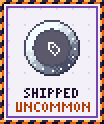</picture></a>
  <a href="https://github.com/tannergolden/markdown/blob/HEAD/docs/references/Catalogue.md#profile-first-light"><picture><source media="(prefers-color-scheme: dark)" srcset="assets/trophies/achievements/first-light.svg">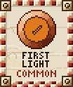</picture></a>
  <a href="https://github.com/tannergolden/markdown/blob/HEAD/docs/references/Catalogue.md#profile-hello-world"><picture><source media="(prefers-color-scheme: dark)" srcset="assets/trophies/achievements/hello-world.svg">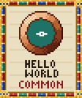</picture></a>
  <a href="https://github.com/tannergolden/markdown/blob/HEAD/docs/references/Catalogue.md#profile-opening-move"><picture><source media="(prefers-color-scheme: dark)" srcset="assets/trophies/achievements/opening-move.svg">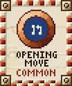</picture></a>
  <a href="https://github.com/tannergolden/markdown/blob/HEAD/docs/references/Catalogue.md#profile-veteran"><picture><source media="(prefers-color-scheme: dark)" srcset="assets/trophies/achievements/veteran.svg">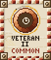</picture></a>
  <a href="https://github.com/tannergolden/markdown/blob/HEAD/docs/references/Catalogue.md#profile-branching-out"><picture><source media="(prefers-color-scheme: dark)" srcset="assets/trophies/achievements/branching-out.svg">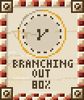</picture></a>
  <a href="https://github.com/tannergolden/markdown/blob/HEAD/docs/references/Catalogue.md#profile-monolith"><picture><source media="(prefers-color-scheme: dark)" srcset="assets/trophies/achievements/monolith.svg">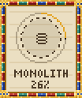</picture></a>
  <a href="https://github.com/tannergolden/markdown/blob/HEAD/docs/references/Catalogue.md#profile-closer"><picture><source media="(prefers-color-scheme: dark)" srcset="assets/trophies/achievements/closer.svg">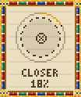</picture></a>
  <a href="https://github.com/tannergolden/markdown/blob/HEAD/docs/references/Catalogue.md#profile-bug-hunter"><picture><source media="(prefers-color-scheme: dark)" srcset="assets/trophies/achievements/bug-hunter.svg">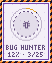</picture></a>
  <a href="https://github.com/tannergolden/markdown/blob/HEAD/docs/references/Catalogue.md#profile-merge-master"><picture><source media="(prefers-color-scheme: dark)" srcset="assets/trophies/achievements/merge-master.svg">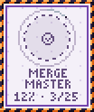</picture></a>
  <a href="https://github.com/tannergolden/markdown/blob/HEAD/docs/references/Catalogue.md#profile-stargazer"><picture><source media="(prefers-color-scheme: dark)" srcset="assets/trophies/achievements/stargazer.svg">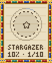</picture></a>
  <a href="https://github.com/tannergolden/markdown/blob/HEAD/docs/references/Catalogue.md#profile-fan-club"><picture><source media="(prefers-color-scheme: dark)" srcset="assets/trophies/achievements/fan-club.svg">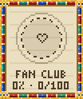</picture></a>
  <a href="https://github.com/tannergolden/markdown/blob/HEAD/docs/references/Catalogue.md#profile-forked"><picture><source media="(prefers-color-scheme: dark)" srcset="assets/trophies/achievements/forked.svg"></picture></a>
  <a href="https://github.com/tannergolden/markdown/blob/HEAD/docs/references/Catalogue.md#profile-long-haul"><picture><source media="(prefers-color-scheme: dark)" srcset="assets/trophies/achievements/long-haul.svg"></picture></a>
  <a href="https://github.com/tannergolden/markdown/blob/HEAD/docs/references/Catalogue.md#profile-second-opinion"><picture><source media="(prefers-color-scheme: dark)" srcset="assets/trophies/achievements/second-opinion.svg">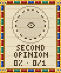</picture></a>
  <a href="https://github.com/tannergolden/markdown/blob/HEAD/docs/references/Catalogue.md#profile-ticket"><picture><source media="(prefers-color-scheme: dark)" srcset="assets/trophies/achievements/ticket.svg"></picture></a>
  <a href="https://github.com/tannergolden/markdown/blob/HEAD/docs/references/Catalogue.md#profile-watched"><picture><source media="(prefers-color-scheme: dark)" srcset="assets/trophies/achievements/watched.svg">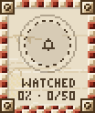</picture></a>

<b>Craft</b>

  <a href="https://github.com/tannergolden/markdown/blob/HEAD/docs/references/Catalogue.md#profile-by-the-book"><picture><source media="(prefers-color-scheme: dark)" srcset="assets/trophies/achievements/by-the-book.svg">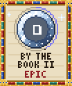</picture></a>
  <a href="https://github.com/tannergolden/markdown/blob/HEAD/docs/references/Catalogue.md#profile-duet"><picture><source media="(prefers-color-scheme: dark)" srcset="assets/trophies/achievements/duet.svg">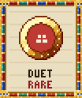</picture></a>
  <a href="https://github.com/tannergolden/markdown/blob/HEAD/docs/references/Catalogue.md#profile-green-machine"><picture><source media="(prefers-color-scheme: dark)" srcset="assets/trophies/achievements/green-machine.svg">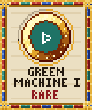</picture></a>
  <a href="https://github.com/tannergolden/markdown/blob/HEAD/docs/references/Catalogue.md#profile-scribe"><picture><source media="(prefers-color-scheme: dark)" srcset="assets/trophies/achievements/scribe.svg">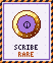</picture></a>
  <a href="https://github.com/tannergolden/markdown/blob/HEAD/docs/references/Catalogue.md#profile-signed"><picture><source media="(prefers-color-scheme: dark)" srcset="assets/trophies/achievements/signed.svg">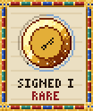</picture></a>
  <a href="https://github.com/tannergolden/markdown/blob/HEAD/docs/references/Catalogue.md#profile-tested"><picture><source media="(prefers-color-scheme: dark)" srcset="assets/trophies/achievements/tested.svg"></picture></a>
  <a href="https://github.com/tannergolden/markdown/blob/HEAD/docs/references/Catalogue.md#profile-fixer"><picture><source media="(prefers-color-scheme: dark)" srcset="assets/trophies/achievements/fixer.svg">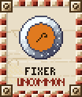</picture></a>
  <a href="https://github.com/tannergolden/markdown/blob/HEAD/docs/references/Catalogue.md#profile-surgeon"><picture><source media="(prefers-color-scheme: dark)" srcset="assets/trophies/achievements/surgeon.svg">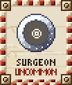</picture></a>
  <a href="https://github.com/tannergolden/markdown/blob/HEAD/docs/references/Catalogue.md#profile-sweeping-change"><picture><source media="(prefers-color-scheme: dark)" srcset="assets/trophies/achievements/sweeping-change.svg">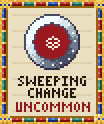</picture></a>
  <a href="https://github.com/tannergolden/markdown/blob/HEAD/docs/references/Catalogue.md#profile-heavy-lifter"><picture><source media="(prefers-color-scheme: dark)" srcset="assets/trophies/achievements/heavy-lifter.svg">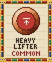</picture></a>
  <a href="https://github.com/tannergolden/markdown/blob/HEAD/docs/references/Catalogue.md#profile-well-maintained"><picture><source media="(prefers-color-scheme: dark)" srcset="assets/trophies/achievements/well-maintained.svg">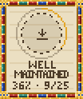</picture></a>
  <a href="https://github.com/tannergolden/markdown/blob/HEAD/docs/references/Catalogue.md#profile-gitmoji"><picture><source media="(prefers-color-scheme: dark)" srcset="assets/trophies/achievements/gitmoji.svg">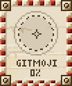</picture></a>
  <a href="https://github.com/tannergolden/markdown/blob/HEAD/docs/references/Catalogue.md#profile-toolsmith"><picture><source media="(prefers-color-scheme: dark)" srcset="assets/trophies/achievements/toolsmith.svg">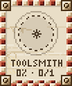</picture></a>
  <a href="https://github.com/tannergolden/markdown/blob/HEAD/docs/references/Catalogue.md#profile-undo"><picture><source media="(prefers-color-scheme: dark)" srcset="assets/trophies/achievements/undo.svg">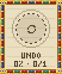</picture></a>

<b>Rhythm</b>

  <a href="https://github.com/tannergolden/markdown/blob/HEAD/docs/references/Catalogue.md#profile-marathon-day"><picture><source media="(prefers-color-scheme: dark)" srcset="assets/trophies/achievements/marathon-day.svg">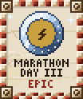</picture></a>
  <a href="https://github.com/tannergolden/markdown/blob/HEAD/docs/references/Catalogue.md#profile-early-bird"><picture><source media="(prefers-color-scheme: dark)" srcset="assets/trophies/achievements/early-bird.svg">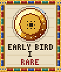</picture></a>
  <a href="https://github.com/tannergolden/markdown/blob/HEAD/docs/references/Catalogue.md#profile-sprint"><picture><source media="(prefers-color-scheme: dark)" srcset="assets/trophies/achievements/sprint.svg">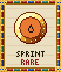</picture></a>
  <a href="https://github.com/tannergolden/markdown/blob/HEAD/docs/references/Catalogue.md#profile-big-week"><picture><source media="(prefers-color-scheme: dark)" srcset="assets/trophies/achievements/big-week.svg"></picture></a>
  <a href="https://github.com/tannergolden/markdown/blob/HEAD/docs/references/Catalogue.md#profile-night-owl"><picture><source media="(prefers-color-scheme: dark)" srcset="assets/trophies/achievements/night-owl.svg"></picture></a>
  <a href="https://github.com/tannergolden/markdown/blob/HEAD/docs/references/Catalogue.md#profile-comeback"><picture><source media="(prefers-color-scheme: dark)" srcset="assets/trophies/achievements/comeback.svg"></picture></a>
  <a href="https://github.com/tannergolden/markdown/blob/HEAD/docs/references/Catalogue.md#profile-lunch-break"><picture><source media="(prefers-color-scheme: dark)" srcset="assets/trophies/achievements/lunch-break.svg"></picture></a>
  <a href="https://github.com/tannergolden/markdown/blob/HEAD/docs/references/Catalogue.md#profile-long-game"><picture><source media="(prefers-color-scheme: dark)" srcset="assets/trophies/achievements/long-game.svg"></picture></a>
  <a href="https://github.com/tannergolden/markdown/blob/HEAD/docs/references/Catalogue.md#profile-weekender"><picture><source media="(prefers-color-scheme: dark)" srcset="assets/trophies/achievements/weekender.svg"></picture></a>
  <a href="https://github.com/tannergolden/markdown/blob/HEAD/docs/references/Catalogue.md#profile-year-of-code"><picture><source media="(prefers-color-scheme: dark)" srcset="assets/trophies/achievements/year-of-code.svg"></picture></a>
  <a href="https://github.com/tannergolden/markdown/blob/HEAD/docs/references/Catalogue.md#profile-weekday-warrior"><picture><source media="(prefers-color-scheme: dark)" srcset="assets/trophies/achievements/weekday-warrior.svg"></picture></a>
  <a href="https://github.com/tannergolden/markdown/blob/HEAD/docs/references/Catalogue.md#profile-four-seasons"><picture><source media="(prefers-color-scheme: dark)" srcset="assets/trophies/achievements/four-seasons.svg"></picture></a>
  <a href="https://github.com/tannergolden/markdown/blob/HEAD/docs/references/Catalogue.md#profile-friday-deploy"><picture><source media="(prefers-color-scheme: dark)" srcset="assets/trophies/achievements/friday-deploy.svg"></picture></a>
  <a href="https://github.com/tannergolden/markdown/blob/HEAD/docs/references/Catalogue.md#profile-perfect-month"><picture><source media="(prefers-color-scheme: dark)" srcset="assets/trophies/achievements/perfect-month.svg"></picture></a>

<b>Community</b>

  <a href="https://github.com/tannergolden/markdown/blob/HEAD/docs/references/Catalogue.md#profile-introduced"><picture><source media="(prefers-color-scheme: dark)" srcset="assets/trophies/achievements/introduced.svg"></picture></a>
  <a href="https://github.com/tannergolden/markdown/blob/HEAD/docs/references/Catalogue.md#profile-open-door"><picture><source media="(prefers-color-scheme: dark)" srcset="assets/trophies/achievements/open-door.svg"></picture></a>
  <a href="https://github.com/tannergolden/markdown/blob/HEAD/docs/references/Catalogue.md#profile-generous"><picture><source media="(prefers-color-scheme: dark)" srcset="assets/trophies/achievements/generous.svg"></picture></a>
  <a href="https://github.com/tannergolden/markdown/blob/HEAD/docs/references/Catalogue.md#profile-answer-key"><picture><source media="(prefers-color-scheme: dark)" srcset="assets/trophies/achievements/answer-key.svg"></picture></a>
  <a href="https://github.com/tannergolden/markdown/blob/HEAD/docs/references/Catalogue.md#profile-backed"><picture><source media="(prefers-color-scheme: dark)" srcset="assets/trophies/achievements/backed.svg"></picture></a>
  <a href="https://github.com/tannergolden/markdown/blob/HEAD/docs/references/Catalogue.md#profile-conversation-starter"><picture><source media="(prefers-color-scheme: dark)" srcset="assets/trophies/achievements/conversation-starter.svg"></picture></a>
  <a href="https://github.com/tannergolden/markdown/blob/HEAD/docs/references/Catalogue.md#profile-crew"><picture><source media="(prefers-color-scheme: dark)" srcset="assets/trophies/achievements/crew.svg"></picture></a>
  <a href="https://github.com/tannergolden/markdown/blob/HEAD/docs/references/Catalogue.md#profile-curious"><picture><source media="(prefers-color-scheme: dark)" srcset="assets/trophies/achievements/curious.svg"></picture></a>
  <a href="https://github.com/tannergolden/markdown/blob/HEAD/docs/references/Catalogue.md#profile-founder"><picture><source media="(prefers-color-scheme: dark)" srcset="assets/trophies/achievements/founder.svg"></picture></a>
  <a href="https://github.com/tannergolden/markdown/blob/HEAD/docs/references/Catalogue.md#profile-gist-keeper"><picture><source media="(prefers-color-scheme: dark)" srcset="assets/trophies/achievements/gist-keeper.svg"></picture></a>
  <a href="https://github.com/tannergolden/markdown/blob/HEAD/docs/references/Catalogue.md#profile-green-light"><picture><source media="(prefers-color-scheme: dark)" srcset="assets/trophies/achievements/green-light.svg"></picture></a>
  <a href="https://github.com/tannergolden/markdown/blob/HEAD/docs/references/Catalogue.md#profile-patron"><picture><source media="(prefers-color-scheme: dark)" srcset="assets/trophies/achievements/patron.svg"></picture></a>
  <a href="https://github.com/tannergolden/markdown/blob/HEAD/docs/references/Catalogue.md#profile-planner"><picture><source media="(prefers-color-scheme: dark)" srcset="assets/trophies/achievements/planner.svg"></picture></a>
  <a href="https://github.com/tannergolden/markdown/blob/HEAD/docs/references/Catalogue.md#profile-red-pen"><picture><source media="(prefers-color-scheme: dark)" srcset="assets/trophies/achievements/red-pen.svg"></picture></a>
  <a href="https://github.com/tannergolden/markdown/blob/HEAD/docs/references/Catalogue.md#profile-registry"><picture><source media="(prefers-color-scheme: dark)" srcset="assets/trophies/achievements/registry.svg"></picture></a>
  <a href="https://github.com/tannergolden/markdown/blob/HEAD/docs/references/Catalogue.md#profile-reporter"><picture><source media="(prefers-color-scheme: dark)" srcset="assets/trophies/achievements/reporter.svg"></picture></a>
  <a href="https://github.com/tannergolden/markdown/blob/HEAD/docs/references/Catalogue.md#profile-roundtable"><picture><source media="(prefers-color-scheme: dark)" srcset="assets/trophies/achievements/roundtable.svg"></picture></a>
  <a href="https://github.com/tannergolden/markdown/blob/HEAD/docs/references/Catalogue.md#profile-second-pair-of-eyes"><picture><source media="(prefers-color-scheme: dark)" srcset="assets/trophies/achievements/second-pair-of-eyes.svg"></picture></a>
  <a href="https://github.com/tannergolden/markdown/blob/HEAD/docs/references/Catalogue.md#profile-team-player"><picture><source media="(prefers-color-scheme: dark)" srcset="assets/trophies/achievements/team-player.svg"></picture></a>
  <a href="https://github.com/tannergolden/markdown/blob/HEAD/docs/references/Catalogue.md#profile-upstream"><picture><source media="(prefers-color-scheme: dark)" srcset="assets/trophies/achievements/upstream.svg"></picture></a>
  <a href="https://github.com/tannergolden/markdown/blob/HEAD/docs/references/Catalogue.md#profile-voice"><picture><source media="(prefers-color-scheme: dark)" srcset="assets/trophies/achievements/voice.svg"></picture></a>

<b>Housekeeping</b>

  <a href="https://github.com/tannergolden/markdown/blob/HEAD/docs/references/Catalogue.md#profile-gatekeeper"><picture><source media="(prefers-color-scheme: dark)" srcset="assets/trophies/achievements/gatekeeper.svg"></picture></a>
  <a href="https://github.com/tannergolden/markdown/blob/HEAD/docs/references/Catalogue.md#profile-locksmith"><picture><source media="(prefers-color-scheme: dark)" srcset="assets/trophies/achievements/locksmith.svg"></picture></a>
  <a href="https://github.com/tannergolden/markdown/blob/HEAD/docs/references/Catalogue.md#profile-auto-pilot"><picture><source media="(prefers-color-scheme: dark)" srcset="assets/trophies/achievements/auto-pilot.svg"></picture></a>
  <a href="https://github.com/tannergolden/markdown/blob/HEAD/docs/references/Catalogue.md#profile-blueprint"><picture><source media="(prefers-color-scheme: dark)" srcset="assets/trophies/achievements/blueprint.svg"></picture></a>
  <a href="https://github.com/tannergolden/markdown/blob/HEAD/docs/references/Catalogue.md#profile-form-filler"><picture><source media="(prefers-color-scheme: dark)" srcset="assets/trophies/achievements/form-filler.svg"></picture></a>
  <a href="https://github.com/tannergolden/markdown/blob/HEAD/docs/references/Catalogue.md#profile-house-rules"><picture><source media="(prefers-color-scheme: dark)" srcset="assets/trophies/achievements/house-rules.svg"></picture></a>
  <a href="https://github.com/tannergolden/markdown/blob/HEAD/docs/references/Catalogue.md#profile-label-maker"><picture><source media="(prefers-color-scheme: dark)" srcset="assets/trophies/achievements/label-maker.svg"></picture></a>
  <a href="https://github.com/tannergolden/markdown/blob/HEAD/docs/references/Catalogue.md#profile-packager"><picture><source media="(prefers-color-scheme: dark)" srcset="assets/trophies/achievements/packager.svg"></picture></a>
  <a href="https://github.com/tannergolden/markdown/blob/HEAD/docs/references/Catalogue.md#profile-semver"><picture><source media="(prefers-color-scheme: dark)" srcset="assets/trophies/achievements/semver.svg"></picture></a>
  <a href="https://github.com/tannergolden/markdown/blob/HEAD/docs/references/Catalogue.md#profile-town-hall"><picture><source media="(prefers-color-scheme: dark)" srcset="assets/trophies/achievements/town-hall.svg"></picture></a>
  <a href="https://github.com/tannergolden/markdown/blob/HEAD/docs/references/Catalogue.md#profile-welcome-mat"><picture><source media="(prefers-color-scheme: dark)" srcset="assets/trophies/achievements/welcome-mat.svg"></picture></a>
  <a href="https://github.com/tannergolden/markdown/blob/HEAD/docs/references/Catalogue.md#profile-curator"><picture><source media="(prefers-color-scheme: dark)" srcset="assets/trophies/achievements/curator.svg"></picture></a>
  <a href="https://github.com/tannergolden/markdown/blob/HEAD/docs/references/Catalogue.md#profile-documented"><picture><source media="(prefers-color-scheme: dark)" srcset="assets/trophies/achievements/documented.svg"></picture></a>
  <a href="https://github.com/tannergolden/markdown/blob/HEAD/docs/references/Catalogue.md#profile-licensed"><picture><source media="(prefers-color-scheme: dark)" srcset="assets/trophies/achievements/licensed.svg"></picture></a>
  <a href="https://github.com/tannergolden/markdown/blob/HEAD/docs/references/Catalogue.md#profile-front-door"><picture><source media="(prefers-color-scheme: dark)" srcset="assets/trophies/achievements/front-door.svg"></picture></a>
  <a href="https://github.com/tannergolden/markdown/blob/HEAD/docs/references/Catalogue.md#profile-open-hand"><picture><source media="(prefers-color-scheme: dark)" srcset="assets/trophies/achievements/open-hand.svg"></picture></a>
  <a href="https://github.com/tannergolden/markdown/blob/HEAD/docs/references/Catalogue.md#profile-roadmap"><picture><source media="(prefers-color-scheme: dark)" srcset="assets/trophies/achievements/roadmap.svg"></picture></a>
  <a href="https://github.com/tannergolden/markdown/blob/HEAD/docs/references/Catalogue.md#profile-tidy"><picture><source media="(prefers-color-scheme: dark)" srcset="assets/trophies/achievements/tidy.svg"></picture></a>

<b>Secret</b>

  <a href="https://github.com/tannergolden/markdown/blob/HEAD/docs/references/Catalogue.md#profile-ghost"><picture><source media="(prefers-color-scheme: dark)" srcset="assets/trophies/achievements/ghost.svg"></picture></a>
  <a href="https://github.com/tannergolden/markdown/blob/HEAD/docs/references/Catalogue.md#profile-constellation"><picture><source media="(prefers-color-scheme: dark)" srcset="assets/trophies/achievements/constellation.svg"></picture></a>
  <a href="https://github.com/tannergolden/markdown/blob/HEAD/docs/references/Catalogue.md#profile-friday-the-13th"><picture><source media="(prefers-color-scheme: dark)" srcset="assets/trophies/achievements/friday-the-13th.svg"></picture></a>
  <a href="https://github.com/tannergolden/markdown/blob/HEAD/docs/references/Catalogue.md#profile-full-house"><picture><source media="(prefers-color-scheme: dark)" srcset="assets/trophies/achievements/full-house.svg"></picture></a>
  <a href="https://github.com/tannergolden/markdown/blob/HEAD/docs/references/Catalogue.md#profile-green-wall"><picture><source media="(prefers-color-scheme: dark)" srcset="assets/trophies/achievements/green-wall.svg"></picture></a>
  <a href="https://github.com/tannergolden/markdown/blob/HEAD/docs/references/Catalogue.md#profile-homecoming"><picture><source media="(prefers-color-scheme: dark)" srcset="assets/trophies/achievements/homecoming.svg"></picture></a>
  <a href="https://github.com/tannergolden/markdown/blob/HEAD/docs/references/Catalogue.md#profile-inbox-zero"><picture><source media="(prefers-color-scheme: dark)" srcset="assets/trophies/achievements/inbox-zero.svg"></picture></a>
  <a href="https://github.com/tannergolden/markdown/blob/HEAD/docs/references/Catalogue.md#profile-leap-day"><picture><source media="(prefers-color-scheme: dark)" srcset="assets/trophies/achievements/leap-day.svg"></picture></a>
  <a href="https://github.com/tannergolden/markdown/blob/HEAD/docs/references/Catalogue.md#profile-midnight-oil"><picture><source media="(prefers-color-scheme: dark)" srcset="assets/trophies/achievements/midnight-oil.svg"></picture></a>
  <a href="https://github.com/tannergolden/markdown/blob/HEAD/docs/references/Catalogue.md#profile-new-year"><picture><source media="(prefers-color-scheme: dark)" srcset="assets/trophies/achievements/new-year.svg"></picture></a>
  <a href="https://github.com/tannergolden/markdown/blob/HEAD/docs/references/Catalogue.md#profile-round-number"><picture><source media="(prefers-color-scheme: dark)" srcset="assets/trophies/achievements/round-number.svg"></picture></a>
  <a href="https://github.com/tannergolden/markdown/blob/HEAD/docs/references/Catalogue.md#profile-the-answer"><picture><source media="(prefers-color-scheme: dark)" srcset="assets/trophies/achievements/the-answer.svg"></picture></a>

<b>Maker</b>

  <a href="https://github.com/tannergolden/markdown/blob/HEAD/docs/references/Catalogue.md#profile-badge-maker"><picture><source media="(prefers-color-scheme: dark)" srcset="assets/trophies/achievements/badge-maker.svg"></picture></a>
  <a href="https://github.com/tannergolden/markdown/blob/HEAD/docs/references/Catalogue.md#profile-pathfinder"><picture><source media="(prefers-color-scheme: dark)" srcset="assets/trophies/achievements/pathfinder.svg"></picture></a>
  <a href="https://github.com/tannergolden/markdown/blob/HEAD/docs/references/Catalogue.md#profile-standard-bearer"><picture><source media="(prefers-color-scheme: dark)" srcset="assets/trophies/achievements/standard-bearer.svg"></picture></a>
  <a href="https://github.com/tannergolden/markdown/blob/HEAD/docs/references/Catalogue.md#profile-trophy-maker"><picture><source media="(prefers-color-scheme: dark)" srcset="assets/trophies/achievements/trophy-maker.svg"></picture></a>

Refreshed daily by <a href="https://github.com/tannergolden/markdown">tannergolden/markdown</a> · Every trophy and achievement, what it is for and how to earn it: <a href="https://github.com/tannergolden/markdown/blob/HEAD/docs/references/Catalogue.md#profile">the catalogue</a>. Click any card for its entry.

<!-- markdown:trophies:end -->

---

## 📦 Latest Releases

The two repositories on this account that shipped most recently, each with its
version, the day it went out and the major tag a stub pins to follow it.
Superseded releases are pruned, so each one shown is its repository's current
release. Redrawn every Wednesday.

<!-- markdown:element:release-1:start -->
<a href="https://github.com/tannergolden/standards/releases/latest">
<picture>
  <source media="(prefers-color-scheme: dark)" srcset="assets/elements/release-1-dark.svg">
  
</picture>
</a>
<!-- markdown:element:release-1:end -->
<!-- markdown:element:release-2:start -->
<a href="https://github.com/tannergolden/environment/releases/latest">
<picture>
  <source media="(prefers-color-scheme: dark)" srcset="assets/elements/release-2-dark.svg">
  
</picture>
</a>
<!-- markdown:element:release-2:end -->

---

## 📝 Field Notes

<!-- notes:start -->

> [!NOTE]
> **GitHub changelog · 2 Nov.** [pull\_request\_target blocked by default December 2](https://github.blog/changelog/2026-11-02-pull_request_target-blocked-by-default-december-2)

> [!TIP]
> **Beginner · Linux.** Identify an unknown file with `file name`; it looks at the contents rather than the extension and reports things like PNG image or ASCII text.

> [!IMPORTANT]
> **End of life · [Angular 20](https://endoflife.date/angular).** Angular 20 stops getting security fixes on 28 November 2026. Move to 22, the newest release.

> [!WARNING]
> **Advisory · [GHSA-8494-f6mr-cjpv](https://github.com/advisories/GHSA-8494-f6mr-cjpv) · npm.** `@hapi/content` (\<= 6.0.2): @hapi/content: quadratic-time parsing of Content-Disposition parameters allows denial of service. Update to `6.0.3` or later.

> [!CAUTION]
> **Professional · Supply chain.** Building release artifacts on a developer machine lets anything on it, from a malicious extension to a compromised package, slip into what you ship. Build releases in CI from a tagged commit and publish provenance for them.

Redrawn every Monday, at random, from 5,000 curated notes and five open data sources. Week 45 of 2026. Open data this week: GitHub changelog, endoflife.date, GitHub Advisory Database (CC BY 4.0).

<!-- notes:end -->

---

## 🌿 Good First Issue

<!-- markdown:element:issue-1:start -->
<a href="https://github.com/langgenius/dify/issues/45584">
<picture>
  <source media="(prefers-color-scheme: dark)" srcset="assets/elements/issue-1-dark.svg">
  
</picture>
</a>
<!-- markdown:element:issue-1:end -->
<!-- markdown:element:issue-2:start -->
<a href="https://github.com/rtk-ai/rtk/issues/5030">
<picture>
  <source media="(prefers-color-scheme: dark)" srcset="assets/elements/issue-2-dark.svg">
  
</picture>
</a>
<!-- markdown:element:issue-2:end -->

The newest good first issue from each of the two most-starred projects that opened one lately, still open and unclaimed. Redrawn every Friday.

---

<!-- markdown:footer:start -->

<a href="#top">
<picture>
  <source media="(max-width: 585px) and (prefers-color-scheme: dark)" srcset="assets/banners/footer-narrow-dark.svg">
  <source media="(max-width: 585px)" srcset="assets/banners/footer-narrow-day.svg">
  <source media="(prefers-color-scheme: dark)" srcset="assets/banners/footer-dark.svg">
  
</picture>
</a>

<a href="https://github.com/tannergolden?tab=repositories"><picture><source media="(prefers-color-scheme: dark)" srcset="assets/banners/link-repositories-dark.svg"></picture></a>
<a href="https://github.com/tannergolden/standards"><picture><source media="(prefers-color-scheme: dark)" srcset="assets/banners/link-standards-dark.svg"></picture></a>
<a href="https://github.com/tannergolden/path"><picture><source media="(prefers-color-scheme: dark)" srcset="assets/banners/link-golden-path-dark.svg"></picture></a>
<a href="https://github.com/tannergolden/markdown"><picture><source media="(prefers-color-scheme: dark)" srcset="assets/banners/link-markdown-dark.svg"></picture></a>

<!-- markdown:footer:end -->
