<!--
title: '👋 TANNER GOLDEN'
description: 'The GitHub profile of Tanner Golden: who I am, the case my work has earned, and where to find me, all drawn by GitHub Actions.'
tags: [github-profile, readme, automation, github-actions]
category: docs
-->

<!-- markdown:header:start -->
<!-- markdownlint-disable MD041 -->

<picture>
  <source media="(max-width: 585px) and (prefers-color-scheme: dark)" srcset="assets/banners/header-narrow-dark.svg">
  <source media="(max-width: 585px)" srcset="assets/banners/header-narrow-day.svg">
  <source media="(prefers-reduced-motion: reduce) and (prefers-color-scheme: dark)" srcset="assets/banners/header-still-dark.svg">
  <source media="(prefers-reduced-motion: reduce)" srcset="assets/banners/header-still-day.svg">
  <source media="(prefers-color-scheme: dark)" srcset="assets/banners/header-dark.svg">
  
</picture>

<!-- markdown:header:end -->

<!-- markdown:badges:start -->

<a href="./"><picture><source media="(prefers-color-scheme: dark)" srcset="assets/badges/static/status-dark.svg"></picture></a>
<a href="./"><picture><source media="(prefers-color-scheme: dark)" srcset="assets/badges/static/role-dark.svg"></picture></a>
<a href="./"><picture><source media="(prefers-color-scheme: dark)" srcset="assets/badges/static/context-dark.svg"></picture></a>
<a href="./LICENSE"><picture><source media="(prefers-color-scheme: dark)" srcset="assets/badges/static/license-dark.svg"></picture></a>

<!-- markdown:badges:end -->

---

## 💡 About Me

I'm a software engineer building infrastructure for AI research. My focus is
the layer under the experiments: environments that rebuild the same way every
time, dependencies that are pinned and scanned, and CI that fails for the
right reasons, so a result can be trusted and repeated.

Most of my public work is one connected system.
[`standards`](https://github.com/tannergolden/standards) holds the engineering
rules and the reusable workflows that enforce them, called by link so a fix
lands once and reaches every repository.
[`path`](https://github.com/tannergolden/path) is the template new
repositories start from, and
[`markdown`](https://github.com/tannergolden/markdown) draws READMEs like this
one from data measured on a schedule.

- **Working on:** reproducible environments, supply-chain hygiene (pinned
  dependencies, secret scanning, CodeQL and SBOMs), and CI that fails for the
  right reasons.
- **Building with:** Python (standard library first), GitHub Actions, Bash and
  Make, plus dev containers and Codespaces so a Mac and a fresh container start
  from the same shell.
- **How I work:** standards a machine enforces, small reviewable changes,
  Conventional Commits, and signed commits on protected branches.
- **Ask me about:** reusable workflows, dependency pinning, release automation,
  and automating the chores nobody should do by hand.

---

## 🎲 Play Against Me

Four games, each on its own board, and in every one I play one side while you
play the other with everyone else on GitHub. I always play White in Chess,
Checkers and Connect Four, and X in Tic-Tac-Toe. I open every game of Chess. In
Checkers, Black moves first, so GitHub opens. In Connect Four and Tic-Tac-Toe,
the Arbiter opens every game for a side drawn at random, with a random first
move.

Pick a move under a board, and its link opens a ready-made issue in
[`play`](https://github.com/tannergolden/play): submit it as it opens. The
first move to reach the game is the one played. The Official Arbiter rules on
it, answers on your issue, and redraws the board within a few minutes. Chess is
open below, and the other three open with a click.

One clock keeps all four, on the hour. A side that goes a week without moving
gets a random legal move from the Arbiter, and a finished game's winning board
stays up for two days before a fresh board comes by itself. A win counts only
for the player who makes the winning move: the checkmate in Chess, the move
that leaves the other side no move in Checkers, the fourth disc in a row in
Connect Four, or the third mark in a row in Tic-Tac-Toe. A move the Arbiter
plays counts for nobody, and a draw is nobody's win. Every win earns its player
a place in the Hall of Fame below.

<!-- markdown:element:chess:start -->

<b>♟️ Chess</b>

<picture>
  <source media="(max-width: 585px) and (prefers-reduced-motion: reduce) and (prefers-color-scheme: dark)" srcset="assets/elements/chess-narrow-still-dark.svg">
  <source media="(max-width: 585px) and (prefers-reduced-motion: reduce)" srcset="assets/elements/chess-narrow-still-day.svg">
  <source media="(max-width: 585px) and (prefers-color-scheme: dark)" srcset="assets/elements/chess-narrow-dark.svg">
  <source media="(max-width: 585px)" srcset="assets/elements/chess-narrow-day.svg">
  <source media="(prefers-reduced-motion: reduce) and (prefers-color-scheme: dark)" srcset="assets/elements/chess-still-dark.svg">
  <source media="(prefers-reduced-motion: reduce)" srcset="assets/elements/chess-still-day.svg">
  <source media="(prefers-color-scheme: dark)" srcset="assets/elements/chess-dark.svg">
  
</picture>

♔ <b>@tannergolden's Turn</b> · 20 legal moves · only @tannergolden can play these

♘ Knights · 4 moves

|  | Move | In words | Play |
| :-: | :--- | :--- | :-: |
| 🐴 | **Bring Out the Queen's Knight to a3!** `Na3` | Knight from b1 to a3 | [Play ↗](https://github.com/tannergolden/play/issues/new?template=move.yml&title=chess%3A%20b1a3%20%C2%B7%20game%201%20%C2%B7%20move%201) |
| 🐴 | **Bring Out the Queen's Knight to c3!** `Nc3` | Knight from b1 to c3 | [Play ↗](https://github.com/tannergolden/play/issues/new?template=move.yml&title=chess%3A%20b1c3%20%C2%B7%20game%201%20%C2%B7%20move%201) |
| 🐴 | **Bring Out the King's Knight to f3!** `Nf3` | Knight from g1 to f3 | [Play ↗](https://github.com/tannergolden/play/issues/new?template=move.yml&title=chess%3A%20g1f3%20%C2%B7%20game%201%20%C2%B7%20move%201) |
| 🐴 | **Bring Out the King's Knight to h3!** `Nh3` | Knight from g1 to h3 | [Play ↗](https://github.com/tannergolden/play/issues/new?template=move.yml&title=chess%3A%20g1h3%20%C2%B7%20game%201%20%C2%B7%20move%201) |

♙ Pawns · 16 moves

|  | Move | In words | Play |
| :-: | :--- | :--- | :-: |
| ♟️ | **March the a-Pawn Two Squares!** `a4` | Pawn from a2 to a4, two squares | [Play ↗](https://github.com/tannergolden/play/issues/new?template=move.yml&title=chess%3A%20a2a4%20%C2%B7%20game%201%20%C2%B7%20move%201) |
| ♟️ | **Push the a-Pawn to a3!** `a3` | Pawn from a2 to a3 | [Play ↗](https://github.com/tannergolden/play/issues/new?template=move.yml&title=chess%3A%20a2a3%20%C2%B7%20game%201%20%C2%B7%20move%201) |
| ♟️ | **March the b-Pawn Two Squares!** `b4` | Pawn from b2 to b4, two squares | [Play ↗](https://github.com/tannergolden/play/issues/new?template=move.yml&title=chess%3A%20b2b4%20%C2%B7%20game%201%20%C2%B7%20move%201) |
| ♟️ | **Push the b-Pawn to b3!** `b3` | Pawn from b2 to b3 | [Play ↗](https://github.com/tannergolden/play/issues/new?template=move.yml&title=chess%3A%20b2b3%20%C2%B7%20game%201%20%C2%B7%20move%201) |
| ♟️ | **March the c-Pawn Two Squares!** `c4` | Pawn from c2 to c4, two squares | [Play ↗](https://github.com/tannergolden/play/issues/new?template=move.yml&title=chess%3A%20c2c4%20%C2%B7%20game%201%20%C2%B7%20move%201) |
| ♟️ | **Push the c-Pawn to c3!** `c3` | Pawn from c2 to c3 | [Play ↗](https://github.com/tannergolden/play/issues/new?template=move.yml&title=chess%3A%20c2c3%20%C2%B7%20game%201%20%C2%B7%20move%201) |
| ♟️ | **March the d-Pawn Two Squares!** `d4` | Pawn from d2 to d4, two squares | [Play ↗](https://github.com/tannergolden/play/issues/new?template=move.yml&title=chess%3A%20d2d4%20%C2%B7%20game%201%20%C2%B7%20move%201) |
| ♟️ | **Push the d-Pawn to d3!** `d3` | Pawn from d2 to d3 | [Play ↗](https://github.com/tannergolden/play/issues/new?template=move.yml&title=chess%3A%20d2d3%20%C2%B7%20game%201%20%C2%B7%20move%201) |
| ♟️ | **March the e-Pawn Two Squares!** `e4` | Pawn from e2 to e4, two squares | [Play ↗](https://github.com/tannergolden/play/issues/new?template=move.yml&title=chess%3A%20e2e4%20%C2%B7%20game%201%20%C2%B7%20move%201) |
| ♟️ | **Push the e-Pawn to e3!** `e3` | Pawn from e2 to e3 | [Play ↗](https://github.com/tannergolden/play/issues/new?template=move.yml&title=chess%3A%20e2e3%20%C2%B7%20game%201%20%C2%B7%20move%201) |
| ♟️ | **March the f-Pawn Two Squares!** `f4` | Pawn from f2 to f4, two squares | [Play ↗](https://github.com/tannergolden/play/issues/new?template=move.yml&title=chess%3A%20f2f4%20%C2%B7%20game%201%20%C2%B7%20move%201) |
| ♟️ | **Push the f-Pawn to f3!** `f3` | Pawn from f2 to f3 | [Play ↗](https://github.com/tannergolden/play/issues/new?template=move.yml&title=chess%3A%20f2f3%20%C2%B7%20game%201%20%C2%B7%20move%201) |
| ♟️ | **March the g-Pawn Two Squares!** `g4` | Pawn from g2 to g4, two squares | [Play ↗](https://github.com/tannergolden/play/issues/new?template=move.yml&title=chess%3A%20g2g4%20%C2%B7%20game%201%20%C2%B7%20move%201) |
| ♟️ | **Push the g-Pawn to g3!** `g3` | Pawn from g2 to g3 | [Play ↗](https://github.com/tannergolden/play/issues/new?template=move.yml&title=chess%3A%20g2g3%20%C2%B7%20game%201%20%C2%B7%20move%201) |
| ♟️ | **March the h-Pawn Two Squares!** `h4` | Pawn from h2 to h4, two squares | [Play ↗](https://github.com/tannergolden/play/issues/new?template=move.yml&title=chess%3A%20h2h4%20%C2%B7%20game%201%20%C2%B7%20move%201) |
| ♟️ | **Push the h-Pawn to h3!** `h3` | Pawn from h2 to h3 | [Play ↗](https://github.com/tannergolden/play/issues/new?template=move.yml&title=chess%3A%20h2h3%20%C2%B7%20game%201%20%C2%B7%20move%201) |

Only @tannergolden can play on this turn: a pick from anyone else is turned away with a comment on its issue. A side that goes a week without moving gets a random legal move from the Arbiter.

<!-- markdown:element:chess:end -->

<!-- markdown:element:checkers:start -->

<b>🏁 Checkers</b>

<picture>
  <source media="(max-width: 585px) and (prefers-reduced-motion: reduce) and (prefers-color-scheme: dark)" srcset="assets/elements/checkers-narrow-still-dark.svg">
  <source media="(max-width: 585px) and (prefers-reduced-motion: reduce)" srcset="assets/elements/checkers-narrow-still-day.svg">
  <source media="(max-width: 585px) and (prefers-color-scheme: dark)" srcset="assets/elements/checkers-narrow-dark.svg">
  <source media="(max-width: 585px)" srcset="assets/elements/checkers-narrow-day.svg">
  <source media="(prefers-reduced-motion: reduce) and (prefers-color-scheme: dark)" srcset="assets/elements/checkers-still-dark.svg">
  <source media="(prefers-reduced-motion: reduce)" srcset="assets/elements/checkers-still-day.svg">
  <source media="(prefers-color-scheme: dark)" srcset="assets/elements/checkers-dark.svg">
  
</picture>

⛂ <b>GitHub's Turn</b> · 7 legal moves · open to choose one

|  | Move | In words | Play |
| :-: | :--- | :--- | :-: |
| 👣 | **Push the Man From 9 to 13!** `9-13` | Man from 9 to 13 | [Play ↗](https://github.com/tannergolden/play/issues/new?template=move.yml&title=checkers%3A%209-13%20%C2%B7%20game%201%20%C2%B7%20move%201) |
| 👣 | **Push the Man From 9 to 14!** `9-14` | Man from 9 to 14 | [Play ↗](https://github.com/tannergolden/play/issues/new?template=move.yml&title=checkers%3A%209-14%20%C2%B7%20game%201%20%C2%B7%20move%201) |
| 👣 | **Push the Man From 10 to 14!** `10-14` | Man from 10 to 14 | [Play ↗](https://github.com/tannergolden/play/issues/new?template=move.yml&title=checkers%3A%2010-14%20%C2%B7%20game%201%20%C2%B7%20move%201) |
| 👣 | **Push the Man From 10 to 15!** `10-15` | Man from 10 to 15 | [Play ↗](https://github.com/tannergolden/play/issues/new?template=move.yml&title=checkers%3A%2010-15%20%C2%B7%20game%201%20%C2%B7%20move%201) |
| 👣 | **Push the Man From 11 to 15!** `11-15` | Man from 11 to 15 | [Play ↗](https://github.com/tannergolden/play/issues/new?template=move.yml&title=checkers%3A%2011-15%20%C2%B7%20game%201%20%C2%B7%20move%201) |
| 👣 | **Push the Man From 11 to 16!** `11-16` | Man from 11 to 16 | [Play ↗](https://github.com/tannergolden/play/issues/new?template=move.yml&title=checkers%3A%2011-16%20%C2%B7%20game%201%20%C2%B7%20move%201) |
| 👣 | **Push the Man From 12 to 16!** `12-16` | Man from 12 to 16 | [Play ↗](https://github.com/tannergolden/play/issues/new?template=move.yml&title=checkers%3A%2012-16%20%C2%B7%20game%201%20%C2%B7%20move%201) |

GitHub plays Black, which moves first in American checkers, so GitHub opens every game, and @tannergolden plays White. Anyone but @tannergolden can play on this turn, and the first pick in is played. The move is due by 19 Oct, 06:10 EST, or the Arbiter plays a random legal move. A jump must be taken whenever there is one, and a man that reaches the far row is crowned.

<!-- markdown:element:checkers:end -->

<!-- markdown:element:connectfour:start -->

<b>⚫ Connect Four</b>

<picture>
  <source media="(max-width: 585px) and (prefers-reduced-motion: reduce) and (prefers-color-scheme: dark)" srcset="assets/elements/connectfour-narrow-still-dark.svg">
  <source media="(max-width: 585px) and (prefers-reduced-motion: reduce)" srcset="assets/elements/connectfour-narrow-still-day.svg">
  <source media="(max-width: 585px) and (prefers-color-scheme: dark)" srcset="assets/elements/connectfour-narrow-dark.svg">
  <source media="(max-width: 585px)" srcset="assets/elements/connectfour-narrow-day.svg">
  <source media="(prefers-reduced-motion: reduce) and (prefers-color-scheme: dark)" srcset="assets/elements/connectfour-still-dark.svg">
  <source media="(prefers-reduced-motion: reduce)" srcset="assets/elements/connectfour-still-day.svg">
  <source media="(prefers-color-scheme: dark)" srcset="assets/elements/connectfour-dark.svg">
  
</picture>

⚫ <b>GitHub's Turn</b> · 7 open columns · open to choose one

|  | Move | In words | Play |
| :-: | :--- | :--- | :-: |
| ⬅️ | **Lay the First Disc on the Left Edge!** `1` | A black disc down column 1, to row 1 | [Play ↗](https://github.com/tannergolden/play/issues/new?template=move.yml&title=connectfour%3A%201%20%C2%B7%20game%201%20%C2%B7%20move%202) |
| ⬇️ | **Send Black to the Floor in Column 2!** `2` | A black disc down column 2, to row 1 | [Play ↗](https://github.com/tannergolden/play/issues/new?template=move.yml&title=connectfour%3A%202%20%C2%B7%20game%201%20%C2%B7%20move%202) |
| ⬇️ | **Drop Black Down Column 3!** `3` | A black disc down column 3, to row 1 | [Play ↗](https://github.com/tannergolden/play/issues/new?template=move.yml&title=connectfour%3A%203%20%C2%B7%20game%201%20%C2%B7%20move%202) |
| ⬇️ | **Send Black to the Floor in the Centre Column!** `4` | A black disc down column 4, to row 1 | [Play ↗](https://github.com/tannergolden/play/issues/new?template=move.yml&title=connectfour%3A%204%20%C2%B7%20game%201%20%C2%B7%20move%202) |
| ⬇️ | **Slide Black Down Column 5 to Row 1!** `5` | A black disc down column 5, to row 1 | [Play ↗](https://github.com/tannergolden/play/issues/new?template=move.yml&title=connectfour%3A%205%20%C2%B7%20game%201%20%C2%B7%20move%202) |
| 🧱 | **Land Black on White in Column 6!** `6` | A black disc down column 6, to row 2 | [Play ↗](https://github.com/tannergolden/play/issues/new?template=move.yml&title=connectfour%3A%206%20%C2%B7%20game%201%20%C2%B7%20move%202) |
| ➡️ | **Drop Black to Row 1 on the Right Edge!** `7` | A black disc down column 7, to row 1 | [Play ↗](https://github.com/tannergolden/play/issues/new?template=move.yml&title=connectfour%3A%207%20%C2%B7%20game%201%20%C2%B7%20move%202) |

@tannergolden always drops the white discs and GitHub the black, and the Arbiter opens every game for a side drawn at random, with a random first disc. Anyone but @tannergolden can play on this turn, and the first pick in is played. The move is due by 19 Oct, 01:15 EST, or the Arbiter plays a random legal move.

<!-- markdown:element:connectfour:end -->

<!-- markdown:element:tictactoe:start -->

<b>❌ Tic-Tac-Toe</b>

<picture>
  <source media="(max-width: 585px) and (prefers-reduced-motion: reduce) and (prefers-color-scheme: dark)" srcset="assets/elements/tictactoe-narrow-still-dark.svg">
  <source media="(max-width: 585px) and (prefers-reduced-motion: reduce)" srcset="assets/elements/tictactoe-narrow-still-day.svg">
  <source media="(max-width: 585px) and (prefers-color-scheme: dark)" srcset="assets/elements/tictactoe-narrow-dark.svg">
  <source media="(max-width: 585px)" srcset="assets/elements/tictactoe-narrow-day.svg">
  <source media="(prefers-reduced-motion: reduce) and (prefers-color-scheme: dark)" srcset="assets/elements/tictactoe-still-dark.svg">
  <source media="(prefers-reduced-motion: reduce)" srcset="assets/elements/tictactoe-still-day.svg">
  <source media="(prefers-color-scheme: dark)" srcset="assets/elements/tictactoe-dark.svg">
  
</picture>

❌ <b>@tannergolden's Turn</b> · 8 open cells · only @tannergolden can play these

|  | Move | In words | Play |
| :-: | :--- | :--- | :-: |
| 📐 | **Take a Corner Along From Theirs, Upper Left!** `Xa3` | X takes the upper left corner | [Play ↗](https://github.com/tannergolden/play/issues/new?template=move.yml&title=tictactoe%3A%20a3%20%C2%B7%20game%201%20%C2%B7%20move%202) |
| 📏 | **Take an Edge by No Mark, Top!** `Xb3` | X takes the top edge | [Play ↗](https://github.com/tannergolden/play/issues/new?template=move.yml&title=tictactoe%3A%20b3%20%C2%B7%20game%201%20%C2%B7%20move%202) |
| 📐 | **Take the Corner Across From Theirs!** `Xc3` | X takes the upper right corner | [Play ↗](https://github.com/tannergolden/play/issues/new?template=move.yml&title=tictactoe%3A%20c3%20%C2%B7%20game%201%20%C2%B7%20move%202) |
| 📏 | **Take an Edge by Their Corner, Left!** `Xa2` | X takes the left edge | [Play ↗](https://github.com/tannergolden/play/issues/new?template=move.yml&title=tictactoe%3A%20a2%20%C2%B7%20game%201%20%C2%B7%20move%202) |
| 🔳 | **Take the Centre!** `Xb2` | X takes the centre | [Play ↗](https://github.com/tannergolden/play/issues/new?template=move.yml&title=tictactoe%3A%20b2%20%C2%B7%20game%201%20%C2%B7%20move%202) |
| 📏 | **Take an Edge by No Mark, Right!** `Xc2` | X takes the right edge | [Play ↗](https://github.com/tannergolden/play/issues/new?template=move.yml&title=tictactoe%3A%20c2%20%C2%B7%20game%201%20%C2%B7%20move%202) |
| 📏 | **Take an Edge by Their Corner, Bottom!** `Xb1` | X takes the bottom edge | [Play ↗](https://github.com/tannergolden/play/issues/new?template=move.yml&title=tictactoe%3A%20b1%20%C2%B7%20game%201%20%C2%B7%20move%202) |
| 📐 | **Take a Corner Along From Theirs, Lower Right!** `Xc1` | X takes the lower right corner | [Play ↗](https://github.com/tannergolden/play/issues/new?template=move.yml&title=tictactoe%3A%20c1%20%C2%B7%20game%201%20%C2%B7%20move%202) |

@tannergolden always plays X and GitHub O, and the Arbiter opens every game for a side drawn at random, with a random first move. Only @tannergolden can play on this turn: a pick from anyone else is turned away with a comment on its issue. The move is due by 19 Oct, 01:15 EST, or the Arbiter plays a random legal move. Three in a row wins, and a full board without one is a draw.

<!-- markdown:element:tictactoe:end -->

### 🏆 Hall of Fame

<!-- markdown:element:hall-of-fame:start -->
<picture>
  <source media="(max-width: 585px) and (prefers-reduced-motion: reduce) and (prefers-color-scheme: dark)" srcset="assets/elements/hall-of-fame-narrow-still-dark.svg">
  <source media="(max-width: 585px) and (prefers-reduced-motion: reduce)" srcset="assets/elements/hall-of-fame-narrow-still-day.svg">
  <source media="(max-width: 585px) and (prefers-color-scheme: dark)" srcset="assets/elements/hall-of-fame-narrow-dark.svg">
  <source media="(max-width: 585px)" srcset="assets/elements/hall-of-fame-narrow-day.svg">
  <source media="(prefers-reduced-motion: reduce) and (prefers-color-scheme: dark)" srcset="assets/elements/hall-of-fame-still-dark.svg">
  <source media="(prefers-reduced-motion: reduce)" srcset="assets/elements/hall-of-fame-still-day.svg">
  <source media="(prefers-color-scheme: dark)" srcset="assets/elements/hall-of-fame-dark.svg">
  
</picture>

🏆 <b>Leaderboard</b> · @tannergolden · GitHub's players join with their first move

|  | Player | ♔♚ | ⛀⛂ | ⚪⚫ | ❌⭕ | Moves | Wins |
| :-: | :--- | --: | --: | --: | --: | --: | --: |
| 🏠 | **[@tannergolden](https://github.com/tannergolden)** | **0** | **0** | **0** | **0** | **0** | **0** |

A win counts only for the player who makes the winning move: the checkmate in Chess, the move that leaves the other side no move in Checkers, the fourth disc in a row in Connect Four and the third mark in a row in Tic-Tac-Toe. A move the Arbiter plays, for either side, counts for nobody, and a draw is nobody's win.

<!-- markdown:element:hall-of-fame:end -->

---

## 💡 How It Fits Together

Follow the arrows from the rules to this page.
[`standards`](https://github.com/tannergolden/standards) holds the rules and
the reusable workflows that enforce them, called by link and never copied, so
a fix lands once and reaches every repository pinned to it.
[`path`](https://github.com/tannergolden/path) is the template every new
repository starts from, already wired to those workflows. A repository that
wants a drawn README adds one
[`markdown`](https://github.com/tannergolden/markdown) stub. Once a day the kit
it calls measures the repository, or here the account, redraws what moved and
commits it as SVGs, header to footer in one commit, so nothing on this page
depends on a third-party service.

<!-- markdown:element:how-it-fits:start -->
<picture>
  <source media="(max-width: 585px) and (prefers-color-scheme: dark)" srcset="assets/elements/how-it-fits-narrow-dark.svg">
  <source media="(max-width: 585px)" srcset="assets/elements/how-it-fits-narrow-day.svg">
  <source media="(prefers-color-scheme: dark)" srcset="assets/elements/how-it-fits-dark.svg">
  
</picture>
<!-- markdown:element:how-it-fits:end -->

---

<!-- markdown:trophies:start -->

  <picture><source media="(prefers-color-scheme: dark)" srcset="assets/trophies/level.svg"></picture>
  <picture><source media="(prefers-color-scheme: dark)" srcset="assets/trophies/next-up.svg"></picture>

  <a href="https://github.com/tannergolden/markdown/blob/HEAD/docs/Catalogue.md#profile-commits"><picture><source media="(prefers-color-scheme: dark)" srcset="assets/trophies/commits.svg"></picture></a>
  <a href="https://github.com/tannergolden/markdown/blob/HEAD/docs/Catalogue.md#profile-repos"><picture><source media="(prefers-color-scheme: dark)" srcset="assets/trophies/repos.svg"></picture></a>
  <a href="https://github.com/tannergolden/markdown/blob/HEAD/docs/Catalogue.md#profile-streak"><picture><source media="(prefers-color-scheme: dark)" srcset="assets/trophies/streak.svg"></picture></a>
  <a href="https://github.com/tannergolden/markdown/blob/HEAD/docs/Catalogue.md#profile-followers"><picture><source media="(prefers-color-scheme: dark)" srcset="assets/trophies/followers.svg"></picture></a>
  <a href="https://github.com/tannergolden/markdown/blob/HEAD/docs/Catalogue.md#profile-pulls"><picture><source media="(prefers-color-scheme: dark)" srcset="assets/trophies/pulls.svg"></picture></a>

<b>Achievements</b> · 40 of 104 earned · next: Generous, 94%

<b>Milestones</b>

  <a href="https://github.com/tannergolden/markdown/blob/HEAD/docs/Catalogue.md#profile-century"><picture><source media="(prefers-color-scheme: dark)" srcset="assets/trophies/achievements/century.svg"></picture></a>
  <a href="https://github.com/tannergolden/markdown/blob/HEAD/docs/Catalogue.md#profile-landed"><picture><source media="(prefers-color-scheme: dark)" srcset="assets/trophies/achievements/landed.svg"></picture></a>
  <a href="https://github.com/tannergolden/markdown/blob/HEAD/docs/Catalogue.md#profile-shipped"><picture><source media="(prefers-color-scheme: dark)" srcset="assets/trophies/achievements/shipped.svg"></picture></a>
  <a href="https://github.com/tannergolden/markdown/blob/HEAD/docs/Catalogue.md#profile-first-light"><picture><source media="(prefers-color-scheme: dark)" srcset="assets/trophies/achievements/first-light.svg"></picture></a>
  <a href="https://github.com/tannergolden/markdown/blob/HEAD/docs/Catalogue.md#profile-hello-world"><picture><source media="(prefers-color-scheme: dark)" srcset="assets/trophies/achievements/hello-world.svg"></picture></a>
  <a href="https://github.com/tannergolden/markdown/blob/HEAD/docs/Catalogue.md#profile-opening-move"><picture><source media="(prefers-color-scheme: dark)" srcset="assets/trophies/achievements/opening-move.svg"></picture></a>
  <a href="https://github.com/tannergolden/markdown/blob/HEAD/docs/Catalogue.md#profile-veteran"><picture><source media="(prefers-color-scheme: dark)" srcset="assets/trophies/achievements/veteran.svg"></picture></a>
  <a href="https://github.com/tannergolden/markdown/blob/HEAD/docs/Catalogue.md#profile-polyglot"><picture><source media="(prefers-color-scheme: dark)" srcset="assets/trophies/achievements/polyglot.svg"></picture></a>
  <a href="https://github.com/tannergolden/markdown/blob/HEAD/docs/Catalogue.md#profile-branching-out"><picture><source media="(prefers-color-scheme: dark)" srcset="assets/trophies/achievements/branching-out.svg"></picture></a>
  <a href="https://github.com/tannergolden/markdown/blob/HEAD/docs/Catalogue.md#profile-shipwright"><picture><source media="(prefers-color-scheme: dark)" srcset="assets/trophies/achievements/shipwright.svg"></picture></a>
  <a href="https://github.com/tannergolden/markdown/blob/HEAD/docs/Catalogue.md#profile-monolith"><picture><source media="(prefers-color-scheme: dark)" srcset="assets/trophies/achievements/monolith.svg"></picture></a>
  <a href="https://github.com/tannergolden/markdown/blob/HEAD/docs/Catalogue.md#profile-bug-hunter"><picture><source media="(prefers-color-scheme: dark)" srcset="assets/trophies/achievements/bug-hunter.svg"></picture></a>
  <a href="https://github.com/tannergolden/markdown/blob/HEAD/docs/Catalogue.md#profile-merge-master"><picture><source media="(prefers-color-scheme: dark)" srcset="assets/trophies/achievements/merge-master.svg"></picture></a>
  <a href="https://github.com/tannergolden/markdown/blob/HEAD/docs/Catalogue.md#profile-closer"><picture><source media="(prefers-color-scheme: dark)" srcset="assets/trophies/achievements/closer.svg"></picture></a>
  <a href="https://github.com/tannergolden/markdown/blob/HEAD/docs/Catalogue.md#profile-fan-club"><picture><source media="(prefers-color-scheme: dark)" srcset="assets/trophies/achievements/fan-club.svg"></picture></a>
  <a href="https://github.com/tannergolden/markdown/blob/HEAD/docs/Catalogue.md#profile-forked"><picture><source media="(prefers-color-scheme: dark)" srcset="assets/trophies/achievements/forked.svg"></picture></a>
  <a href="https://github.com/tannergolden/markdown/blob/HEAD/docs/Catalogue.md#profile-long-haul"><picture><source media="(prefers-color-scheme: dark)" srcset="assets/trophies/achievements/long-haul.svg"></picture></a>
  <a href="https://github.com/tannergolden/markdown/blob/HEAD/docs/Catalogue.md#profile-second-opinion"><picture><source media="(prefers-color-scheme: dark)" srcset="assets/trophies/achievements/second-opinion.svg"></picture></a>
  <a href="https://github.com/tannergolden/markdown/blob/HEAD/docs/Catalogue.md#profile-stargazer"><picture><source media="(prefers-color-scheme: dark)" srcset="assets/trophies/achievements/stargazer.svg"></picture></a>
  <a href="https://github.com/tannergolden/markdown/blob/HEAD/docs/Catalogue.md#profile-ticket"><picture><source media="(prefers-color-scheme: dark)" srcset="assets/trophies/achievements/ticket.svg"></picture></a>
  <a href="https://github.com/tannergolden/markdown/blob/HEAD/docs/Catalogue.md#profile-watched"><picture><source media="(prefers-color-scheme: dark)" srcset="assets/trophies/achievements/watched.svg"></picture></a>

<b>Craft</b>

  <a href="https://github.com/tannergolden/markdown/blob/HEAD/docs/Catalogue.md#profile-by-the-book"><picture><source media="(prefers-color-scheme: dark)" srcset="assets/trophies/achievements/by-the-book.svg"></picture></a>
  <a href="https://github.com/tannergolden/markdown/blob/HEAD/docs/Catalogue.md#profile-duet"><picture><source media="(prefers-color-scheme: dark)" srcset="assets/trophies/achievements/duet.svg"></picture></a>
  <a href="https://github.com/tannergolden/markdown/blob/HEAD/docs/Catalogue.md#profile-green-machine"><picture><source media="(prefers-color-scheme: dark)" srcset="assets/trophies/achievements/green-machine.svg"></picture></a>
  <a href="https://github.com/tannergolden/markdown/blob/HEAD/docs/Catalogue.md#profile-scribe"><picture><source media="(prefers-color-scheme: dark)" srcset="assets/trophies/achievements/scribe.svg"></picture></a>
  <a href="https://github.com/tannergolden/markdown/blob/HEAD/docs/Catalogue.md#profile-signed"><picture><source media="(prefers-color-scheme: dark)" srcset="assets/trophies/achievements/signed.svg"></picture></a>
  <a href="https://github.com/tannergolden/markdown/blob/HEAD/docs/Catalogue.md#profile-fixer"><picture><source media="(prefers-color-scheme: dark)" srcset="assets/trophies/achievements/fixer.svg"></picture></a>
  <a href="https://github.com/tannergolden/markdown/blob/HEAD/docs/Catalogue.md#profile-surgeon"><picture><source media="(prefers-color-scheme: dark)" srcset="assets/trophies/achievements/surgeon.svg"></picture></a>
  <a href="https://github.com/tannergolden/markdown/blob/HEAD/docs/Catalogue.md#profile-sweeping-change"><picture><source media="(prefers-color-scheme: dark)" srcset="assets/trophies/achievements/sweeping-change.svg"></picture></a>
  <a href="https://github.com/tannergolden/markdown/blob/HEAD/docs/Catalogue.md#profile-heavy-lifter"><picture><source media="(prefers-color-scheme: dark)" srcset="assets/trophies/achievements/heavy-lifter.svg"></picture></a>
  <a href="https://github.com/tannergolden/markdown/blob/HEAD/docs/Catalogue.md#profile-tested"><picture><source media="(prefers-color-scheme: dark)" srcset="assets/trophies/achievements/tested.svg"></picture></a>
  <a href="https://github.com/tannergolden/markdown/blob/HEAD/docs/Catalogue.md#profile-well-maintained"><picture><source media="(prefers-color-scheme: dark)" srcset="assets/trophies/achievements/well-maintained.svg"></picture></a>
  <a href="https://github.com/tannergolden/markdown/blob/HEAD/docs/Catalogue.md#profile-gitmoji"><picture><source media="(prefers-color-scheme: dark)" srcset="assets/trophies/achievements/gitmoji.svg"></picture></a>
  <a href="https://github.com/tannergolden/markdown/blob/HEAD/docs/Catalogue.md#profile-toolsmith"><picture><source media="(prefers-color-scheme: dark)" srcset="assets/trophies/achievements/toolsmith.svg"></picture></a>
  <a href="https://github.com/tannergolden/markdown/blob/HEAD/docs/Catalogue.md#profile-undo"><picture><source media="(prefers-color-scheme: dark)" srcset="assets/trophies/achievements/undo.svg"></picture></a>

<b>Rhythm</b>

  <a href="https://github.com/tannergolden/markdown/blob/HEAD/docs/Catalogue.md#profile-marathon-day"><picture><source media="(prefers-color-scheme: dark)" srcset="assets/trophies/achievements/marathon-day.svg"></picture></a>
  <a href="https://github.com/tannergolden/markdown/blob/HEAD/docs/Catalogue.md#profile-sprint"><picture><source media="(prefers-color-scheme: dark)" srcset="assets/trophies/achievements/sprint.svg"></picture></a>
  <a href="https://github.com/tannergolden/markdown/blob/HEAD/docs/Catalogue.md#profile-big-week"><picture><source media="(prefers-color-scheme: dark)" srcset="assets/trophies/achievements/big-week.svg"></picture></a>
  <a href="https://github.com/tannergolden/markdown/blob/HEAD/docs/Catalogue.md#profile-night-owl"><picture><source media="(prefers-color-scheme: dark)" srcset="assets/trophies/achievements/night-owl.svg"></picture></a>
  <a href="https://github.com/tannergolden/markdown/blob/HEAD/docs/Catalogue.md#profile-comeback"><picture><source media="(prefers-color-scheme: dark)" srcset="assets/trophies/achievements/comeback.svg"></picture></a>
  <a href="https://github.com/tannergolden/markdown/blob/HEAD/docs/Catalogue.md#profile-long-game"><picture><source media="(prefers-color-scheme: dark)" srcset="assets/trophies/achievements/long-game.svg"></picture></a>
  <a href="https://github.com/tannergolden/markdown/blob/HEAD/docs/Catalogue.md#profile-lunch-break"><picture><source media="(prefers-color-scheme: dark)" srcset="assets/trophies/achievements/lunch-break.svg"></picture></a>
  <a href="https://github.com/tannergolden/markdown/blob/HEAD/docs/Catalogue.md#profile-weekender"><picture><source media="(prefers-color-scheme: dark)" srcset="assets/trophies/achievements/weekender.svg"></picture></a>
  <a href="https://github.com/tannergolden/markdown/blob/HEAD/docs/Catalogue.md#profile-early-bird"><picture><source media="(prefers-color-scheme: dark)" srcset="assets/trophies/achievements/early-bird.svg"></picture></a>
  <a href="https://github.com/tannergolden/markdown/blob/HEAD/docs/Catalogue.md#profile-year-of-code"><picture><source media="(prefers-color-scheme: dark)" srcset="assets/trophies/achievements/year-of-code.svg"></picture></a>
  <a href="https://github.com/tannergolden/markdown/blob/HEAD/docs/Catalogue.md#profile-weekday-warrior"><picture><source media="(prefers-color-scheme: dark)" srcset="assets/trophies/achievements/weekday-warrior.svg"></picture></a>
  <a href="https://github.com/tannergolden/markdown/blob/HEAD/docs/Catalogue.md#profile-four-seasons"><picture><source media="(prefers-color-scheme: dark)" srcset="assets/trophies/achievements/four-seasons.svg"></picture></a>
  <a href="https://github.com/tannergolden/markdown/blob/HEAD/docs/Catalogue.md#profile-friday-deploy"><picture><source media="(prefers-color-scheme: dark)" srcset="assets/trophies/achievements/friday-deploy.svg"></picture></a>
  <a href="https://github.com/tannergolden/markdown/blob/HEAD/docs/Catalogue.md#profile-perfect-month"><picture><source media="(prefers-color-scheme: dark)" srcset="assets/trophies/achievements/perfect-month.svg"></picture></a>

<b>Community</b>

  <a href="https://github.com/tannergolden/markdown/blob/HEAD/docs/Catalogue.md#profile-introduced"><picture><source media="(prefers-color-scheme: dark)" srcset="assets/trophies/achievements/introduced.svg"></picture></a>
  <a href="https://github.com/tannergolden/markdown/blob/HEAD/docs/Catalogue.md#profile-open-door"><picture><source media="(prefers-color-scheme: dark)" srcset="assets/trophies/achievements/open-door.svg"></picture></a>
  <a href="https://github.com/tannergolden/markdown/blob/HEAD/docs/Catalogue.md#profile-generous"><picture><source media="(prefers-color-scheme: dark)" srcset="assets/trophies/achievements/generous.svg"></picture></a>
  <a href="https://github.com/tannergolden/markdown/blob/HEAD/docs/Catalogue.md#profile-curious"><picture><source media="(prefers-color-scheme: dark)" srcset="assets/trophies/achievements/curious.svg"></picture></a>
  <a href="https://github.com/tannergolden/markdown/blob/HEAD/docs/Catalogue.md#profile-answer-key"><picture><source media="(prefers-color-scheme: dark)" srcset="assets/trophies/achievements/answer-key.svg"></picture></a>
  <a href="https://github.com/tannergolden/markdown/blob/HEAD/docs/Catalogue.md#profile-backed"><picture><source media="(prefers-color-scheme: dark)" srcset="assets/trophies/achievements/backed.svg"></picture></a>
  <a href="https://github.com/tannergolden/markdown/blob/HEAD/docs/Catalogue.md#profile-conversation-starter"><picture><source media="(prefers-color-scheme: dark)" srcset="assets/trophies/achievements/conversation-starter.svg"></picture></a>
  <a href="https://github.com/tannergolden/markdown/blob/HEAD/docs/Catalogue.md#profile-crew"><picture><source media="(prefers-color-scheme: dark)" srcset="assets/trophies/achievements/crew.svg"></picture></a>
  <a href="https://github.com/tannergolden/markdown/blob/HEAD/docs/Catalogue.md#profile-founder"><picture><source media="(prefers-color-scheme: dark)" srcset="assets/trophies/achievements/founder.svg"></picture></a>
  <a href="https://github.com/tannergolden/markdown/blob/HEAD/docs/Catalogue.md#profile-gist-keeper"><picture><source media="(prefers-color-scheme: dark)" srcset="assets/trophies/achievements/gist-keeper.svg"></picture></a>
  <a href="https://github.com/tannergolden/markdown/blob/HEAD/docs/Catalogue.md#profile-green-light"><picture><source media="(prefers-color-scheme: dark)" srcset="assets/trophies/achievements/green-light.svg"></picture></a>
  <a href="https://github.com/tannergolden/markdown/blob/HEAD/docs/Catalogue.md#profile-patron"><picture><source media="(prefers-color-scheme: dark)" srcset="assets/trophies/achievements/patron.svg"></picture></a>
  <a href="https://github.com/tannergolden/markdown/blob/HEAD/docs/Catalogue.md#profile-planner"><picture><source media="(prefers-color-scheme: dark)" srcset="assets/trophies/achievements/planner.svg"></picture></a>
  <a href="https://github.com/tannergolden/markdown/blob/HEAD/docs/Catalogue.md#profile-red-pen"><picture><source media="(prefers-color-scheme: dark)" srcset="assets/trophies/achievements/red-pen.svg"></picture></a>
  <a href="https://github.com/tannergolden/markdown/blob/HEAD/docs/Catalogue.md#profile-registry"><picture><source media="(prefers-color-scheme: dark)" srcset="assets/trophies/achievements/registry.svg"></picture></a>
  <a href="https://github.com/tannergolden/markdown/blob/HEAD/docs/Catalogue.md#profile-reporter"><picture><source media="(prefers-color-scheme: dark)" srcset="assets/trophies/achievements/reporter.svg"></picture></a>
  <a href="https://github.com/tannergolden/markdown/blob/HEAD/docs/Catalogue.md#profile-roundtable"><picture><source media="(prefers-color-scheme: dark)" srcset="assets/trophies/achievements/roundtable.svg"></picture></a>
  <a href="https://github.com/tannergolden/markdown/blob/HEAD/docs/Catalogue.md#profile-second-pair-of-eyes"><picture><source media="(prefers-color-scheme: dark)" srcset="assets/trophies/achievements/second-pair-of-eyes.svg"></picture></a>
  <a href="https://github.com/tannergolden/markdown/blob/HEAD/docs/Catalogue.md#profile-team-player"><picture><source media="(prefers-color-scheme: dark)" srcset="assets/trophies/achievements/team-player.svg"></picture></a>
  <a href="https://github.com/tannergolden/markdown/blob/HEAD/docs/Catalogue.md#profile-upstream"><picture><source media="(prefers-color-scheme: dark)" srcset="assets/trophies/achievements/upstream.svg"></picture></a>
  <a href="https://github.com/tannergolden/markdown/blob/HEAD/docs/Catalogue.md#profile-voice"><picture><source media="(prefers-color-scheme: dark)" srcset="assets/trophies/achievements/voice.svg"></picture></a>

<b>Housekeeping</b>

  <a href="https://github.com/tannergolden/markdown/blob/HEAD/docs/Catalogue.md#profile-gatekeeper"><picture><source media="(prefers-color-scheme: dark)" srcset="assets/trophies/achievements/gatekeeper.svg"></picture></a>
  <a href="https://github.com/tannergolden/markdown/blob/HEAD/docs/Catalogue.md#profile-locksmith"><picture><source media="(prefers-color-scheme: dark)" srcset="assets/trophies/achievements/locksmith.svg"></picture></a>
  <a href="https://github.com/tannergolden/markdown/blob/HEAD/docs/Catalogue.md#profile-auto-pilot"><picture><source media="(prefers-color-scheme: dark)" srcset="assets/trophies/achievements/auto-pilot.svg"></picture></a>
  <a href="https://github.com/tannergolden/markdown/blob/HEAD/docs/Catalogue.md#profile-blueprint"><picture><source media="(prefers-color-scheme: dark)" srcset="assets/trophies/achievements/blueprint.svg"></picture></a>
  <a href="https://github.com/tannergolden/markdown/blob/HEAD/docs/Catalogue.md#profile-form-filler"><picture><source media="(prefers-color-scheme: dark)" srcset="assets/trophies/achievements/form-filler.svg"></picture></a>
  <a href="https://github.com/tannergolden/markdown/blob/HEAD/docs/Catalogue.md#profile-house-rules"><picture><source media="(prefers-color-scheme: dark)" srcset="assets/trophies/achievements/house-rules.svg"></picture></a>
  <a href="https://github.com/tannergolden/markdown/blob/HEAD/docs/Catalogue.md#profile-label-maker"><picture><source media="(prefers-color-scheme: dark)" srcset="assets/trophies/achievements/label-maker.svg"></picture></a>
  <a href="https://github.com/tannergolden/markdown/blob/HEAD/docs/Catalogue.md#profile-town-hall"><picture><source media="(prefers-color-scheme: dark)" srcset="assets/trophies/achievements/town-hall.svg"></picture></a>
  <a href="https://github.com/tannergolden/markdown/blob/HEAD/docs/Catalogue.md#profile-welcome-mat"><picture><source media="(prefers-color-scheme: dark)" srcset="assets/trophies/achievements/welcome-mat.svg"></picture></a>
  <a href="https://github.com/tannergolden/markdown/blob/HEAD/docs/Catalogue.md#profile-curator"><picture><source media="(prefers-color-scheme: dark)" srcset="assets/trophies/achievements/curator.svg"></picture></a>
  <a href="https://github.com/tannergolden/markdown/blob/HEAD/docs/Catalogue.md#profile-documented"><picture><source media="(prefers-color-scheme: dark)" srcset="assets/trophies/achievements/documented.svg"></picture></a>
  <a href="https://github.com/tannergolden/markdown/blob/HEAD/docs/Catalogue.md#profile-licensed"><picture><source media="(prefers-color-scheme: dark)" srcset="assets/trophies/achievements/licensed.svg"></picture></a>
  <a href="https://github.com/tannergolden/markdown/blob/HEAD/docs/Catalogue.md#profile-semver"><picture><source media="(prefers-color-scheme: dark)" srcset="assets/trophies/achievements/semver.svg"></picture></a>
  <a href="https://github.com/tannergolden/markdown/blob/HEAD/docs/Catalogue.md#profile-front-door"><picture><source media="(prefers-color-scheme: dark)" srcset="assets/trophies/achievements/front-door.svg"></picture></a>
  <a href="https://github.com/tannergolden/markdown/blob/HEAD/docs/Catalogue.md#profile-open-hand"><picture><source media="(prefers-color-scheme: dark)" srcset="assets/trophies/achievements/open-hand.svg"></picture></a>
  <a href="https://github.com/tannergolden/markdown/blob/HEAD/docs/Catalogue.md#profile-packager"><picture><source media="(prefers-color-scheme: dark)" srcset="assets/trophies/achievements/packager.svg"></picture></a>
  <a href="https://github.com/tannergolden/markdown/blob/HEAD/docs/Catalogue.md#profile-roadmap"><picture><source media="(prefers-color-scheme: dark)" srcset="assets/trophies/achievements/roadmap.svg"></picture></a>
  <a href="https://github.com/tannergolden/markdown/blob/HEAD/docs/Catalogue.md#profile-tidy"><picture><source media="(prefers-color-scheme: dark)" srcset="assets/trophies/achievements/tidy.svg"></picture></a>

<b>Secret</b>

  <a href="https://github.com/tannergolden/markdown/blob/HEAD/docs/Catalogue.md#profile-ghost"><picture><source media="(prefers-color-scheme: dark)" srcset="assets/trophies/achievements/ghost.svg"></picture></a>
  <a href="https://github.com/tannergolden/markdown/blob/HEAD/docs/Catalogue.md#profile-constellation"><picture><source media="(prefers-color-scheme: dark)" srcset="assets/trophies/achievements/constellation.svg"></picture></a>
  <a href="https://github.com/tannergolden/markdown/blob/HEAD/docs/Catalogue.md#profile-friday-the-13th"><picture><source media="(prefers-color-scheme: dark)" srcset="assets/trophies/achievements/friday-the-13th.svg"></picture></a>
  <a href="https://github.com/tannergolden/markdown/blob/HEAD/docs/Catalogue.md#profile-full-house"><picture><source media="(prefers-color-scheme: dark)" srcset="assets/trophies/achievements/full-house.svg"></picture></a>
  <a href="https://github.com/tannergolden/markdown/blob/HEAD/docs/Catalogue.md#profile-green-wall"><picture><source media="(prefers-color-scheme: dark)" srcset="assets/trophies/achievements/green-wall.svg"></picture></a>
  <a href="https://github.com/tannergolden/markdown/blob/HEAD/docs/Catalogue.md#profile-homecoming"><picture><source media="(prefers-color-scheme: dark)" srcset="assets/trophies/achievements/homecoming.svg"></picture></a>
  <a href="https://github.com/tannergolden/markdown/blob/HEAD/docs/Catalogue.md#profile-inbox-zero"><picture><source media="(prefers-color-scheme: dark)" srcset="assets/trophies/achievements/inbox-zero.svg"></picture></a>
  <a href="https://github.com/tannergolden/markdown/blob/HEAD/docs/Catalogue.md#profile-leap-day"><picture><source media="(prefers-color-scheme: dark)" srcset="assets/trophies/achievements/leap-day.svg"></picture></a>
  <a href="https://github.com/tannergolden/markdown/blob/HEAD/docs/Catalogue.md#profile-midnight-oil"><picture><source media="(prefers-color-scheme: dark)" srcset="assets/trophies/achievements/midnight-oil.svg"></picture></a>
  <a href="https://github.com/tannergolden/markdown/blob/HEAD/docs/Catalogue.md#profile-new-year"><picture><source media="(prefers-color-scheme: dark)" srcset="assets/trophies/achievements/new-year.svg"></picture></a>
  <a href="https://github.com/tannergolden/markdown/blob/HEAD/docs/Catalogue.md#profile-round-number"><picture><source media="(prefers-color-scheme: dark)" srcset="assets/trophies/achievements/round-number.svg"></picture></a>
  <a href="https://github.com/tannergolden/markdown/blob/HEAD/docs/Catalogue.md#profile-the-answer"><picture><source media="(prefers-color-scheme: dark)" srcset="assets/trophies/achievements/the-answer.svg"></picture></a>

<b>Maker</b>

  <a href="https://github.com/tannergolden/markdown/blob/HEAD/docs/Catalogue.md#profile-badge-maker"><picture><source media="(prefers-color-scheme: dark)" srcset="assets/trophies/achievements/badge-maker.svg"></picture></a>
  <a href="https://github.com/tannergolden/markdown/blob/HEAD/docs/Catalogue.md#profile-pathfinder"><picture><source media="(prefers-color-scheme: dark)" srcset="assets/trophies/achievements/pathfinder.svg"></picture></a>
  <a href="https://github.com/tannergolden/markdown/blob/HEAD/docs/Catalogue.md#profile-standard-bearer"><picture><source media="(prefers-color-scheme: dark)" srcset="assets/trophies/achievements/standard-bearer.svg"></picture></a>
  <a href="https://github.com/tannergolden/markdown/blob/HEAD/docs/Catalogue.md#profile-trophy-maker"><picture><source media="(prefers-color-scheme: dark)" srcset="assets/trophies/achievements/trophy-maker.svg"></picture></a>

Refreshed daily by <a href="https://github.com/tannergolden/markdown">tannergolden/markdown</a> · Every trophy and achievement, what it is for and how to earn it: <a href="https://github.com/tannergolden/markdown/blob/HEAD/docs/Catalogue.md#profile">the catalogue</a>. Click any card for its entry.

<!-- markdown:trophies:end -->

---

## 📦 Latest Releases

The two repositories on this account that shipped most recently, each with its
version, the day it went out and the major tag a stub pins to follow it.
Superseded releases are pruned, so each one shown is its repository's current
release. Redrawn every Wednesday.

<!-- markdown:element:release-1:start -->
<a href="https://github.com/tannergolden/markdown/releases/latest">
<picture>
  <source media="(prefers-color-scheme: dark)" srcset="assets/elements/release-1-dark.svg">
  
</picture>
</a>
<!-- markdown:element:release-1:end -->
<!-- markdown:element:release-2:start -->
<a href="https://github.com/tannergolden/standards/releases/latest">
<picture>
  <source media="(prefers-color-scheme: dark)" srcset="assets/elements/release-2-dark.svg">
  
</picture>
</a>
<!-- markdown:element:release-2:end -->

---

## 📝 Field Notes

<!-- notes:start -->

> [!NOTE]
> **Professional · HTTP.** TLS 1.3 early data lets a returning client send its first request without waiting for the handshake, but an attacker can replay that data, so servers should accept only idempotent requests in it and can answer others with `425 Too Early`.

> [!TIP]
> **Beginner · Shell.** Insert a command's output into another command with `$(...)`, as in `echo "Backup from $(date +%F)"` or `cd "$(git rev-parse --show-toplevel)"` to reach the repository root.

> [!IMPORTANT]
> **End of life · [Ruby 3.3](https://endoflife.date/ruby).** Ruby 3.3 stops getting security fixes on 31 March 2027. Move to 4.0, the newest release.

> [!WARNING]
> **Advanced · Algorithms.** A Bloom filter's false-positive rate climbs steeply once it holds more items than it was sized for, and entries cannot be removed. Size it for the maximum item count and target rate, and rebuild it when you outgrow that.

> [!CAUTION]
> **Professional · Incidents.** Rehearse failing over to your disaster recovery region, and failing back, on a schedule. A first attempt made during a real disaster often stalls on a dependency nobody remembered.

Redrawn every Monday, at random, from 5,000 curated notes and five open data sources. Week 41 of 2026. Open data this week: endoflife.date.

<!-- notes:end -->

---

## 🌿 Good First Issue

<!-- markdown:element:issue-1:start -->
<a href="https://github.com/langgenius/dify/issues/43768">
<picture>
  <source media="(prefers-color-scheme: dark)" srcset="assets/elements/issue-1-dark.svg">
  
</picture>
</a>
<!-- markdown:element:issue-1:end -->
<!-- markdown:element:issue-2:start -->
<a href="https://github.com/tt-a1i/archify/issues/681">
<picture>
  <source media="(prefers-color-scheme: dark)" srcset="assets/elements/issue-2-dark.svg">
  
</picture>
</a>
<!-- markdown:element:issue-2:end -->

The newest good first issue from each of the two most-starred projects that opened one lately, still open and unclaimed. Redrawn every Friday.

---

<!-- markdown:footer:start -->

<a href="#top">
<picture>
  <source media="(max-width: 585px) and (prefers-color-scheme: dark)" srcset="assets/banners/footer-narrow-dark.svg">
  <source media="(max-width: 585px)" srcset="assets/banners/footer-narrow-day.svg">
  <source media="(prefers-color-scheme: dark)" srcset="assets/banners/footer-dark.svg">
  
</picture>
</a>

<a href="https://github.com/tannergolden?tab=repositories"><picture><source media="(prefers-color-scheme: dark)" srcset="assets/banners/link-repositories-dark.svg"></picture></a>
<a href="https://github.com/tannergolden/standards"><picture><source media="(prefers-color-scheme: dark)" srcset="assets/banners/link-standards-dark.svg"></picture></a>
<a href="https://github.com/tannergolden/path"><picture><source media="(prefers-color-scheme: dark)" srcset="assets/banners/link-golden-path-dark.svg"></picture></a>
<a href="https://github.com/tannergolden/markdown"><picture><source media="(prefers-color-scheme: dark)" srcset="assets/banners/link-markdown-dark.svg"></picture></a>

<!-- markdown:footer:end -->
