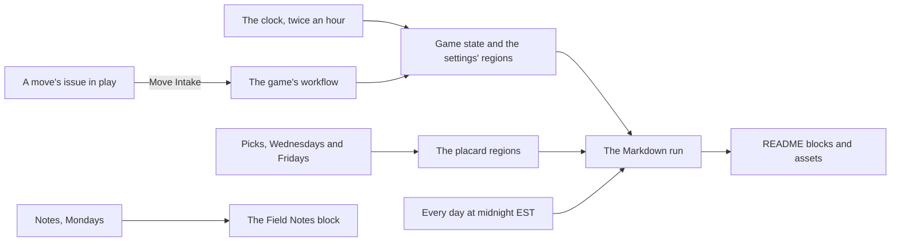

<!--
title: '🗺️ OVERVIEW'
description: 'What the profile repository holds and how its parts fit: the page, the four games, the Field Notes and the placards, which run writes each file, and how to work here. Read it first, before changing anything in this repository.'
type: guide
keywords: [architecture, map, repository, automation, readme, state, setup]
-->

<!-- markdownlint-disable MD041 -->
<div align="center">

# 🗺️ OVERVIEW

<a name="top"></a>

**What lives in this repository, which run writes each part, and where to read next.**

_Most of the profile is drawn by machines: know which part is yours._

</div>

---

## 💡 What This Repository Is

This repository is @tannergolden's GitHub profile: its `README.md` is the page
on [the profile](https://github.com/tannergolden). Very little of that page is
typed. The [Markdown Kit](https://github.com/tannergolden/markdown) draws its
header, badges, boards, Hall of Fame, schematic, placards, trophies and footer
as SVGs; a script here draws the Field Notes; and four games, Chess, Checkers,
Pentago and Tic-Tac, are played on it by the workflows here, every move
arriving as an issue in [tannergolden/play](https://github.com/tannergolden/play).

This repository is MIT under [LICENSE](../../LICENSE), and its scripts,
standard-library Python and Bash run by GitHub Actions, carry
`SPDX-License-Identifier: MIT`. The rest of the games is proprietary,
tannergolden/play under its own licence and the kit's Game Materials under its
`LICENSE-GAMES`, so nothing of theirs is copied here.

---

## 📁 What Lives Where

```bash
.
├── README.md                 # the profile page: drawn blocks, and the prose around them
├── LICENSE                   # MIT
├── assets/                   # every SVG the kit draws, never edited by hand
├── docs/                     # these documents, in the standards' seven folders
└── .github/
    ├── markdown.yaml         # the page's settings, with regions the runs write
    ├── markdown.lock.json    # what the kit last measured
    ├── chess/                # Chess's state, written by its runs and the clock
    ├── checkers/             # Checkers' state, the same way
    ├── pentago/              # Pentago's state, the same way
    ├── tictac/               # Tic-Tac's state, the same way
    ├── notes/                # the Field Notes' library: 1,000 notes for each kind of alert
    ├── scripts/              # the engines, the clock, the pickers, the notes, arbiter.sh, the tests
    ├── workflows/            # the games, the clock, the page's runs and the tests
    ├── CODEOWNERS            # @tannergolden reviews everything
    └── dependabot.yml        # the pinned actions, updated once a month
```

Every folder under `.github/` keeps a `README.md` that logs its files.

---

## ✍️ Who Writes What

| What                                                                                     | Written by                                  | When                                                          |
| :--------------------------------------------------------------------------------------- | :------------------------------------------ | :------------------------------------------------------------ |
| `README.md` between the kit's markers, `assets/`, and `.github/markdown.lock.json`       | the kit, through 📝 Markdown                | daily at midnight EST, and when a move, a tick or a pick asks |
| `README.md` between `<!-- notes:start -->` and `<!-- notes:end -->`                      | `notes.py`, through 📝 Notes                | Mondays at 09:30 EST                                          |
| The rest of `README.md`                                                                  | by hand                                     |                                                               |
| `.github/markdown.yaml`: the `tictac`, `pentago`, `checkers`, `chess` and `hall` regions | the games' own runs, and the clock          | after every move, and twice an hour                           |
| `.github/markdown.yaml`: the `releases` and `issues` regions                             | `releases.py` and `issue.py`, through Picks | Wednesdays and Fridays at 09:30 EST                           |
| The rest of `.github/markdown.yaml`                                                      | by hand                                     |                                                               |
| `.github/chess/`, `checkers/`, `pentago/` and `tictac/`                                  | the game's own runs, and the clock          | after every move, and on any tick that moves the game on      |
| `.github/notes/`, `.github/scripts/`, `.github/workflows/` and `docs/`                   | by hand                                     |                                                               |

The kit's markers are each `<!-- markdown:<part>:start -->` and its `:end`
twin, and a region of the settings is the lines between `# <name>:start` and
`# <name>:end`. Never edit what a run writes: the next run writes it again,
and a game's state that no longer replays stops that game and the clock, as
[Troubleshooting](../operations/Troubleshooting.md) says.

---

## 🔄 What Changes The Page



- **A move** comes from tannergolden/play, is played or turned away by its
  game's workflow, and redraws the page when the board changed.
- **The clock** keeps all four games' time: the Arbiter's week, the Ghost
  Rule's draws and the fresh boards.
- **The schedules** draw the page every night, the Field Notes every Monday
  and the placards on Wednesdays and Fridays.

---

## 🌿 Working Here

- **Python 3.11 or later, and nothing to install.** The scripts use the
  standard library alone (`notes.py` reads its TOML with `tomllib`), and the
  workflows run them on the runner's own `python3`.
- **Run the tests with the tokens unset**, as 🧪 Games Tests runs them. They
  reach no network: every answer from outside comes from a fixture.

```bash
env -u GH_TOKEN -u GITHUB_TOKEN -u MARKDOWN_TOKEN \
  python3 -m unittest discover -s .github/scripts -p 'test_*.py'
```

- **Two switches add the deepest counts**: `CHESS_PERFT_DEEP=1` and
  `CHECKERS_PERFT_DEEP=1`, which 🧪 Games Tests sets.
- **`KIT_SRC` holds every board to the kit's own checks.** Set to a checkout
  of tannergolden/markdown's `src`, it runs the five tests of `test_kit.py`,
  which are skipped without it, in 🧪 Games Tests too.
- **Before a push** that changes the scripts or the games' workflows: the
  tests, shellcheck on `arbiter.sh`, and actionlint and zizmor on the
  workflows.
- **Commits** are Conventional Commits with an emoji and a scope, and land on
  Development, never force-pushed. The owner's standing rules for this
  repository, what may be named in it among them, are in
  [CLAUDE.md](../../CLAUDE.md), and the
  [standards](https://github.com/tannergolden/standards/blob/Development/docs/README.md)
  have the rest.

---

## 🧭 Where To Read Next

| To                                                             | Read                                                            |
| :------------------------------------------------------------- | :-------------------------------------------------------------- |
| Play the games, or answer a player's question                  | [Games](../library/Games.md) and each game's guide beside it    |
| Follow a move from its issue to its ruling, and the clock      | [How The Games Run](../technical/How-The-Games-Run.md)          |
| See how the page, the placards and the Field Notes are drawn   | [How The Page Is Drawn](../technical/How-The-Page-Is-Drawn.md)  |
| Look up a field of a game's state, or a region of the settings | [Game State](../references/Game-State.md)                       |
| Look up a workflow's schedule, permissions, secrets or commits | [Workflows & Schedules](../references/Workflows-&-Schedules.md) |
| Get a stuck game or an unchanged page going again              | [Troubleshooting](../operations/Troubleshooting.md)             |

---

<div align="center">

**Know what draws a line before you change it.**

[↑ Back to Top](#top)

<br />

Built with ❤️ by the Engineering Team. Distributed under the MIT License.

</div>
