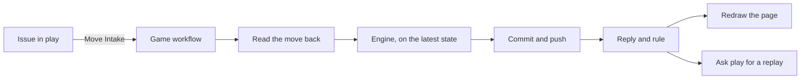

<!--
title: '🎲 HOW THE GAMES RUN'
description: 'How a move travels from its issue on tannergolden/play to its ruling and the redraw, how the engine decides it, how the clock keeps every game''s week, and what a game module gives the shared engine. Read it before changing a game''s workflow, its script or arbiter.sh.'
type: guide
-->

<!-- markdownlint-disable MD041 -->

# 🎲 HOW THE GAMES RUN

**From a pick under a board to the Arbiter's ruling, one run for every move.**

_Played on the latest state, and never played twice._

---

## 💡 The Parts

| Part                    | Files                                                                                                  | What it does                                                                         |
| :---------------------- | :----------------------------------------------------------------------------------------------------- | :----------------------------------------------------------------------------------- |
| A game's workflow       | `chess.yml`; `tictac.yml`, `pentago.yml` and `checkers.yml`, which each call `game.yml`                | Takes one move from play's Move Intake, plays it or turns it away, replies and rules |
| The engines             | `chess.py` for Chess; `games.py` for the other three, with `tictac.py`, `pentago.py` and `checkers.py` | Decide a move against the state, save it, and set the board out for the page         |
| The rules and the names | `*_rules.py` and `*_names.py`                                                                          | Each game's legal moves and endings, and each move's emoji, name and words           |
| The clock               | `clock.yml` and `clock.py`                                                                             | Twice an hour, every game's Arbiter in one run                                       |
| The Arbiter's words     | `arbiter.sh`                                                                                           | Replies, rulings, the logbook and the outage notice on tannergolden/play             |
| The Hall of Fame        | `hall.py`                                                                                              | The four games' series, winners and leaderboard, from every game's state             |
| The replays             | `replays.py`                                                                                           | What each turn of a won game did, for play's Replay workflow                         |
| What they share         | `page.py`                                                                                              | The page's time in EST, the week, the two days, and the settings' regions            |

The workflows are in [`.github/workflows/`](../../.github/workflows/README.md)
and the scripts in [`.github/scripts/`](../../.github/scripts/README.md), whose
header comments and docstrings say the rest of what each one does.

---

## 🚀 A Move, Step By Step

1. **A player follows a move's link.** It opens an issue in
   tannergolden/play titled `<game>: <move> · game <N> · move <M>`. play's
   Move Intake checks it and starts the game's workflow here through the
   Official Arbiter, with the move (`uci` for Chess, `move` for the others),
   `game`, `move_number`, `issue`, `player` and `player_id`. play's
   [How A Move Travels](https://github.com/tannergolden/play#-how-a-move-travels)
   says what the intake does first.
2. **The move is read back from its issue.** Every input is written by a
   stranger, by way of an issue title, so each reaches a script through an
   environment variable, never as an expression inside one, and the engine
   checks each against its pattern again before it reads the board. First,
   with the run's own token, which reads play and writes nothing there, the
   workflow fetches the issue: its author's account ID must be `player_id`,
   and its title exactly the move's. A run that fails this plays nothing and
   says nothing on the issue. A run with no issue is accepted only from the
   owner, as their own move.
3. **The engine plays it on the latest state.** Up to five times, the
   workflow fetches the branch, resets to it and runs the engine. When nothing
   changed, as for a move turned away, it stops there; otherwise it commits
   the game's folder and `.github/markdown.yaml` as `github-actions[bot]` and
   pushes. A push that loses the race waits 2, 4, 6, then 8 seconds and starts
   again from the state that won, where the move may now be stale, and the
   reply says so.
4. **The engine says how it went**: the reply in `comment.md` and the commit
   message in `commit.txt`, in the run's temporary folder, and six step
   outputs: `changed` (draw the page again), `issue`, `logbook`, `replay` (a
   person's own move won the game), `ruling` (`played` or `turned away`) and
   `game` (the game whose milestone the issue joins).
5. **The Arbiter replies and rules.** A token minted from the Official
   Arbiter App, with Issues write on play alone, lets
   [`arbiter.sh`](../../.github/scripts/arbiter.sh) post the reply and lock
   the issue, so that only the owner and the Arbiter write there after and no
   player can use it to notify the owner at will (`say`); label it `played`
   or `turned away`, taking off
   `stranded`, `overdue` and the other ruling, file it in the milestone
   `<Game> · game <N>`, made the first time it is needed, and close it as
   completed or as not planned (`rule`); and close the outage notice if one is
   open (`settle`). The reply comes before the redraw, so a redraw that fails
   never swallows it.
6. **The page is redrawn.** When `changed` is true, the run starts 📝
   Markdown, which draws the board from the region the engine just wrote.
7. **A win asks for its replay.** When a person's own move won the game, a
   token with Actions write on play starts play's `replay.yml`. It is best
   effort: play's Replay workflow also looks for new replays every hour.

When a run fails after the read-back and before the game rules on the move,
the move is still answered: [The Arbiter's Notices](#-the-arbiters-notices)
says how.

---

## ⚖️ How The Engine Rules

`play()` in `chess.py` and in `games.py` makes the same checks in the same
order, and the first that applies decides. The replies are in the intake's own
words, since the intake turns most of these moves away before they come.

| When                                                                           | Ruling        | Logged as                                   |
| :----------------------------------------------------------------------------- | :------------ | :------------------------------------------ |
| The move is for an earlier game, and is the move from this issue that ended it | `played`      | `already played from this issue`            |
| The last game's final board is still up                                        | `turned away` | `the last game's final board is up`         |
| The move is for an earlier game                                                | `turned away` | `an earlier game`                           |
| The move is for a game not yet begun                                           | `turned away` | `a later game`                              |
| The move is for an earlier move, and is this issue's own, already played       | `played`      | `already played from this issue`            |
| The move is for an earlier move, and another got there first                   | `turned away` | `stale`                                     |
| The move is for a later move than the board is on                              | `turned away` | `a later move`                              |
| It is the other side's turn, or the other side's ghost                         | `turned away` | `White's turn`, `GitHub's ghost`, and so on |
| The move is not legal, or not an open square or hole for a ghost               | `turned away` | `illegal`, `illegal ghost`                  |
| None of these                                                                  | `played`      | `played <move>`                             |

Before any of these, a request that is not in the form the intake sends is
turned away as _This move can't be played as sent_, when there is an issue to
answer it on.

- **The owner is known by account ID**, the repository owner's, and every
  player by `player_id`, so a change of login changes nothing.
- **A turned-away move pings nobody.** Its reply names the owner and every
  player as links to their profiles, never as mentions.
- **A move's issue joins the milestone of the game it was sent for**, and none
  when that game never was, so a title cannot make a milestone up.
- **Every run replays the whole game** from its first move, so a state that
  does not replay stops the run: see
  [Troubleshooting](../operations/Troubleshooting.md#-a-games-state-will-not-load).

---

## ⏰ The Clock

No game's own workflow keeps a schedule. [`clock.yml`](../../.github/workflows/clock.yml)
runs at 17 and 47 minutes past every hour, and `clock.py` ticks each game in
tier order, Tic-Tac, Pentago, Checkers, then Chess. For each, in one tick:

- **A first game starts.** Tic-Tac's, Pentago's and Checkers' first games
  start on the first run that meets them, GitHub to open Checkers as Black.
  Chess's first game begins only with the owner's first move.
- **The Ghost Rule's first draw.** Once a fresh Tic-Tac or Pentago board's
  start has come, the Arbiter draws the side that places the first ghost. Its
  draw of the side that moves first comes in the run that places the second
  ghost, whoever places it.
- **A final board's two days.** While a finished game's final board is up,
  nothing moves; once its two days are up, the fresh board is set out.
- **The Arbiter's week.** When the side to move has gone a week without
  moving, counted from the last turn or from the board's start, the Arbiter
  plays a random legal move for it, or places its ghost in a random open
  square or hole.

Then every board and the Hall of Fame are set out again, one commit saves every
game that moved on, with that game's own message when it was the only one, the
notices go out, and one 📝 Markdown run is started if anything changed.

Every draw and every random move is seeded by a text naming the game, the turn
and a time the state already holds, as `pick()` in `games.py` and `tick()` in
`chess.py` do it, so the pick is fair but no secret: a tick run again on the
same state picks exactly the same move. Only one clock runs at a time, and
every check counts from the state, never from the run, so a tick GitHub
delays or drops is caught up by the next.

---

## 🤖 The Arbiter's Notices

| Notice                          | Where                                                                                                 | When                                                                                 |
| :------------------------------ | :---------------------------------------------------------------------------------------------------- | :----------------------------------------------------------------------------------- |
| The reply                       | The move's issue, then locked                                                                         | Every move a game rules on                                                           |
| The Arbiter's move after a week | The issue of the player's move it answers; when it answers none, the owner's logbook                  | When the clock plays for a side                                                      |
| The logbook                     | One open issue in play labelled `arbiter-logbook`, opened and locked by the Arbiter                   | Each move of the Arbiter's that answers no player's issue, such as one after its own |
| The outage notice               | One open issue in play labelled `arbiter-outage`, _🧯 The Arbiter is down_, mentioning the owner once | A run fails before ruling on a move                                                  |
| The stopped move                | The move's issue, _The Arbiter couldn't rule on ..._, linking the outage notice, left open            | The same failure                                                                     |

Every move a failure stops links to the same outage notice, so the owner hears
of it once, and the next move that goes through closes it. The stopped move's
issue stays open for a run of it over again to rule on. The Arbiter may come
back to a locked issue, to say what it played after a week: `say` unlocks it,
comments and locks it again. Any part of a ruling that fails is a warning in
the run's log, never a failed move: the reply is already there.

---

## 🔁 Races And Runs Made Over Again

- **The game workflows keep no concurrency group, on purpose.** GitHub keeps
  one waiting run in a group and cancels the rest, which would lose their
  replies, so every run plays on the latest state and pushes instead, as in
  step 3.
- **A run made over again finds its own move already played.** A re-run of
  its job, or play sending the same move again, is matched by its issue, its
  player and its move: the engine rules `played`, answers as when the move was
  played, and draws the page again when it was the last move. Nothing is ever
  played twice.
- **The commits are the bot's**, so a move never counts as anyone's
  contribution, and their messages never name an issue.
  [Workflows & Schedules](../references/Workflows-&-Schedules.md#-the-commits)
  lists each message.
- **🧪 Games Tests runs when the games' code or workflows change**, never on
  a move's commit, which touches only the state and the settings.

---

## 🧩 What A Game Module Gives The Engine

`games.py` plays Tic-Tac, Pentago and Checkers through one module for each,
imported by its key, so the three share every check, reply and save. `chess.py`
is its own engine, built the same way: `play` for a move, `tick` for the
clock, `board` and `finished` for the page, and `save` for the state.

What each game module defines for <code>games.py</code>

| Name                                                                    | What it is                                                                                       |
| :---------------------------------------------------------------------- | :----------------------------------------------------------------------------------------------- |
| `KEY`, `TITLE`                                                          | The key in paths, titles and commits (`tictac`), and the name a reader sees (`Tic-Tac`)          |
| `EXT`, `RECORD`                                                         | A finished game's file extension, and what a board's note calls that file                        |
| `GHOST_RULE`, `OPENER`                                                  | Whether the Ghost Rule opens the game, and the side that always opens, or `None` for a draw      |
| `CODE`, `GHOST_CODE`                                                    | The shape of a move, and of a ghost, in an issue's title                                         |
| `WORDS`, `LEAD`                                                         | What each side is called (`X`, `White`), and the sign a reply and a commit lead with             |
| `RESULTS`, `DRAWN`                                                      | Each result's score, and the words for each kind of draw                                         |
| `GHOSTS`, `SPOT`                                                        | Under the Ghost Rule: a ghost's verbs, and what it stands on (`square`, `hole`)                  |
| `OPENS_NOTE`, `RULE`                                                    | The sentences a board's note carries                                                             |
| `start`, `legal`, `make`, `ending`, `why_illegal`                       | The rules: the opening position, the legal moves, a move made, how a game ends, why a move fails |
| `notation`, `shown`, `listing`, `entry`, `ghost_listing`, `ghost_cells` | How a move is written, and the list under the board                                              |
| `fields`, `marked`, `alert`, `pressure`, `alarm`, `cry`, `final`        | What the board and the replies say beyond what every game shares                                 |
| `record`                                                                | Checkers' PDN; without it, the engine writes the game as text                                    |

A change to how a move is played or answered updates, in the same commits,
[Games](../library/Games.md), the game's own guide beside it, Play Against Me
in the profile's [README](../../README.md), and the header comments of the
workflows and of `arbiter.sh`.

---

## 🔗 See also

- [Game State](../references/Game-State.md) - every file a game keeps, and
  the regions it writes
- [Workflows & Schedules](../references/Workflows-&-Schedules.md) - when each
  run comes, what it may write, and its secrets
- [Troubleshooting](../operations/Troubleshooting.md) - when a move is not
  ruled on, or a run fails
- [The GitHub App](https://github.com/tannergolden/play#-the-github-app) -
  the Official Arbiter, as tannergolden/play sets it up

---

**Read it back, play it on the latest state, then say so on the issue.**

[↑ Back to Top](#top)

 

Built with ❤️ by the Engineering Team. Distributed under the MIT License.

